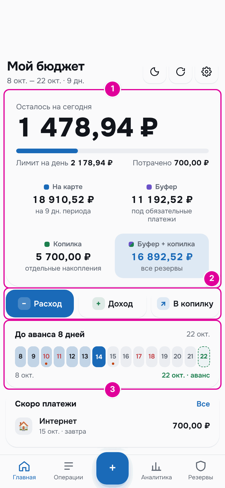
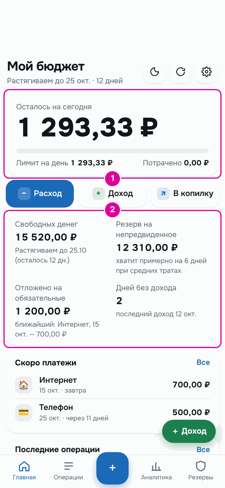

# 1. Что это за приложение

Это личный бюджет внутри Telegram. Он каждый день подсказывает, сколько можно потратить сегодня, чтобы денег хватило до следующей зарплаты и на все обязательные платежи.

## Как это работает

Представьте, что у вас есть деньги до следующей зарплаты и список счетов, которые нужно оплатить: аренда, интернет, телефон. Можно каждый день прикидывать в уме, сколько ещё можно потратить. Приложение делает этот расчёт за вас.

Оно откладывает деньги на обязательные платежи. Остаток делит на дни до следующей выплаты. Так получается сумма на сегодня. Вы записываете траты, и сумма на сегодня уменьшается. Если сегодня потратили меньше, завтра можно потратить чуть больше. Если больше — завтра чуть меньше.

Деньги в приложении разложены как по конвертам. Конверт — как конверт с деньгами в ящике стола, на котором написано, на что эти деньги. Например, «на траты», «на обязательные», «копилка». Сами деньги лежат там же, где и раньше, — на ваших картах. Приложение только помнит, какая часть для чего. Подробнее — в главе [«Как устроен бюджет»](04-budget.md).

*Главный экран в режиме «Зарплата и аванс». 1 — сколько можно потратить сегодня и где лежат деньги. 2 — кнопки для записи расхода и дохода. 3 — сколько дней осталось до следующей выплаты.*

## Два режима

Приложение работает в одном из двух режимов. Режим выбирают по тому, как приходят деньги.

**«Зарплата и аванс».** Подходит, если вы получаете зарплату и аванс в известные дни, например 7 и 22 числа. Приложение само считает суммы выплат по окладу и знает, когда придут следующие деньги. Поэтому оно может заранее отложить деньги на будущие платежи и выровнять месяцы с большими и маленькими выплатами. Подробнее — в главе [«Режим «Зарплата и аванс»»](05-payroll.md).

**«Подработки, без графика».** Подходит, если деньги приходят в любой день и любыми суммами: заказы, подработки, своё дело. Приложение не гадает, когда будет следующий доход. Оно считает только деньги, которые уже пришли. Каждый доход сразу делится: часть в резерв на непредвиденное, часть на обязательные платежи, остальное — на траты на ближайшие две недели. Подробнее — в главе [«Режим «Подработки»»](06-side-jobs.md).

*Главный экран в режиме «Подработки». 1 — сумма на сегодня. 2 — свободные деньги, резерв и деньги на обязательные платежи.*

## Пример

В демо-данных этой инструкции человек получает зарплату 7-го и аванс 22-го. Сегодня 14 октября. До аванса 9 дней, считая сегодняшний. На карте на эти дни лежит 19 610,52 ₽. Приложение делит их на 9 дней и показывает «Лимит на день» 2 178,94 ₽.

Утром человек купил молоко и хлеб за 640 ₽ и заплатил за метро 60 ₽. На экране «Потрачено» 700,00 ₽ и «Осталось на сегодня» 1 478,94 ₽ — это первая картинка этой главы.

## Важно знать

- Приложение не подключается к банку. Оно знает только то, что вы в него записали. Записывайте траты, и числа будут точными.
- Режим можно сменить в любой момент в «Настройки» → «Как приходят деньги». Данные другого режима не удаляются.
- Учёт по реальным картам и счетам — отдельная функция. Её включают по желанию, расчёт бюджета от неё не меняется. Подробнее — в главе [«Карты и счета»](12-accounts.md).

---
[Оглавление](README.md) · [Как открыть и начать →](02-start.md)
