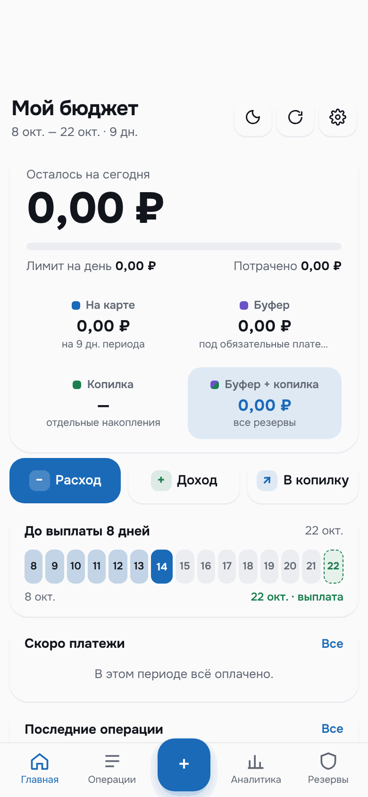
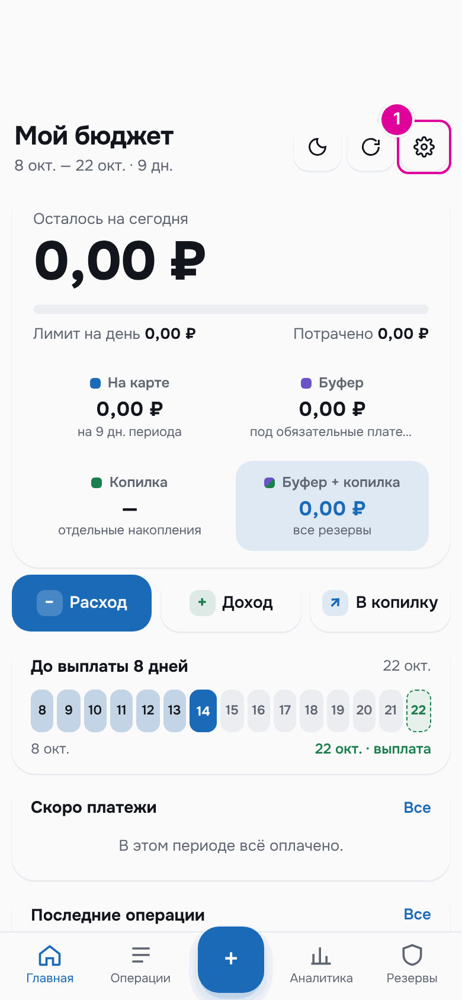
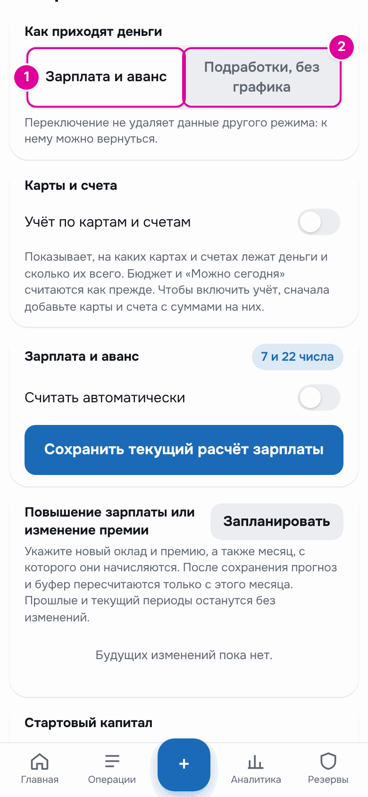

# 2. Как открыть и начать

Приложение открывается из чата с ботом в Telegram. В этой главе — как его открыть, что видно при первом запуске и как выбрать режим.

## Как это работает

Бот — это собеседник в Telegram, который отвечает автоматически. Через него открывается приложение, и он же присылает утренний отчёт и короткие ответы на кнопки меню.

Приложение — это экран внутри Telegram, похожий на сайт. Все записи хранятся в нём. Ваши данные видны только вам: у каждого человека своя отдельная база.

## Пошагово: открыть приложение

1. Найдите бота в Telegram и нажмите «Запустить» или отправьте `/start`.
2. Бот ответит сообщением с кнопкой «💰 Открыть бюджет». Нажмите её.
3. В следующий раз можно открывать приложение кнопкой меню слева от поля ввода сообщения. Обычно она называется «Бюджет».

> Ваш личный бюджет:
>
> [ 💰 Открыть бюджет ]

*Сообщение бота в ответ на `/start`.*

Сразу после него бот присылает второе сообщение и показывает под полем ввода кнопки быстрого меню. Их можно вернуть командой `/menu`.

> Быстрое меню — под полем ввода сообщения.

*Сообщение бота.*

Что делают кнопки «📅 На сегодня», «🧾 Траты сегодня» и «💳 На карте», рассказано в главе [«Бот»](13-bot.md).

## Пошагово: первый запуск

При первом открытии приложение создаёт для вас чистый бюджет. Все суммы равны нулю. По умолчанию выбран режим «Зарплата и аванс» с выплатами 7 и 22 числа. Уже есть восемь категорий трат: «Продукты», «Транспорт», «Кафе», «Дом», «Здоровье», «Развлечения», «Покупки», «Другое».

*Так выглядит главный экран до настройки: все числа нулевые.*

Чтобы появились настоящие числа, приложению нужно знать, как к вам приходят деньги.

1. Нажмите шестерёнку в правом верхнем углу. Откроются «Настройки».

*1 — кнопка «Настройки».*

Рядом с шестерёнкой ещё две кнопки. Кнопка с луной переключает светлую и тёмную тему. Круглая стрелка обновляет данные на экране.

## Пошагово: выбрать режим

1. Если зарплата и аванс приходят в известные дни, оставьте выбранным «Зарплата и аванс».
2. Если доход приходит в разные дни и разными суммами, нажмите «Подработки, без графика».

*Блок «Как приходят деньги». 1 — режим «Зарплата и аванс». 2 — режим «Подработки, без графика».*

Дальше настройка зависит от режима:

- «Зарплата и аванс» — укажите оклад, дни выплат и стартовый капитал. Подробно — в главе [«Режим «Зарплата и аванс»»](05-payroll.md).
- «Подработки» — укажите, сколько денег у вас сейчас и сколько из них резерв. Подробно — в главе [«Режим «Подработки»»](06-side-jobs.md).

Затем добавьте обязательные платежи: аренду, интернет, телефон, кредиты. Как это сделать — в главе [«Обязательные платежи»](08-bills.md).

## Пример

Человек получает зарплату 7-го и аванс 22-го. Он оставляет режим «Зарплата и аванс». В блоке «Зарплата и аванс» указывает оклад 80 000 ₽ и премию 10 000 ₽ до НДФЛ. В блоке «Стартовый капитал» указывает, что на 1 августа у него было 40 000 ₽. Добавляет три обязательных платежа: «Аренда» 25 000 ₽ 10-го числа, «Интернет» 700 ₽ 15-го, «Телефон» 500 ₽ 25-го.

После этого на главном экране появляются настоящие числа. Как они выглядят 14 октября, показано в главе [«Главный экран»](03-home.md).

## Важно знать

- Переключение режима не удаляет данные другого режима. К нему можно вернуться.
- Для режима «Подработки» сначала нужно заполнить «Старт режима» и нажать «Сохранить». Без этого режим не включится, а приложение покажет подсказку «Укажите старт режима и нажмите «Сохранить»».
- Если бот на кнопки меню отвечает «Бюджет ещё не настроен. Откройте его, и здесь появятся цифры.», откройте приложение хотя бы один раз.

---
[← Что это за приложение](01-about.md) · [Оглавление](README.md) · [Главный экран →](03-home.md)
