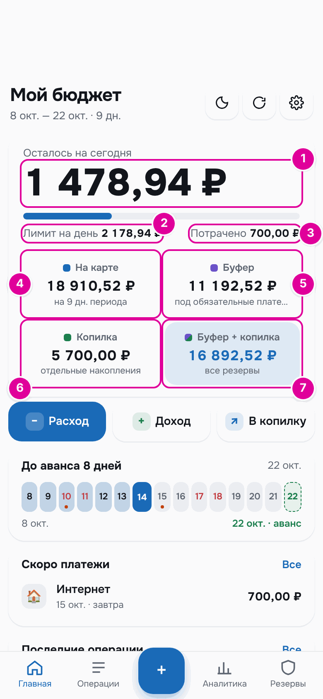
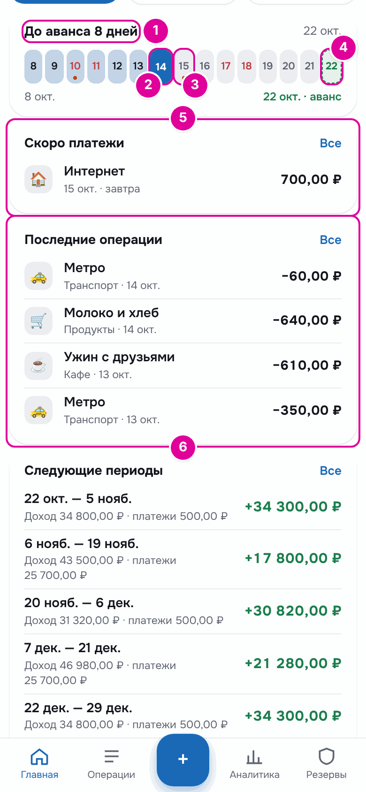
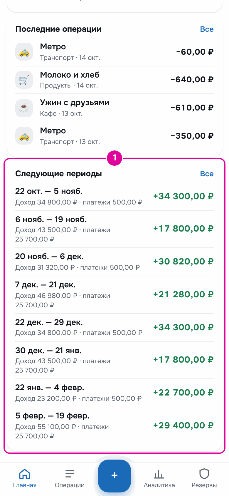
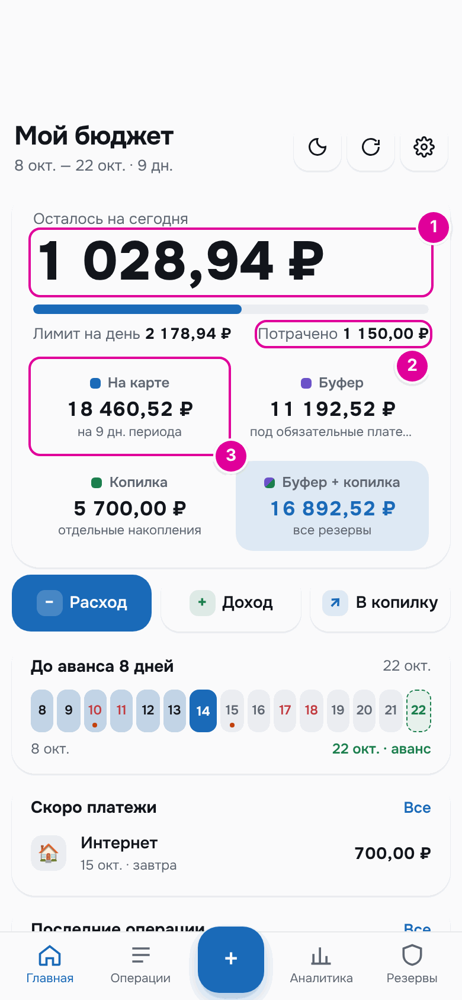
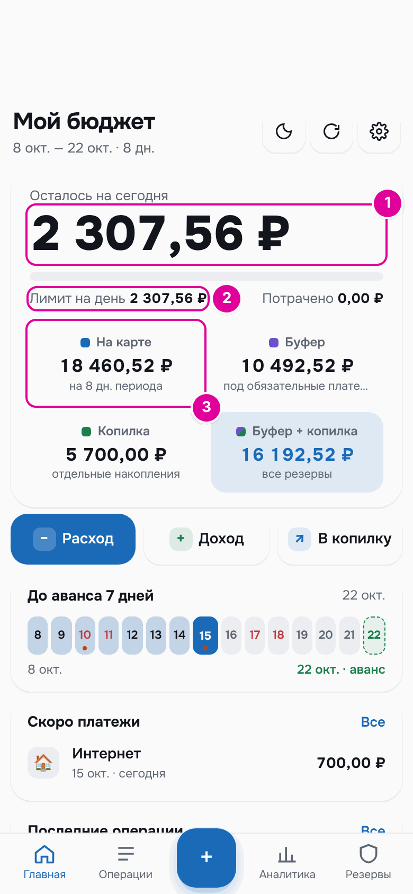

# 3. Главный экран

Главный экран отвечает на один вопрос: сколько можно потратить сегодня. Ниже — что значит каждое число и почему оно меняется.

## Как это работает

Представьте, что деньги на обычные траты до следующей зарплаты лежат в одном конверте. Каждое утро вы делите содержимое конверта на число оставшихся дней. Получается сумма на сегодня. Потратили меньше — остаток остаётся в конверте, и завтра на день придётся чуть больше. Потратили больше — завтра чуть меньше.

Приложение делает это деление само. Обязательные платежи и копилка в этот конверт не входят: деньги на них лежат отдельно.

## Числа в верхней карточке

*Верхняя карточка главного экрана 14 октября. Номера отметок совпадают с пунктами списка.*

1. **«Осталось на сегодня»** — сколько ещё можно потратить сегодня. Это «Лимит на день» минус «Потрачено». Если потратить больше лимита, число станет отрицательным и красным.
2. **«Лимит на день»** — сколько можно потратить за весь сегодняшний день. Его считают утром: деньги «На карте» на начало дня делят на число оставшихся дней до выплаты, считая сегодняшний и сам день выплаты.
3. **«Потрачено»** — сумма сегодняшних обычных трат. Обязательные платежи сюда не входят. Полоска над этой строкой показывает, какая часть лимита уже потрачена.
4. **«На карте»** — все деньги на обычные траты до следующей выплаты. Подпись «на 9 дн. периода» говорит, на сколько дней их нужно растянуть. Период — это дни от выплаты до выплаты.
5. **«Буфер»** — деньги, отложенные под обязательные платежи и на будущие периоды. Буфер — как отдельный конверт для счетов и на чёрный день до следующей зарплаты. В сумму на сегодня он не входит. Подробнее — в главе [«Режим «Зарплата и аванс»»](05-payroll.md).
6. **«Копилка»** — ваши отдельные накопления. Они меняются только когда вы сами кладёте или берёте деньги. Подробнее — в главе [«Копилка»](09-piggy.md).
7. **«Буфер + копилка»** — сумма двух предыдущих плиток, все отложенные деньги.

Под заголовком «Мой бюджет» написан текущий период и сколько в нём осталось дней, например «8 окт. — 22 окт. · 9 дн.».

### Одно число — разные названия

Сумму на сегодня в разных местах называют по-разному:

- на главном экране — «Лимит на день», а остаток после трат — «Осталось на сегодня»;
- на вкладке «Резервы» → «Буфер» остаток на сегодня называется «Можно сегодня»;
- в ответе бота на кнопку «📅 На сегодня» лимит называется «Можно потратить»;
- в утреннем отчёте бота — «На день сегодня», а в режиме «Подработки» — «Можно сегодня».

## Остальные блоки

*Полоска дней и списки. Номера совпадают с пунктами ниже.*

1. **«До аванса 8 дней»** или «До выплаты …» — сколько дней до следующей выплаты. Справа — её дата.
2. **Сегодняшний день** в полоске выделен синим. Прошедшие дни периода закрашены голубым, будущие — серым. Числа суббот и воскресений — красные, как в календаре.
3. **Точка под числом** — в этот день обязательный платёж.
4. **День выплаты** обведён зелёной пунктирной рамкой. В этот день ещё тратятся деньги старого периода. Новый период начинается на следующий день.
5. **«Скоро платежи»** — до трёх ближайших неоплаченных платежей периода: «завтра», «через 11 дней», «просрочен». Кнопка «Все» открывает полный список.
6. **«Последние операции»** — четыре последние записи. Кнопка «Все» открывает раздел «Операции».

*«Следующие периоды»: доход и платежи каждого будущего периода.*

Справа зелёным показано, сколько остаётся от дохода периода после обязательных платежей. Кнопка «Все» открывает вкладку «Резервы» → «Буфер». Там же блок «В буфере сейчас»: сколько денег в буфере, зачем они и когда следующее поступление. Подробнее — в главе [«Режим «Зарплата и аванс»»](05-payroll.md).

## Пошагово: почему «Лимит на день» меняется

Лимит пересчитывается каждый день и после каждой записи.

1. **Потратили меньше лимита.** Остаток остаётся «На карте» и делится на оставшиеся дни. Завтра лимит станет больше.
2. **Потратили больше лимита.** Перерасход по умолчанию делится на оставшиеся дни. Завтра лимит станет меньше. Подробнее — в главе [«Траты»](07-expenses.md).
3. **Добавились деньги на траты.** Например, перенесли деньги из копилки на карту или записали доход «Деньги на карте». Лимит вырастет.
4. **Пришла выплата.** На следующий день начинается новый период со своими деньгами и новым лимитом.

## Пример

Утро 14 октября. До аванса 22 октября 9 дней, считая сегодняшний. На карте на начало дня 19 610,52 ₽.

«Лимит на день» = 19 610,52 ₽ ÷ 9 = 2 178,94 ₽.

Утром записаны две траты: продукты на 640 ₽ и метро на 60 ₽. «Потрачено» 700,00 ₽, «Осталось на сегодня» 1 478,94 ₽, «На карте» 18 910,52 ₽.

Днём человек обедает в кафе за 450 ₽ и записывает расход.

| Число | До обеда | После обеда |
| --- | --- | --- |
| «Осталось на сегодня» | 1 478,94 ₽ | 1 028,94 ₽ |
| «Лимит на день» | 2 178,94 ₽ | 2 178,94 ₽ |
| «Потрачено» | 700,00 ₽ | 1 150,00 ₽ |
| «На карте» | 18 910,52 ₽ | 18 460,52 ₽ |

*После обеда. 1 — «Осталось на сегодня» уменьшилось на 450 ₽. 2 — «Потрачено» выросло на 450 ₽. 3 — «На карте» уменьшилось на 450 ₽.*

Больше в этот день человек ничего не тратит. Утром 15 октября до аванса 8 дней. На карте 18 460,52 ₽.

Новый «Лимит на день» = 18 460,52 ₽ ÷ 8 = 2 307,56 ₽. Это больше, чем вчера: неистраченные 1 028,94 ₽ разошлись по оставшимся дням.

*Следующий день. 1 и 2 — новый лимит 2 307,56 ₽. 3 — те же 18 460,52 ₽ на карте, но теперь на 8 дней.*

Буфер в этот день уменьшился с 11 192,52 ₽ до 10 492,52 ₽. 15 октября — день платежа за интернет, и 700 ₽ на него ушли из буфера. На сумму на сегодня это не повлияло.

## Важно знать

- Деньги на обязательные платежи и копилка не входят в «Лимит на день». Не нужно вычитать их в уме.
- Если записать трату задним числом, лимит на сегодня тоже пересчитается. Пример — в главе [«Типичные ситуации»](15-situations.md).
- Если числа на экране кажутся старыми, нажмите круглую стрелку вверху: данные обновятся.
- В режиме «Подработки» главный экран выглядит немного иначе. Вместо плиток «На карте» и «Буфер» там свободные деньги, резерв и деньги на обязательные платежи. Подробнее — в главе [«Режим «Подработки»»](06-side-jobs.md).

---
[← Как открыть и начать](02-start.md) · [Оглавление](README.md) · [Как устроен бюджет →](04-budget.md)
