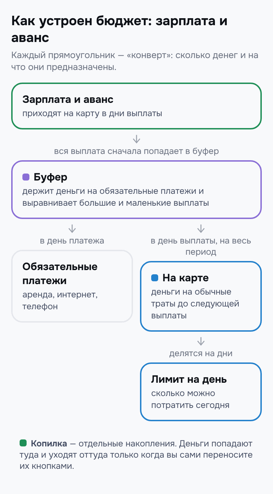
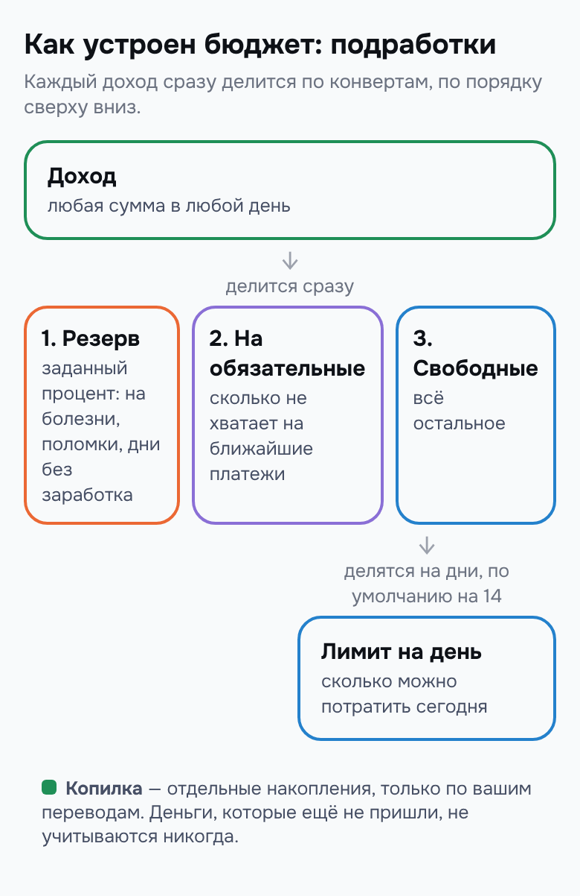

# 4. Как устроен бюджет

Эта глава объясняет, из чего складываются числа на главном экране. Без формул — на примере конвертов.

## Как это работает

Представьте ящик стола с несколькими конвертами. На каждом написано, для чего эти деньги: на траты, на счета, в копилку. Получили зарплату — разложили её по конвертам. Пошли в магазин — взяли деньги из конверта на траты. Пришёл счёт за интернет — оплатили из конверта для счетов.

Приложение работает так же. Деньги физически лежат на ваших картах, как и раньше. Приложение только помнит, сколько денег в каком конверте.

### Конверты в режиме «Зарплата и аванс»

*Схема режима «Зарплата и аванс».*

- **«Буфер»** — конверт для счетов и на будущее. Вся зарплата и весь аванс сначала попадают сюда. Из буфера оплачиваются обязательные платежи. Ещё буфер выравнивает выплаты: из большой выплаты откладывает часть на период с маленькой.
- **«На карте»** — конверт «на траты». В день выплаты буфер выдаёт сюда деньги на весь следующий период. Эти деньги делятся на дни, и получается «Лимит на день».
- **«Копилка»** — отдельные накопления. Деньги попадают в копилку и уходят из неё только по вашей команде.

### Конверты в режиме «Подработки»

*Схема режима «Подработки».*

- **«Резерв на непредвиденное»** — конверт на болезни, поломки и дни без заработка. Сюда уходит заданный процент от каждого дохода, по умолчанию 10 %.
- **«Отложено на обязательные»** — конверт на ближайшие обязательные платежи. Сюда уходит столько, сколько не хватает на них.
- **«Свободные деньги»** — всё остальное. Эти деньги делятся на дни, по умолчанию на 14, и получается «Лимит на день».
- **«Копилка»** — как и в другом режиме, только по вашей команде.

## Пошагово: где увидеть каждый конверт

1. На главном экране в верхней карточке видны «На карте», «Буфер» и «Копилка». В режиме «Подработки» — «Свободных денег», «Резерв на непредвиденное» и «Отложено на обязательные».
2. В разделе «Резервы» (кнопка на нижней панели) у каждого конверта своя вкладка: «Буфер», «Копилка», «Платежи». В режиме «Подработки» — «На обязательные», «Резерв», «Копилка», «Платежи».
3. Если включены карты и счета, под каждой картой на главном экране написано, какие конверты на ней лежат. Подробнее — в главе [«Карты и счета»](12-accounts.md).

## Пример

Утро 14 октября, после первых трат дня. Деньги разложены так:

| Конверт | Сумма | Для чего |
| --- | --- | --- |
| «На карте» | 18 910,52 ₽ | обычные траты до аванса 22 октября |
| «Буфер» | 11 192,52 ₽ | интернет 15-го, телефон 25-го и будущие периоды |
| «Копилка» | 5 700,00 ₽ | накопления |
| Всего | 35 803,04 ₽ | |

Человек тратит только из конверта «На карте». В день его делят на 9 оставшихся дней, поэтому лимит не съест деньги, отложенные на телефон или на следующий период.

Если включить учёт по картам, приложение покажет и где лежат эти деньги. Например, «на траты» — на «Карте 1», буфер и копилка — на «Накопительном» счёте.

## Важно знать

- Конверты — это договорённость о том, на что предназначены деньги. Приложение не переводит деньги между вашими картами само.
- Буфер не покрывает перерасход. Если потратить больше лимита, деньги из буфера не возьмутся. Перерасход либо распределится по оставшимся дням, либо вы сами возьмёте деньги из копилки.
- Деньги на обязательные платежи уже учтены. Когда вы отмечаете платёж оплаченным, сумма на сегодня не уменьшается второй раз.

---
[← Главный экран](03-home.md) · [Оглавление](README.md) · [Режим «Зарплата и аванс» →](05-payroll.md)
