# 5. Режим «Зарплата и аванс»

Этот режим для тех, кто получает зарплату и аванс в известные дни. Приложение само считает суммы выплат, откладывает деньги на обязательные платежи и делит остальное на дни.

## Как это работает

Время делится на периоды. Период — это дни от одной выплаты до следующей. Например, с 8 по 22 октября: аванс 22-го закрывает период, а новый начинается 23-го. В день выплаты ещё тратятся деньги старого периода.

Вся выплата сначала попадает в буфер. Буфер — как конверт для счетов и на будущее. Из него в день платежа оплачиваются аренда, интернет, телефон. И из него же в день выплаты выдаются деньги на траты — ровно на один следующий период.

Почему не всё сразу? Выплаты бывают разными: зарплата с премией больше аванса, а аренда приходится на один из периодов. Если тратить всю большую выплату сразу, в следующем периоде денег не хватит. Поэтому буфер выдаёт на траты одинаковую сумму в день на несколько месяцев вперёд. В богатый период он откладывает излишек, в бедный — добавляет.

## Суммы и даты выплат

### Пошагово

Откройте «Настройки» (шестерёнка вверху) и найдите блок «Зарплата и аванс».

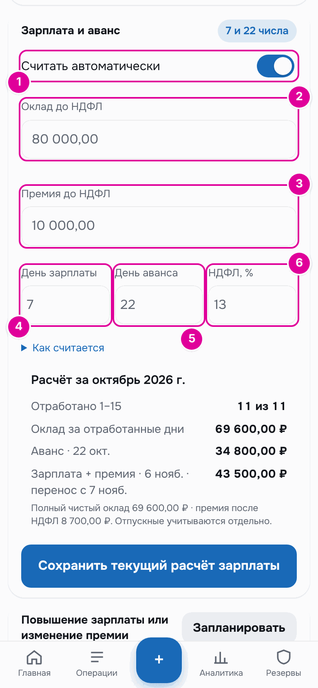

*Настройки зарплаты. Номера совпадают с шагами.*

1. Включите «Считать автоматически».
2. В поле «Оклад до НДФЛ» введите оклад до вычета налога, как в трудовом договоре.
3. В поле «Премия до НДФЛ» введите ежемесячную премию до налога. Если премии нет, оставьте 0.
4. В поле «День зарплаты» укажите число месяца, когда приходит зарплата.
5. В поле «День аванса» укажите число месяца, когда приходит аванс.
6. В поле «НДФЛ, %» оставьте 13 или укажите свою ставку налога.

Прокрутите ниже, к блоку «Расчёт за …».

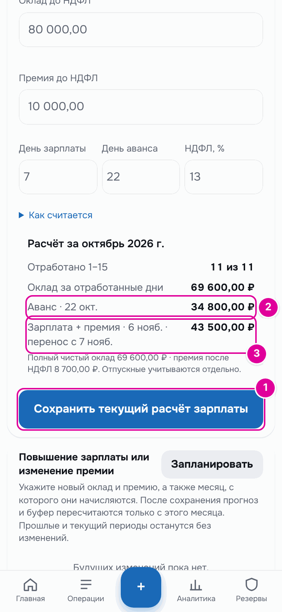

*Расчёт после сохранения. Номера совпадают с шагами.*

1. Нажмите «Сохранить текущий расчёт зарплаты». Расчёт обновится по новым данным.
2. Проверьте сумму и дату ближайшего аванса.
3. Проверьте сумму и дату зарплаты. Если дату перенесли с выходного, это написано рядом.

### Как считаются суммы

Аванс — это часть чистого оклада за рабочие дни с 1 по 15 число. Зарплата — остаток оклада за отработанные дни плюс премия после налога. Если раскрыть строку «Как считается», приложение покажет это же правило.

### Пример

Оклад 80 000 ₽ и премия 10 000 ₽ до НДФЛ, налог 13 %.

- Чистый оклад: 80 000 − 13 % = 69 600 ₽. Чистая премия: 10 000 − 13 % = 8 700 ₽.
- В октябре 2026 года 22 рабочих дня, из них 11 — с 1 по 15 число.
- Аванс 22 октября: 69 600 × 11 ÷ 22 = 34 800 ₽.
- Зарплата за октябрь: 69 600 − 34 800 + 8 700 = 43 500 ₽.

### Перенос на рабочий день

Если день выплаты выпадает на выходной или праздник, деньги приходят в последний рабочий день перед ним. Приложение проверяет это по производственному календарю России.

В примере зарплата за октябрь должна прийти 7 ноября. Это суббота, поэтому в расчёте написано «6 нояб. · перенос с 7 нояб.». Весь бюджет считается от 6 ноября.

## Стартовый капитал

Стартовый капитал — это все ваши деньги на день начала учёта, кроме копилки. От этой суммы приложение начинает раскладывать деньги по конвертам.

### Пошагово

Блок «Стартовый капитал» находится в «Настройках» ниже блока зарплаты.

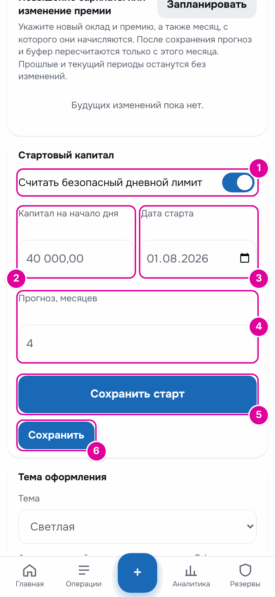

*Стартовый капитал. Номера совпадают с шагами.*

1. Включите «Считать безопасный дневной лимит». Без него не работает буфер.
2. В поле «Капитал на начало дня» введите, сколько у вас было денег утром в день старта. Копилку не включайте.
3. В поле «Дата старта» выберите этот день. Дата не может быть в будущем.
4. В поле «Прогноз, месяцев» укажите, на сколько месяцев вперёд считать буфер. По умолчанию 4.
5. Нажмите «Сохранить старт». Так сохраняются переключатель, капитал и дата.
6. Если меняли «Прогноз, месяцев», нажмите ещё и «Сохранить» под ним.

### Пример

Человек начал вести бюджет 1 августа. На картах у него было 40 000 ₽. Он вводит «Капитал на начало дня» 40 000, «Дата старта» 01.08.2026 и нажимает «Сохранить старт». Приложение раскладывает эти деньги и все выплаты после 1 августа по конвертам. Пять тысяч накоплений он отдельно кладёт в копилку.

## Буфер и деньги на период

Всё о буфере собрано в разделе «Резервы» → «Буфер». Чтобы открыть его, нажмите «Резервы» на нижней панели.

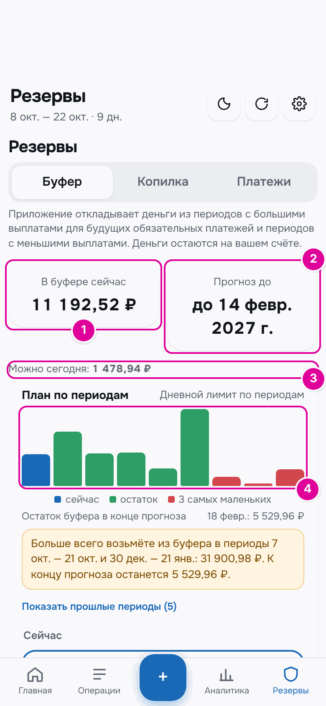

*Вкладка «Буфер». 1 — сколько денег в буфере сейчас. 2 — до какой даты считается прогноз. 3 — сколько ещё можно потратить сегодня. 4 — график остатка буфера по периодам.*

На графике каждый столбик — остаток буфера в конце периода. Синий столбик — текущий период, красные — три периода с самым маленьким остатком. Под графиком написано, сколько останется в буфере к концу прогноза.

Ниже графика — карточки периодов: «Сейчас» и «Следующие». Кнопка «Показать прошлые периоды» показывает уже закончившиеся. На этой вкладке период начинается в сам день выплаты, ведь в этот день деньги приходят в буфер. Поэтому зарплата 7 октября здесь кормит период «7 окт. — 21 окт.», хотя тратить её начинают с 8-го.

*Карточка периода. 1 — сколько в этот период берётся из буфера или кладётся в него. 2 — выплата периода и её статус. 3 — куда идут деньги периода. 4 — сколько останется в буфере.*

В карточке:

- «На карту» — сколько выплата даёт на траты следующего периода. Ниже — сколько это в день. Для текущего периода здесь сегодняшний лимит: в нём учтены остатки прошлых дней.
- «Обязательные» — платежи, даты которых попадают в этот период.
- «Свободно» — выплата минус обязательные платежи.
- «взять из буфера» или «положить в буфер» — разница между «Свободно» и «На карту».

### Пример

Зарплата 7 октября — 43 500 ₽. В этот период платить аренду 25 000 ₽ и интернет 700 ₽, всего 25 700 ₽. Свободно 43 500 − 25 700 = 17 800 ₽.

На траты нужно 26 814,90 ₽: это 1 787,66 ₽ в день на 15 дней. Свободных денег меньше, поэтому 26 814,90 − 17 800 = 9 014,90 ₽ берётся из буфера.

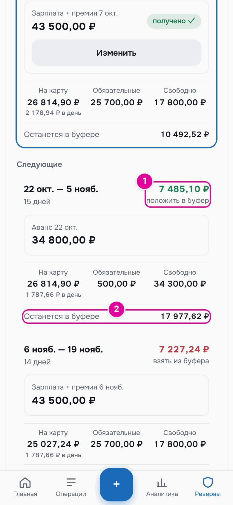

*Следующий период: 1 — деньги, которые аванс отложит в буфер. 2 — остаток буфера в конце периода.*

Аванс 22 октября — 34 800 ₽. Платежей в этот период только телефон на 500 ₽. Свободно 34 300 ₽. На траты снова 26 814,90 ₽, а 34 300 − 26 814,90 = 7 485,10 ₽ откладывается в буфер. Так аванс помогает следующей зарплате, из которой опять платить аренду.

## День выплаты и «Получил ✓»

Приложение заранее знает расчётную сумму выплаты. Но настоящие деньги могут прийти позже или в другой сумме. Поэтому в день выплаты оно просит подтвердить, что деньги пришли.

### Что происходит в день выплаты

В день выплаты ещё идёт старый период. На экране — остаток старого периода на его последний день. Новые деньги на траты появятся в «На карте» только завтра.

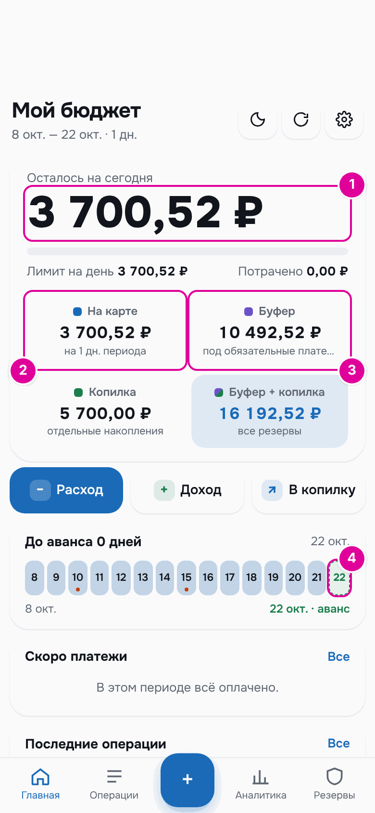

*День аванса до подтверждения. 1 — остаток старого периода на сегодня. 2 — на карте только этот остаток. 3 — аванса в буфере пока нет. 4 — сегодня день выплаты.*

### Пошагово: подтвердить выплату

Когда деньги пришли, откройте «Резервы» → «Буфер» и найдите карточку «Сейчас».

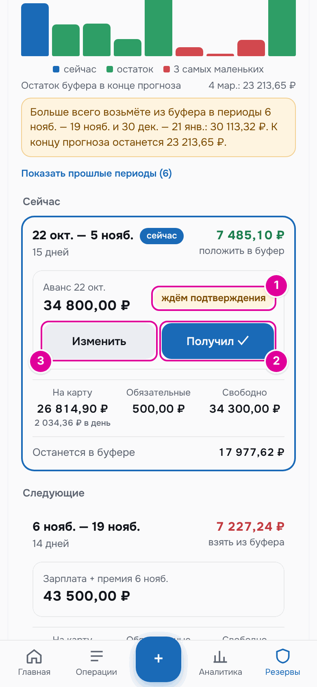

*Номера 1 и 2 совпадают с шагами. 3 — кнопка «Изменить», о ней ниже.*

1. У выплаты написано «ждём подтверждения».
2. Нажмите «Получил ✓». Откроется окно «Подтвердить получение».

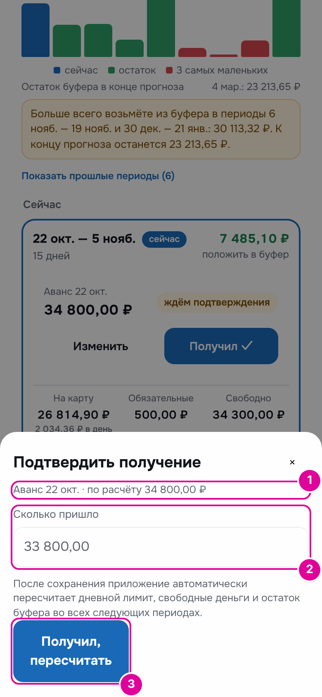

*Номера совпадают с шагами.*

1. Вверху написано, какая это выплата и сколько ожидалось по расчёту.
2. В поле «Сколько пришло» уже стоит расчётная сумма. Если пришло другое число, исправьте его.
3. Нажмите «Получил, пересчитать».

Статус сменится на «получено ✓», и приложение пересчитает лимит на день и буфер во всех следующих периодах. Если сегодняшний утренний отчёт уже пришёл, бот пришлёт его ещё раз с новыми числами.

### Пример: пришло на 1 000 ₽ меньше

По расчёту аванс 34 800 ₽, а пришло 33 800 ₽. Человек вводит 33 800 и нажимает «Получил, пересчитать».

| В карточке периода | До | После |
| --- | --- | --- |
| Выплата | 34 800,00 ₽ | 33 800,00 ₽ |
| «положить в буфер» | 7 485,10 ₽ | 6 626,55 ₽ |
| «На карту» | 26 814,90 ₽ | 26 673,45 ₽ |
| в день | 2 034,36 ₽ | 2 024,93 ₽ |
| «Останется в буфере» | 17 977,62 ₽ | 17 119,07 ₽ |

Недостающая тысяча разделилась: на траты пойдёт на 141,45 ₽ меньше, а в буфер отложится на 858,55 ₽ меньше.

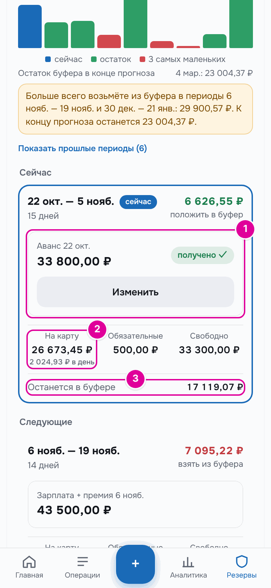

*После подтверждения. 1 — сумма и статус «получено ✓». 2 — деньги на следующий период. 3 — остаток буфера.*

На главном экране в этот же день «Осталось на сегодня» не меняется: это всё ещё последний день старого периода. Буфер вырос с 10 492,52 ₽ до 17 619,07 ₽: в него пришли 33 800 ₽, и сразу 26 673,45 ₽ отложены на траты нового периода. Эти 26 673,45 ₽ уже не в буфере, но ещё и не «На карте» — они появятся там завтра.

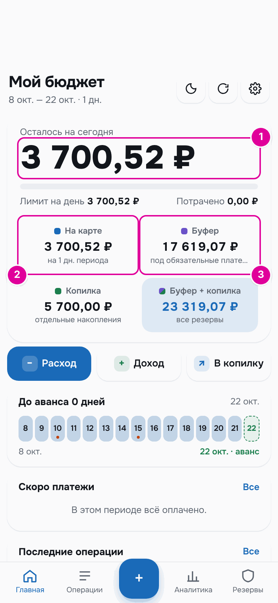

*День выплаты после «Получил ✓». 1 — сумма на сегодня не изменилась. 2 — на карте остаток старого периода. 3 — буфер с учётом аванса.*

Утром 23 октября начинается новый период. На карте 3 700,52 ₽ остатка плюс 26 673,45 ₽ новых, всего 30 373,97 ₽ на 15 дней. Лимит на день — 2 024,93 ₽.

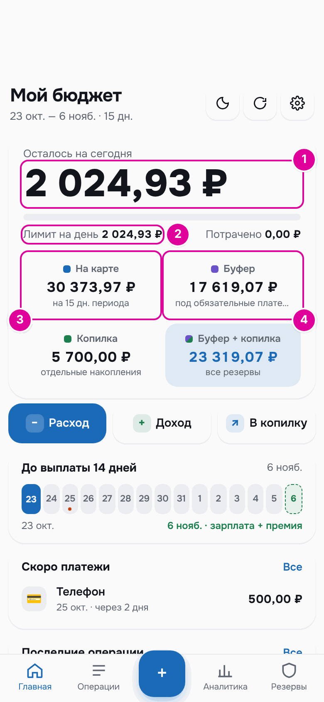

*Первый день нового периода. 1 и 2 — новый лимит. 3 — деньги на траты нового периода. 4 — буфер.*

### Что будет, если не нажать «Получил ✓»

Пока выплата не подтверждена, приложение считает, что денег ещё нет. Прогноз на будущее строится по расчётной сумме, но на карту новые деньги не выдаются. Бот в ответах и в утреннем отчёте напоминает:

> ⏳ Выплата ещё не подтверждена. Когда деньги придут, нажмите «Получил ✓» в приложении.

*Сообщение бота в ответ на кнопку «📅 На сегодня» или «💳 На карте».*

Если не подтвердить аванс, 23 октября новый период живёт только на остатке старого: 3 700,52 ₽ на 15 дней, то есть 246,70 ₽ в день вместо 2 024,93 ₽.

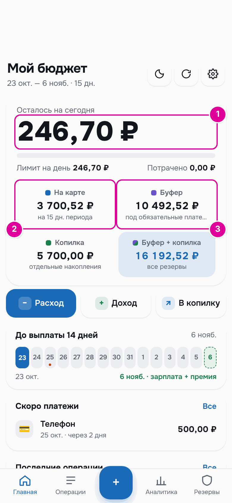

*Аванс не подтверждён. 1 — маленький лимит. 2 — на карте только остаток старого периода. 3 — аванса нет и в буфере.*

Как только вы нажмёте «Получил ✓», числа станут как на предыдущей картинке. Если не подтверждать совсем, выплата засчитается сама, когда наступит следующая выплата.

### Кнопка «Изменить»

«Изменить» есть только у выплаты текущего периода. Она открывает окно «Фактическая сумма выплаты». В поле «Получено фактически» введите сумму и нажмите «Сохранить и пересчитать». Если день выплаты уже наступил, это тоже считается подтверждением. Кнопка «Вернуть расчёт» возвращает расчётную сумму.

Прошлые периоды не меняются: деньги, уже выданные на траты, остаются как были.

## Отпуск

Отпускные — это отдельный доход. Зарплата и аванс при этом уменьшаются только за рабочие дни отпуска.

- Отпуск в рабочие дни с 1 по 15 число уменьшает ближайший аванс.
- Отпуск во второй половине месяца уменьшает зарплату.
- Если отпуск переходит через 15-е, дни до 15-го уменьшают аванс, после — зарплату.

### Пошагово

В «Настройках» найдите блок «Отпускные» и нажмите «＋». Откроется окно «Новый отпуск».

*Окно отпуска. Номера совпадают с шагами.*

1. В поле «Начало» выберите первый день отпуска.
2. В поле «Окончание» выберите последний день.
3. В поле «Отпускные к получению» введите сумму из расчётного листка.
4. В поле «Дата выплаты отпускных» проверьте дату. Приложение ставит её за 3 дня до начала отпуска. Если бухгалтерия платит в другой день, исправьте.
5. Нажмите «Сохранить отпуск».

Отпуск появится в списке. Изменить его можно кнопкой «Изм.», удалить — кнопкой «×».

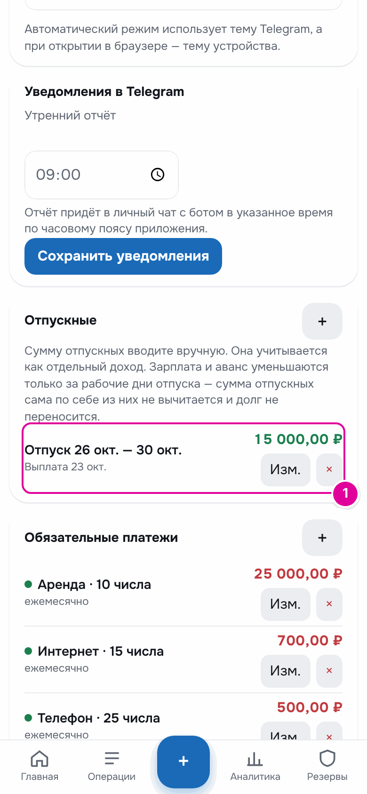

*1 — сохранённый отпуск.*

### Пример

Отпуск с 26 по 30 октября — это 5 рабочих дней во второй половине месяца. Отпускные 15 000 ₽ придут 23 октября.

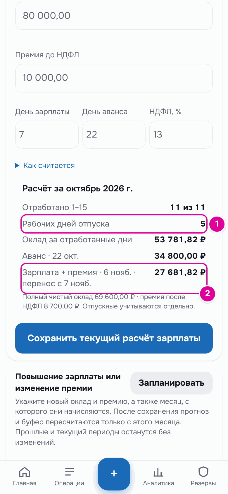

*Расчёт с отпуском. 1 — рабочие дни отпуска. 2 — новая сумма зарплаты.*

| В расчёте | Без отпуска | С отпуском |
| --- | --- | --- |
| Аванс 22 октября | 34 800,00 ₽ | 34 800,00 ₽ |
| Зарплата 6 ноября | 43 500,00 ₽ | 27 681,82 ₽ |
| Отпускные 23 октября | — | 15 000,00 ₽ |

Аванс не изменился: отпуск во второй половине месяца. Зарплата стала меньше на оплату пяти дней: оклад за 17 отработанных дней из 22 — это 53 781,82 ₽.

### Когда отпускные пришли

До даты выплаты приложение учитывает отпускные как ожидаемые деньги. С этой даты они учитываются, только когда вы их запишете.

На главном экране нажмите «Доход». Откроется окно «Дополнительный доход».

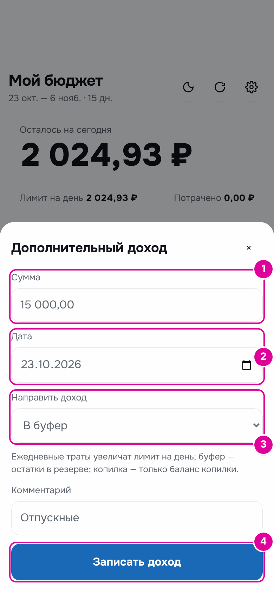

*Номера совпадают с шагами.*

1. В поле «Сумма» введите, сколько пришло.
2. В поле «Дата» поставьте день, когда пришли деньги.
3. В поле «Направить доход» выберите «В буфер». Тогда отпускные, как и зарплата, помогут всем следующим периодам.
4. Нажмите «Записать доход».

## Повышение зарплаты

Если с какого-то месяца меняется оклад или премия, это можно запланировать заранее. В «Настройках» в блоке «Повышение зарплаты или изменение премии» нажмите «Запланировать».

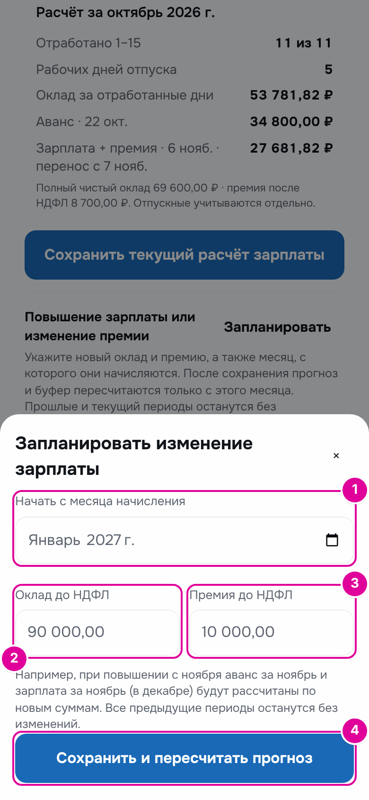

*Номера совпадают с шагами.*

1. В поле «Начать с месяца начисления» выберите месяц. Подходит только будущий месяц.
2. Введите новый «Оклад до НДФЛ».
3. Введите новую «Премию до НДФЛ».
4. Нажмите «Сохранить и пересчитать прогноз».

Прогноз и буфер пересчитаются начиная с этого месяца. Прошлые и текущий периоды не изменятся.

## Дополнительный доход

Любые деньги кроме зарплаты и аванса — премию на руки, возврат, подарок — записывают кнопкой «Доход». Окно то же, что и для отпускных выше.

В поле «Направить доход» три варианта:

- «Деньги на карте» — деньги добавятся к тратам текущего периода и разделятся на оставшиеся дни. Лимит на день вырастет.
- «В буфер» — деньги пойдут на обязательные платежи и будущие периоды.
- «В копилку» — деньги лягут в копилку. Бюджет на траты не изменится.

## Важно знать

- Держите включённым «Считать автоматически». Без него приложение не знает сумм будущих выплат и строит прогноз без них.
- Даты обязательных платежей на рабочий день не переносятся. Переносятся только дни зарплаты и аванса.
- Если на вкладке «Буфер» написано «Включите безопасный дневной лимит в настройках.», включите «Считать безопасный дневной лимит» в блоке «Стартовый капитал».
- Новая «Дата старта» пересчитывает всю историю заново. Меняйте её, только если хотите начать учёт с другого дня.

---
[← Как устроен бюджет](04-budget.md) · [Оглавление](README.md) · [Режим «Подработки» →](06-side-jobs.md)
