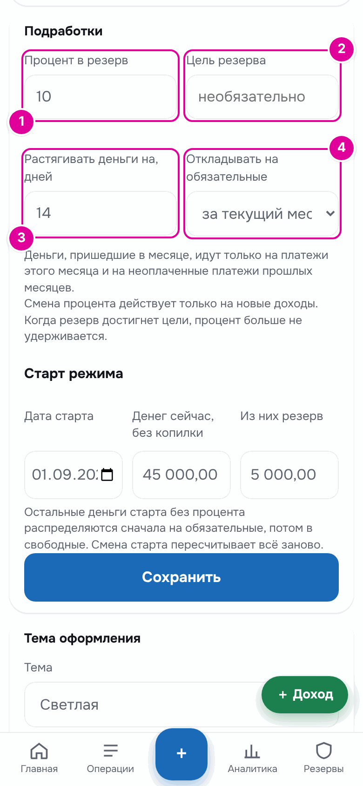
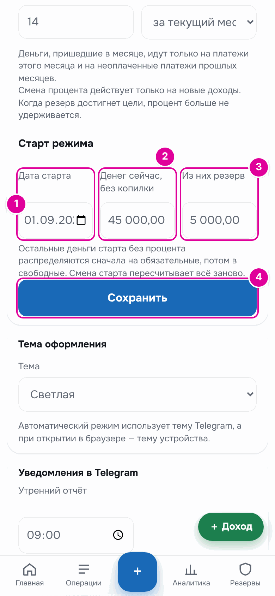
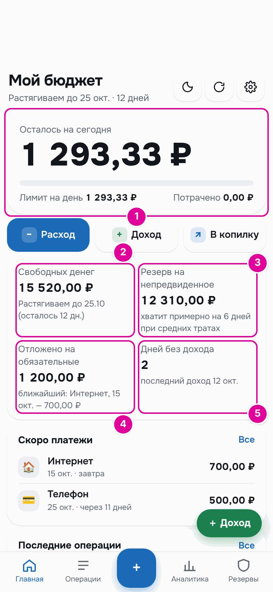
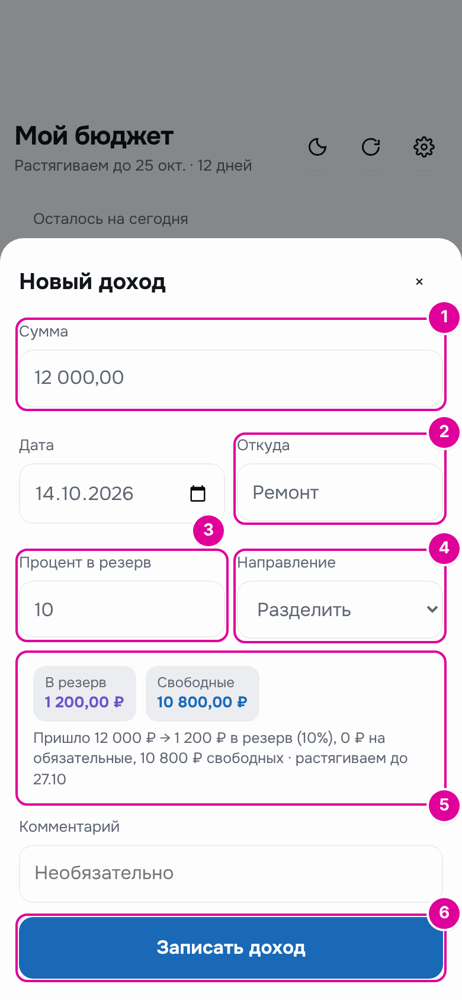
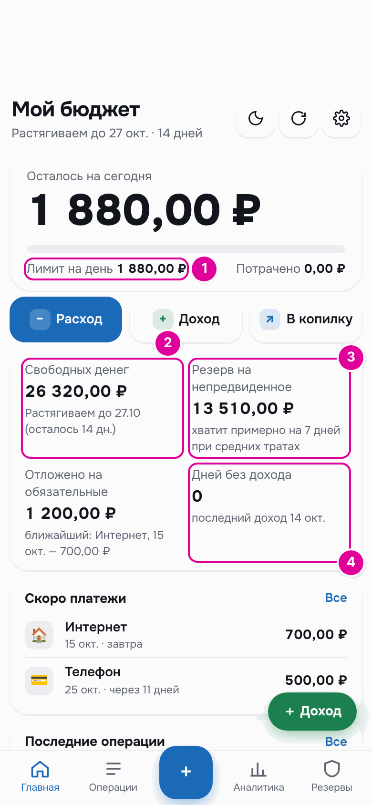
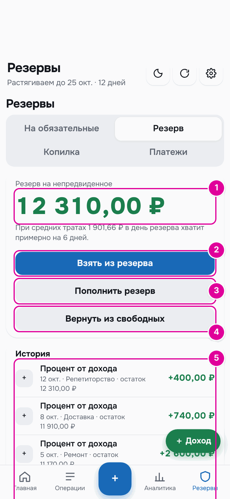
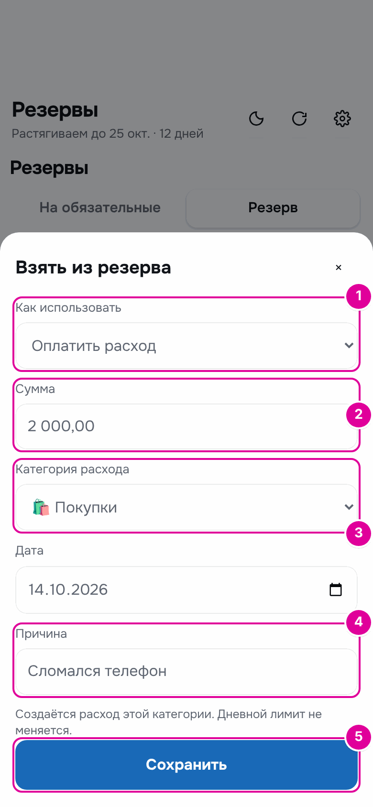
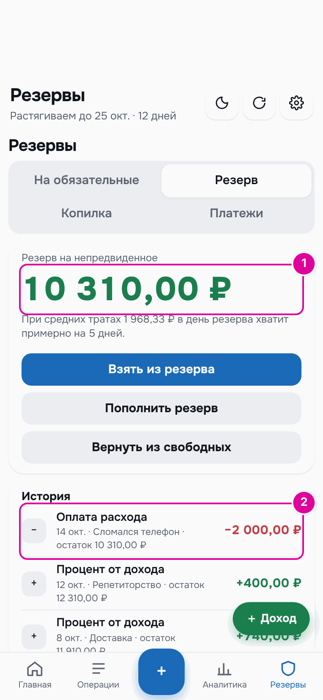
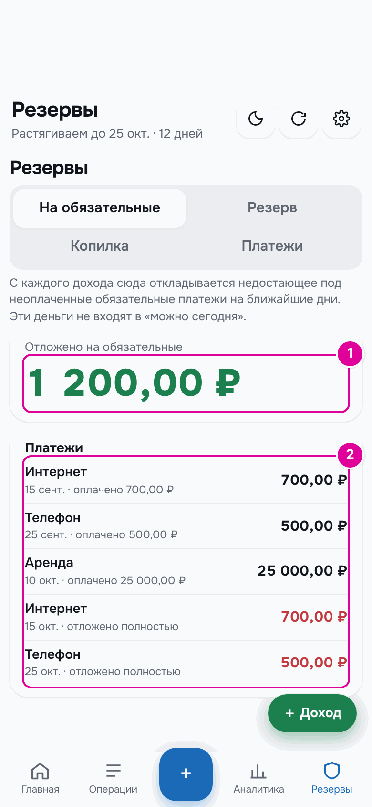
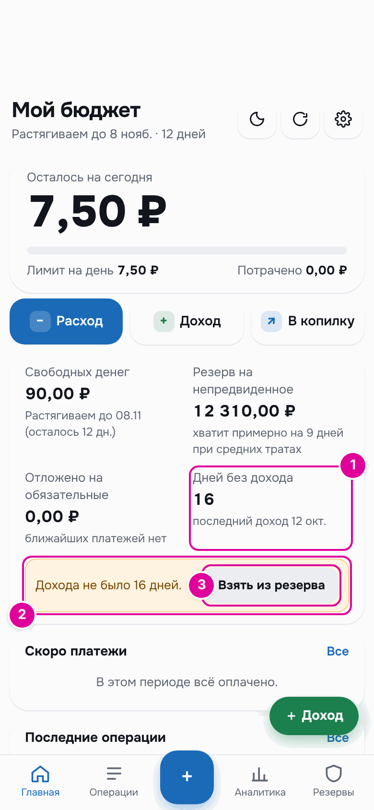

# 6. Режим «Подработки»

Этот режим для тех, у кого доход приходит без графика: в любой день и любыми суммами. Приложение считает только деньги, которые уже пришли, и растягивает их на две недели вперёд.

## Как это работает

Каждый доход сразу раскладывается по трём конвертам, по порядку:

1. **«Резерв на непредвиденное»** — заданный процент от дохода, по умолчанию 10 %. Это подушка на болезни, поломки и дни без заработка.
2. **«Отложено на обязательные»** — столько, сколько не хватает на ближайшие неоплаченные обязательные платежи.
3. **«Свободные деньги»** — всё остальное. Из них считается сумма на день.

Свободные деньги делятся на дни до даты растягивания. Дата растягивания — это день, до которого должно хватить денег. После нового дохода она ставится на 14 дней вперёд, считая день дохода. Если новый доход не пришёл, а дата прошла, окно сдвигается дальше.

Деньги, которые ещё не пришли, не учитываются никогда. Приложение не гадает, сколько вы заработаете завтра.

## Пошагово: включить режим

Откройте «Настройки» и в блоке «Как приходят деньги» нажмите «Подработки, без графика». Появится блок «Подработки».

*Настройки режима. Номера совпадают с шагами.*

1. «Процент в резерв» — сколько процентов каждого дохода уходит в резерв. По умолчанию 10.
2. «Цель резерва» — необязательно. Когда резерв дойдёт до этой суммы, процент больше не удерживается.
3. «Растягивать деньги на, дней» — на сколько дней делить свободные деньги. По умолчанию 14.
4. «Откладывать на обязательные» — «за текущий месяц» или «на N дней вперёд». В первом случае деньги месяца идут только на платежи этого месяца и на неоплаченные платежи прошлых месяцев. Во втором появится поле «Обязательные на, дней вперёд».

Ниже, в разделе «Старт режима», укажите, с чего начать.

*Старт режима. Номера совпадают с шагами.*

1. «Дата старта» — день начала учёта, не позже сегодняшнего.
2. «Денег сейчас, без копилки» — все ваши деньги на этот день, кроме копилки.
3. «Из них резерв» — сколько из этих денег вы уже считаете неприкосновенным запасом.
4. Нажмите «Сохранить». Остальные деньги старта без процента распределятся сначала на обязательные, потом в свободные.

## Главный экран

*Номера совпадают с пунктами ниже.*

1. «Осталось на сегодня» и «Лимит на день» — как в другом режиме: сумма на сегодня и остаток после трат.
2. «Свободных денег» — сколько свободных денег сейчас. Ниже — «Растягиваем до …» и сколько дней осталось.
3. «Резерв на непредвиденное» — сколько в резерве и примерно на сколько дней его хватит при ваших средних тратах.
4. «Отложено на обязательные» — сколько отложено на платежи и какой платёж ближайший.
5. «Дней без дохода» — сколько дней прошло с последнего дохода.

## Пошагово: записать доход

Нажмите «Доход» на главном экране или зелёную кнопку «＋ Доход» внизу. Откроется окно «Новый доход».

*Окно дохода. Номера совпадают с шагами.*

1. В поле «Сумма» введите, сколько пришло.
2. В поле «Откуда» можно написать источник: «ремонт», «доставка». Приложение запомнит прежние варианты.
3. «Процент в резерв» уже заполнен из настроек. Для одного дохода его можно поменять.
4. «Направление» — обычно «Разделить». Можно выбрать «Целиком в копилку» или «Целиком в резерв».
5. Проверьте разбивку: сколько уйдёт в резерв, на обязательные и в свободные.
6. Нажмите «Записать доход».

По умолчанию в поле «Дата» стоит сегодняшний день. Если доход пришёл раньше, поменяйте дату.

## Пример

14 октября пришло 12 000 ₽ за ремонт. Разбивка в окне: «Пришло 12 000 ₽ → 1 200 ₽ в резерв (10%), 0 ₽ на обязательные, 10 800 ₽ свободных · растягиваем до 27.10». На обязательные ничего не ушло: интернет и телефон этого месяца уже обеспечены.

| Число | До дохода | После дохода |
| --- | --- | --- |
| «Свободных денег» | 15 520,00 ₽ | 26 320,00 ₽ |
| Растягиваем до | 25.10, 12 дней | 27.10, 14 дней |
| «Лимит на день» | 1 293,33 ₽ | 1 880,00 ₽ |
| «Резерв на непредвиденное» | 12 310,00 ₽ | 13 510,00 ₽ |
| «Дней без дохода» | 2 | 0 |

Новый лимит: 26 320 ₽ ÷ 14 дней = 1 880 ₽.

*После дохода. 1 — новый лимит. 2 — свободные деньги и новая дата растягивания. 3 — резерв вырос на 1 200 ₽. 4 — счётчик дней без дохода обнулился.*

## Резерв

Резерв трогают только явно, с указанием причины. Он находится в «Резервы» → «Резерв».

*1 — сколько в резерве. 2 — «Взять из резерва». 3 — «Пополнить резерв». 4 — «Вернуть из свободных». 5 — история.*

Что делают кнопки:

- «Взять из резерва» — потратить резерв. Причина обязательна. В поле «Как использовать» три варианта:
  - «Оплатить расход» — создаётся расход выбранной категории, лимит на день не меняется;
  - «В свободные деньги» — сумма добавится к свободным и разделится на дни до даты растягивания;
  - «Покрыть перерасход сегодня» — не больше сегодняшнего перерасхода.
- «Пополнить резерв» — положить в резерв деньги извне.
- «Вернуть из свободных» — переложить часть свободных денег в резерв. Лимит на день пересчитается.

«В свободные деньги», «Покрыть перерасход сегодня» и «Вернуть из свободных» записываются только сегодняшним днём.

### Пошагово: взять из резерва на покупку

Нажмите «Взять из резерва». Откроется окно с тем же названием.

*Номера совпадают с шагами.*

1. В «Как использовать» оставьте «Оплатить расход».
2. В поле «Сумма» введите стоимость покупки.
3. Выберите «Категория расхода».
4. В поле «Причина» напишите, на что деньги. Без причины окно не сохранится.
5. Нажмите «Сохранить».

### Пример

Сломался телефон, новый стоит 2 000 ₽. Человек берёт деньги из резерва на расход «Покупки». Резерв уменьшается с 12 310,00 ₽ до 10 310,00 ₽. «Лимит на день» остаётся 1 293,33 ₽, «Свободных денег» — 15 520,00 ₽.

*1 — резерв после траты. 2 — запись в истории с причиной.*

## Деньги на обязательные

Вкладка «Резервы» → «На обязательные» показывает, сколько отложено и под какие платежи.

*1 — сколько отложено. 2 — платежи и их статусы.*

У каждого платежа статус: «оплачено …», «отложено полностью» или «отложено … · не хватает …». Если на ближайшие платежи не хватает денег, на главном экране появится предупреждение «На обязательные не хватает … к …».

Платёж отмечают оплаченным на вкладке «Платежи», как в другом режиме. Деньги берутся из отложенного. Если отложено меньше, недостающее спишется со свободных денег. Подробнее — в главе [«Обязательные платежи»](08-bills.md).

## Если долго нет дохода

Если дохода нет столько дней, на сколько растягиваются деньги, на главном экране появляется предупреждение «Дохода не было … дней.» и кнопка «Взять из резерва».

*1 — счётчик дней без дохода. 2 — предупреждение. 3 — кнопка «Взять из резерва».*

В примере последний доход был 12 октября. К 28 октября свободных денег осталось 90 ₽, лимит на день — 7,50 ₽, а в резерве 12 310 ₽. Кнопка «Взять из резерва» сразу открывает окно с вариантом «В свободные деньги».

## Важно знать

- Смена процента в настройках действует только на новые доходы. Прошлые доходы остаются разделёнными как были.
- Доход, записанный задним числом, а также правка или удаление дохода пересчитывают всё, что было после него.
- Резерв не может уйти в минус ни в один день. Если операция к этому приведёт, приложение её не сохранит.
- Доход, который целиком ушёл в резерв, в копилку или на обязательные, не сдвигает дату растягивания. Но предупреждение о днях без дохода он снимает.

---
[← Режим «Зарплата и аванс»](05-payroll.md) · [Оглавление](README.md) · [Траты →](07-expenses.md)
