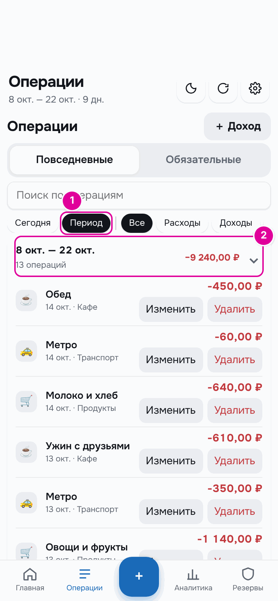

# 7. Траты

Траты — это главное, что вы записываете каждый день. Чем точнее записи, тем точнее сумма на сегодня.

## Как это работает

Каждая трата уменьшает «Осталось на сегодня» и деньги «На карте». Трату относят к категории: «Продукты», «Транспорт», «Кафе» и другие. По категориям потом видно в аналитике, на что уходят деньги.

Обязательные платежи — аренду, интернет — записывать как траты не нужно. Их отмечают отдельно, как в главе [«Обязательные платежи»](08-bills.md).

## Пошагово: записать трату

Открыть окно расхода можно двумя кнопками.

*Номера совпадают с шагами.*

1. Нажмите «Расход» на главном экране.
2. Или нажмите «+» в центре нижней панели. Эта кнопка есть на любом экране.

Откроется окно «Новый расход».

*Номера совпадают с шагами.*

1. В поле «Сумма» введите сумму. Копейки — через запятую.
2. Нажмите плитку категории. Выбранная плитка обведена.
3. «Дата» — сегодня. Если трата была в другой день, поменяйте дату.
4. «Комментарий» — необязательно. Например, «Обед». По комментарию трату потом легко найти.
5. Нажмите «Записать расход».

Если категорий больше восьми, последняя плитка называется «Ещё». Она показывает остальные категории.

## Пример

14 октября «Осталось на сегодня» 1 478,94 ₽, «Потрачено» 700,00 ₽. Человек записывает обед за 450 ₽ в категорию «Кафе».

После записи «Осталось на сегодня» 1 028,94 ₽, «Потрачено» 1 150,00 ₽.

*1 — остаток на сегодня уменьшился на 450 ₽. 2 — потрачено выросло на 450 ₽.*

## Пошагово: найти, изменить, удалить

Все записи — в разделе «Операции» на нижней панели.

*Номера совпадают с пунктами.*

1. Вкладки «Повседневные» и «Обязательные». На второй — оплаченные обязательные платежи.
2. Поле «Поиск по операциям». Ищет по комментарию, категории и названию платежа.
3. Кнопки «Все», «Расходы», «Доходы», «Копилка» оставляют в списке только операции одного вида. Про «Сегодня» и «Период» — ниже.
4. Операции сгруппированы по неделям. В заголовке недели — сколько операций и сколько потрачено. Нажмите заголовок, чтобы свернуть или развернуть неделю.
5. «Изменить» открывает трату в том же окне, что и при записи. Поменяйте сумму, категорию, дату или комментарий и нажмите «Записать расход».
6. «Удалить» удаляет запись. Приложение переспросит: «Удалить операцию?».

Кнопки «Сегодня» и «Период» в начале того же ряда оставляют операции за сегодня или за текущий период — тот, что написан под заголовком экрана. Вместо недель тогда одна группа: сколько в ней операций и сколько потрачено. Их можно сочетать с кнопками вида и поиском: «Период» и «Расходы» — все траты периода. Повторное нажатие выключает кнопку. В режиме «Подработки» кнопки «Период» нет: там нет периодов от выплаты до выплаты.

Когда нажата кнопка «Период», под ней появляются стрелки: ‹ — предыдущий период, › — следующий, до текущего. Каждый период идёт от дня после выплаты до следующей выплаты, как в заголовке экрана. Если снова нажать «Период», список вернётся к текущему периоду.

*1 — кнопка «Период». 2 — стрелки: предыдущий и следующий период. 3 — группа за период: сколько операций и сколько потрачено.*

*1 — в поиске набрано «кафе». В списке остались траты этой категории.*

*Изменение траты: 1 — новая сумма, 2 — кнопка сохранения.*

## Если потратили больше, чем можно сегодня

Перерасход — это траты сверх «Лимита на день». Тогда «Осталось на сегодня» становится отрицательным, а на главном экране появляется блок «Перерасход сегодня».

Буфер перерасход не покрывает. Есть два варианта:

- **«Распределить по дням периода».** Перерасход делится на оставшиеся дни. Лимит на каждый следующий день станет немного меньше. Так приложение делает и без нажатия: кнопка просто скрывает блок.
- **«Взять из копилки».** Деньги из копилки закрывают перерасход сегодня. Следующие дни из-за него не уменьшаются.

В режиме «Подработки» есть третья кнопка — «Взять из резерва».

### Пример

После обеда «Осталось на сегодня» 1 028,94 ₽. Человек покупает кроссовки за 2 000 ₽. Теперь «Осталось на сегодня» −971,06 ₽, а в блоке «Перерасход сегодня» — 971,06 ₽.

*1 — отрицательный остаток. 2 — сумма перерасхода. 3 — «Распределить по дням периода». 4 — «Взять из копилки».*

Бот в ответ на кнопку «📅 На сегодня» тоже предупредит:

> 📅 Сегодня, 14.10
>
> Можно потратить: 2 178,94 ₽\
> Потрачено: 3 150,00 ₽\
> Осталось на сегодня: -971,06 ₽
>
> ⚠️ Перерасход 971,06 ₽. Как его покрыть, можно выбрать в приложении.

*Сообщение бота.*

**Вариант 1: распределить по дням.** Ничего делать не нужно. На следующий день на карте 16 460,52 ₽ на 8 дней, «Лимит на день» 2 057,56 ₽. Без кроссовок было бы 2 307,56 ₽. Перерасход съел по 250 ₽ из каждого из восьми следующих дней.

*Следующий день. 1 — лимит стал меньше. 2 — денег на карте на 2 000 ₽ меньше.*

**Вариант 2: взять из копилки.** Нажмите «Взять из копилки». Откроется окно «Покрыть перерасход из копилки».

*Номера совпадают с шагами.*

1. В поле «Сумма» введите сумму перерасхода. Больше перерасхода ввести нельзя.
2. Нажмите «Покрыть».

Результат: «Осталось на сегодня» 0,00 ₽, «Лимит на день» вырос до 3 150,00 ₽, в копилке 4 728,94 ₽ вместо 5 700,00 ₽. «На карте» осталось 17 431,58 ₽ — ровно столько, сколько осталось бы, если бы сегодня потратили ровно лимит 2 178,94 ₽. Поэтому следующие дни из-за перерасхода не уменьшатся.

*1 — перерасхода больше нет. 2 — копилка уменьшилась на 971,06 ₽.*

## Важно знать

- Если перерасход случился в последний день периода, он уменьшит деньги следующего периода.
- Трату, оплаченную из копилки, можно записать и сразу. Для этого перенесите деньги из копилки «На сегодня», как в главе [«Копилка»](09-piggy.md).
- Трата задним числом пересчитывает и сегодняшний лимит. Пример — в главе [«Типичные ситуации»](15-situations.md).
- Если включены карты и счета, в окне расхода есть ещё поля «С какой карты» и «Из чего». Подробнее — в главе [«Карты и счета»](12-accounts.md).

---
[← Режим «Подработки»](06-side-jobs.md) · [Оглавление](README.md) · [Обязательные платежи →](08-bills.md)
