# 7. Траты

Траты — это главное, что вы записываете каждый день. Чем точнее записи, тем точнее сумма на сегодня.

## Как это работает

Каждая трата уменьшает «Осталось на сегодня» и деньги «На карте». Трату относят к категории: «Продукты», «Транспорт», «Кафе» и другие. По категориям потом видно в аналитике, на что уходят деньги.

Обязательные платежи — аренду, интернет — записывать как траты не нужно. Их отмечают отдельно, как в главе [«Обязательные платежи»](08-bills.md).

## Пошагово: записать трату

Открыть окно расхода можно двумя кнопками.

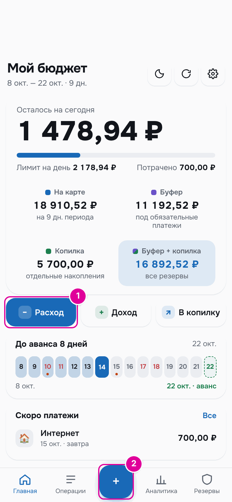

*Номера совпадают с шагами.*

1. Нажмите «Расход» на главном экране.
2. Или нажмите «+» в центре нижней панели. Эта кнопка есть на любом экране.

Откроется окно «Новый расход».

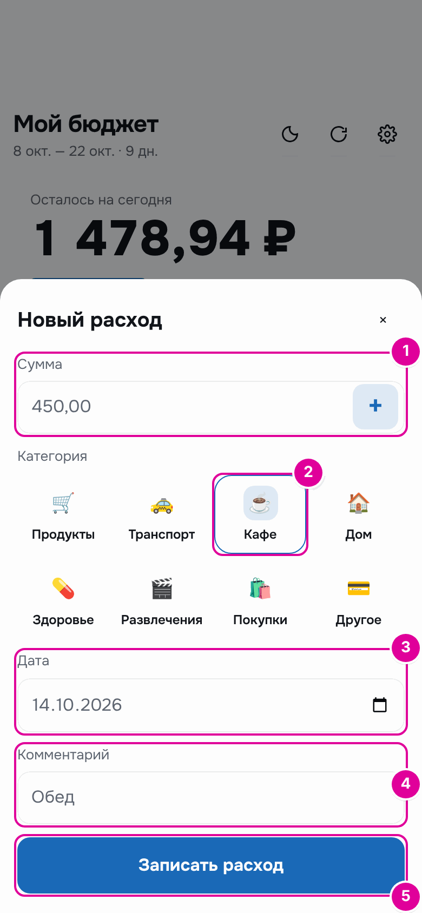

*Номера совпадают с шагами.*

1. В поле «Сумма» введите сумму. Копейки — через запятую.
2. Нажмите плитку категории. Выбранная плитка обведена.
3. «Дата» — сегодня. Если трата была в другой день, поменяйте дату.
4. «Комментарий» — необязательно. Например, «Обед». По комментарию трату потом легко найти.
5. Нажмите «Записать расход».

Если категорий больше восьми, последняя плитка называется «Ещё». Она показывает остальные категории.

Если за покупку было несколько чеков, их можно сложить прямо в этом окне. Как это сделать — ниже, после примера.

## Пример

14 октября «Осталось на сегодня» 1 478,94 ₽, «Потрачено» 700,00 ₽. Человек записывает обед за 450 ₽ в категорию «Кафе».

После записи «Осталось на сегодня» 1 028,94 ₽, «Потрачено» 1 150,00 ₽.

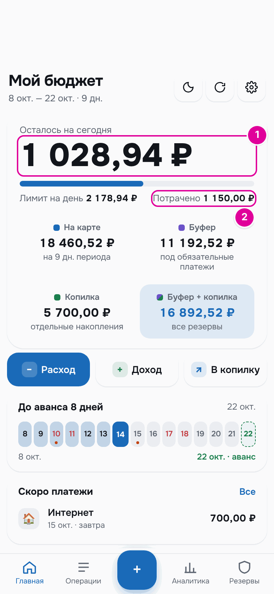

*1 — остаток на сегодня уменьшился на 450 ₽. 2 — потрачено выросло на 450 ₽.*

## Пошагово: несколько сумм в одной трате

Бывает, что одна трата складывается из нескольких чеков. Например, вы зашли за продуктами в три магазина подряд. Складывать суммы в уме не нужно: в поле «Сумма» есть кнопка «+». Она работает как калькулятор: суммы складываются, а записывается одна трата на итог.

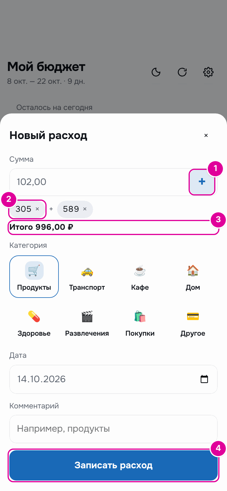

*Номера совпадают с шагами.*

1. Введите первую сумму и нажмите «+» справа в поле «Сумма». Сумма переместится под поле, а поле очистится для следующей. Так же добавьте остальные суммы.
2. Добавленные суммы видны под полем. Ошиблись — нажмите на сумму с крестиком, и она уберётся.
3. «Итого» — все суммы вместе с той, что сейчас в поле. Последнюю сумму переносить кнопкой «+» не нужно.
4. Выберите категорию и нажмите «Записать расход».

### Пример

14 октября «Осталось на сегодня» 1 478,94 ₽, «Потрачено» 700,00 ₽. Человек покупает продукты тремя чеками: 305 ₽, 589 ₽ и 102 ₽. Он вводит 305 и нажимает «+», вводит 589 и нажимает «+», вводит 102, выбирает «Продукты» и нажимает «Записать расход».

| Число | До записи | После записи |
| --- | --- | --- |
| «Осталось на сегодня» | 1 478,94 ₽ | 482,94 ₽ |
| «Потрачено» | 700,00 ₽ | 1 696,00 ₽ |

Остаток уменьшился на 996 ₽ — на сумму всех трёх чеков.

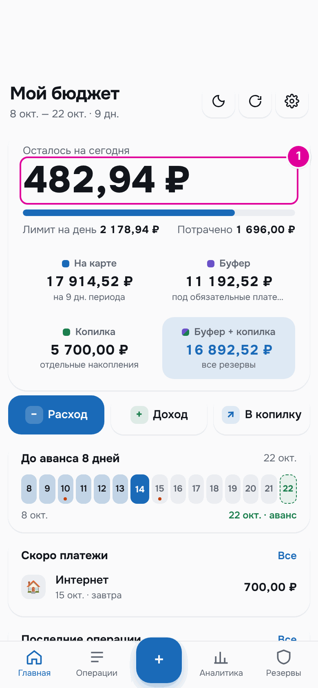

*1 — остаток на сегодня.*

Комментарий человек не заполнял, поэтому приложение само записало в него, из каких сумм сложилась трата.

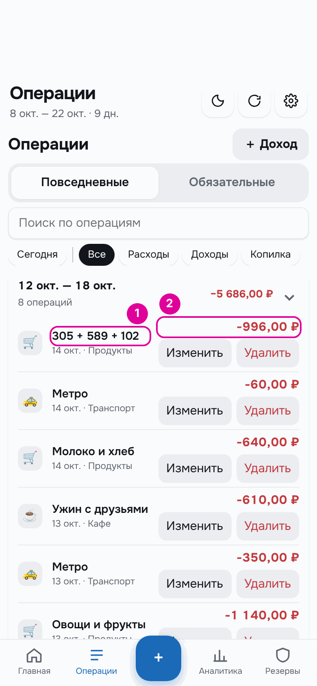

*1 — комментарий с суммами чеков. 2 — одна трата на итог.*

## Пошагово: найти, изменить, удалить

Все записи — в разделе «Операции» на нижней панели.

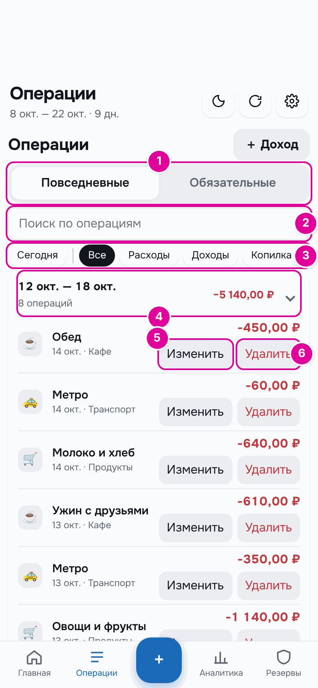

*Номера совпадают с пунктами.*

1. Вкладки «Повседневные» и «Обязательные». На второй — оплаченные обязательные платежи.
2. Поле «Поиск по операциям». Ищет по комментарию, категории и названию платежа.
3. Кнопка «Сегодня» оставляет в списке только сегодняшние операции. Кнопки «Все», «Расходы», «Доходы», «Копилка» оставляют только операции одного вида.
4. Операции сгруппированы по неделям. В заголовке недели — сколько операций и сколько потрачено. Нажмите заголовок, чтобы свернуть или развернуть неделю.
5. «Изменить» открывает трату в том же окне, что и при записи. Поменяйте сумму, категорию, дату или комментарий и нажмите «Записать расход».
6. «Удалить» удаляет запись. Приложение переспросит: «Удалить операцию?».

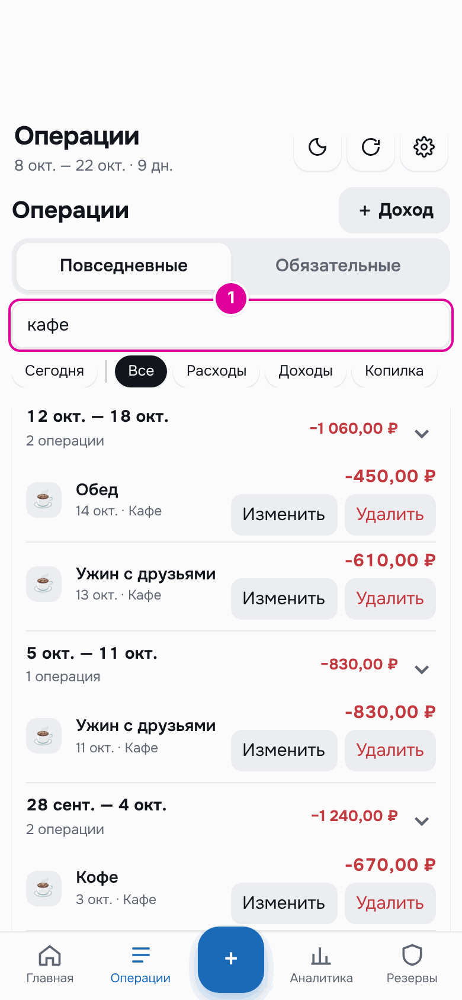

*1 — в поиске набрано «кафе». В списке остались траты этой категории.*

Кнопку «Сегодня» можно сочетать с остальными. Например, «Сегодня» и «Расходы» вместе показывают только сегодняшние траты. Так удобно вечером проверить, всё ли записано за день.

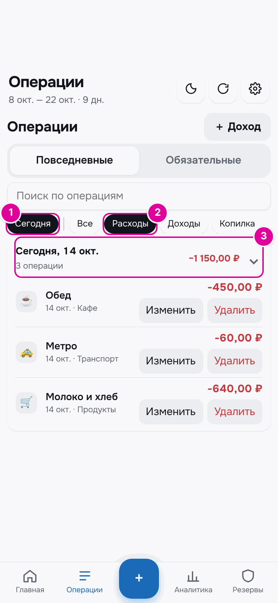

*1 — «Сегодня». 2 — «Расходы». 3 — вместо недель одна группа «Сегодня, 14 окт.»: сколько операций и сколько потрачено за день.*

Чтобы снова видеть все дни, нажмите «Сегодня» ещё раз. На вкладке «Обязательные» этих кнопок нет.

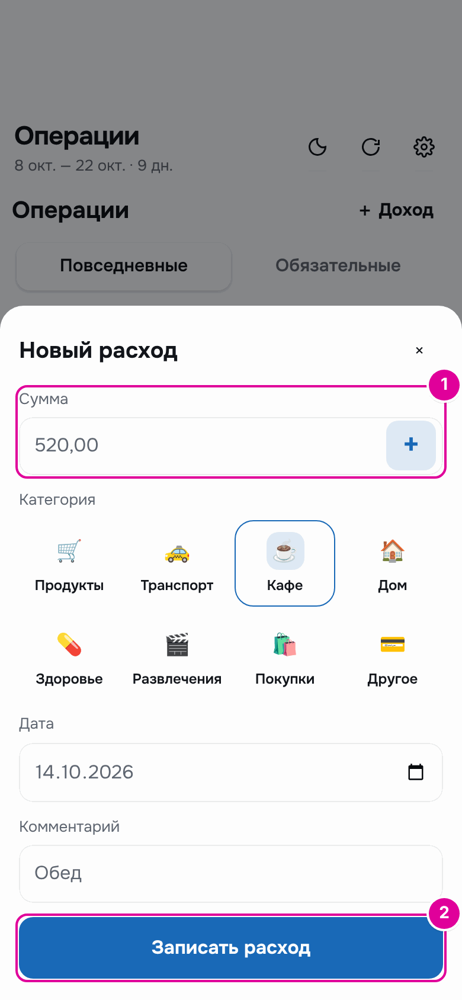

*Изменение траты: 1 — новая сумма, 2 — кнопка сохранения.*

## Если потратили больше, чем можно сегодня

Перерасход — это траты сверх «Лимита на день». Тогда «Осталось на сегодня» становится отрицательным, а на главном экране появляется блок «Перерасход сегодня».

Буфер перерасход не покрывает. Есть два варианта:

- **«Распределить по дням периода».** Перерасход делится на оставшиеся дни. Лимит на каждый следующий день станет немного меньше. Так приложение делает и без нажатия: кнопка просто скрывает блок.
- **«Взять из копилки».** Деньги из копилки закрывают перерасход сегодня. Следующие дни из-за него не уменьшаются.

В режиме «Подработки» есть третья кнопка — «Взять из резерва».

### Пример

После обеда «Осталось на сегодня» 1 028,94 ₽. Человек покупает кроссовки за 2 000 ₽. Теперь «Осталось на сегодня» −971,06 ₽, а в блоке «Перерасход сегодня» — 971,06 ₽.

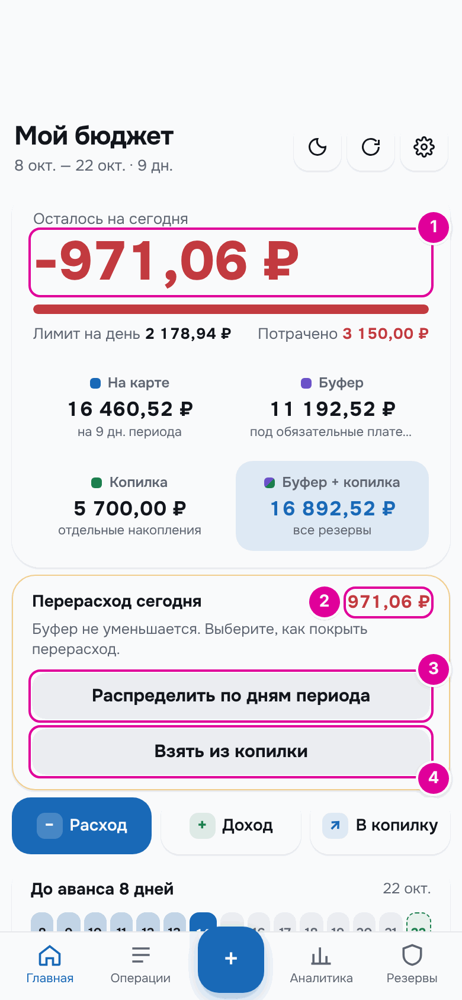

*1 — отрицательный остаток. 2 — сумма перерасхода. 3 — «Распределить по дням периода». 4 — «Взять из копилки».*

Бот в ответ на кнопку «📅 На сегодня» тоже предупредит:

> 📅 Сегодня, 14.10
>
> Можно потратить: 2 178,94 ₽\
> Потрачено: 3 150,00 ₽\
> Осталось на сегодня: -971,06 ₽
>
> ⚠️ Перерасход 971,06 ₽. Как его покрыть, можно выбрать в приложении.

*Сообщение бота.*

**Вариант 1: распределить по дням.** Ничего делать не нужно. На следующий день на карте 16 460,52 ₽ на 8 дней, «Лимит на день» 2 057,56 ₽. Без кроссовок было бы 2 307,56 ₽. Перерасход съел по 250 ₽ из каждого из восьми следующих дней.

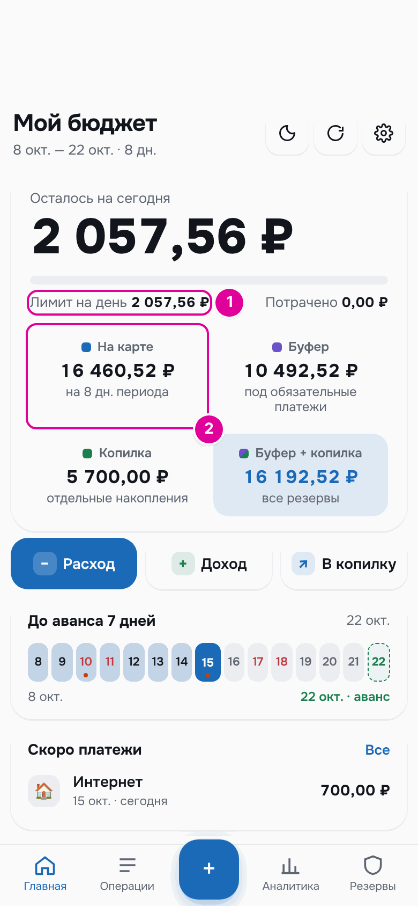

*Следующий день. 1 — лимит стал меньше. 2 — денег на карте на 2 000 ₽ меньше.*

**Вариант 2: взять из копилки.** Нажмите «Взять из копилки». Откроется окно «Покрыть перерасход из копилки».

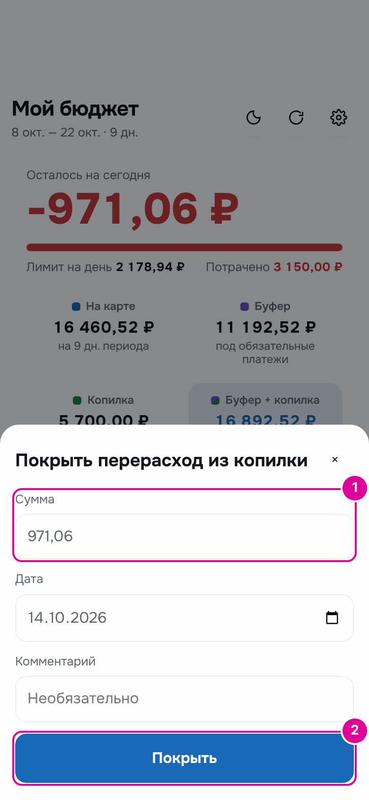

*Номера совпадают с шагами.*

1. В поле «Сумма» введите сумму перерасхода. Больше перерасхода ввести нельзя.
2. Нажмите «Покрыть».

Результат: «Осталось на сегодня» 0,00 ₽, «Лимит на день» вырос до 3 150,00 ₽, в копилке 4 728,94 ₽ вместо 5 700,00 ₽. «На карте» осталось 17 431,58 ₽ — ровно столько, сколько осталось бы, если бы сегодня потратили ровно лимит 2 178,94 ₽. Поэтому следующие дни из-за перерасхода не уменьшатся.

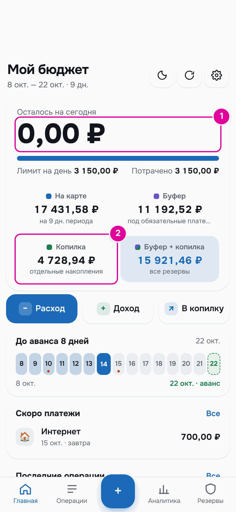

*1 — перерасхода больше нет. 2 — копилка уменьшилась на 971,06 ₽.*

## Важно знать

- Если перерасход случился в последний день периода, он уменьшит деньги следующего периода.
- Трату, оплаченную из копилки, можно записать и сразу. Для этого перенесите деньги из копилки «На сегодня», как в главе [«Копилка»](09-piggy.md).
- Трата задним числом пересчитывает и сегодняшний лимит. Пример — в главе [«Типичные ситуации»](15-situations.md).
- Если включены карты и счета, в окне расхода есть ещё поля «С какой карты» и «Из чего». Подробнее — в главе [«Карты и счета»](12-accounts.md).
- Все суммы, сложенные кнопкой «+», попадают в одну категорию. Если чеки за разное — например, продукты и лекарства, — запишите их отдельными тратами.
- Если комментарий заполнен, приложение его не меняет: суммы чеков в него не дописываются.
- Если на клавиатуре есть знак +, он работает так же, как кнопка «+». Можно вставить и готовую запись вида 305+589+102: она разложится на суммы.

---
[← Режим «Подработки»](06-side-jobs.md) · [Оглавление](README.md) · [Обязательные платежи →](08-bills.md)
