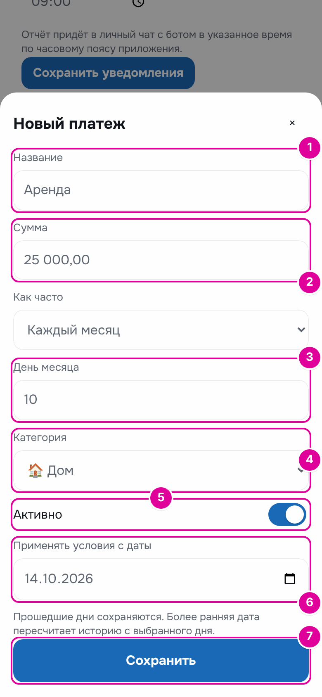
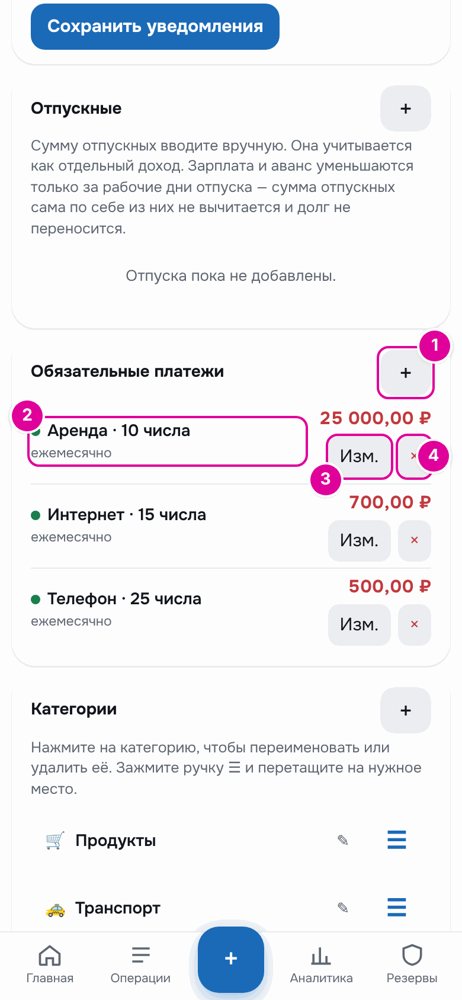
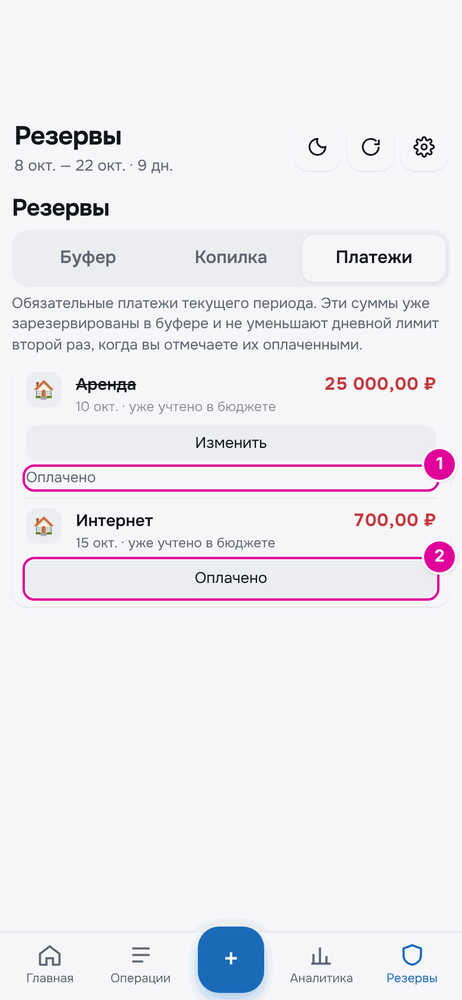
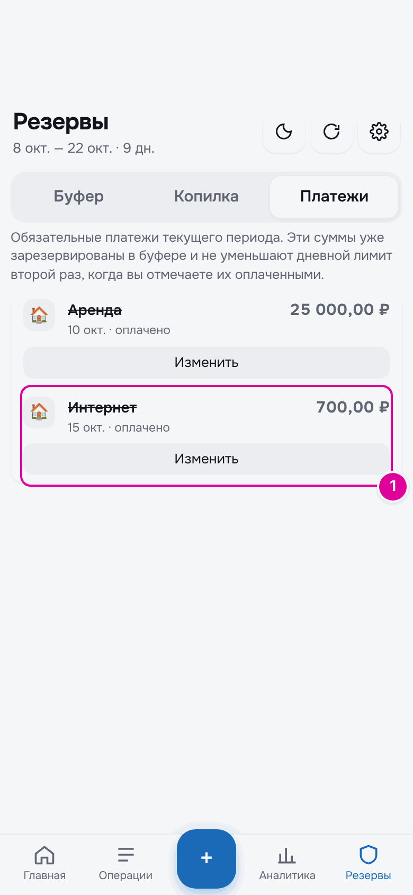
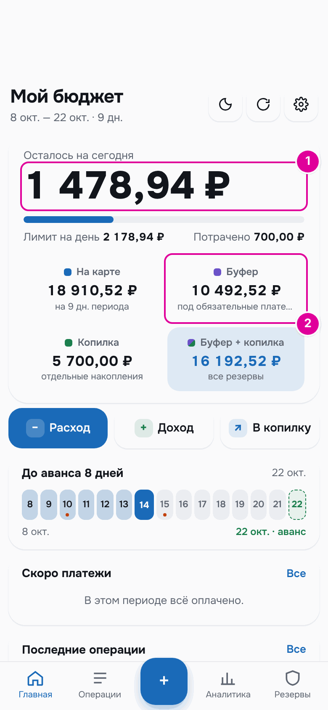
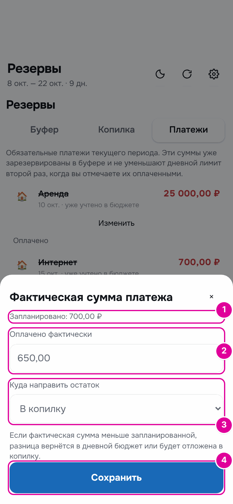
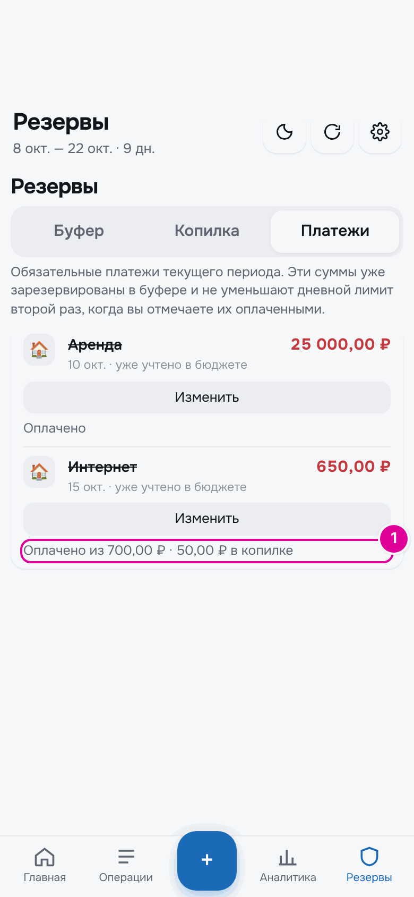
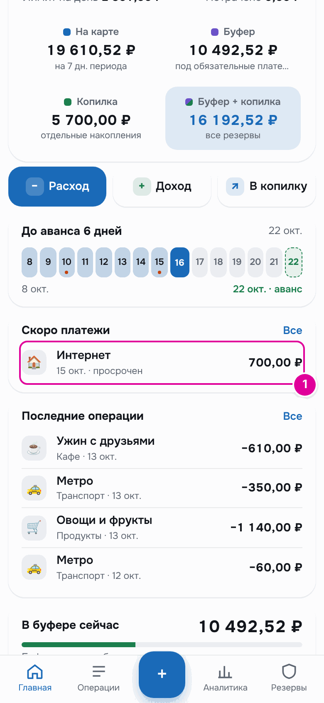

# 8. Обязательные платежи

Обязательные платежи — это то, что нужно платить каждый месяц в определённый день: аренда, интернет, телефон, кредит. Приложение заранее откладывает на них деньги, чтобы сумма на сегодня их не съела.

## Как это работает

Представьте отдельный конверт для счетов. Как только приходит зарплата, вы сразу кладёте в него деньги на аренду и интернет. Тратите только то, что осталось вне конверта. Когда приходит день платежа, деньги уже лежат в конверте.

В режиме «Зарплата и аванс» таким конвертом служит буфер. В режиме «Подработки» — «Отложено на обязательные». Поэтому, когда вы отмечаете платёж оплаченным, сумма на сегодня второй раз не уменьшается.

## Пошагово: добавить платёж

Откройте «Настройки», найдите блок «Обязательные платежи» и нажмите «＋». Откроется окно «Новый платеж».

*Номера совпадают с шагами.*

1. «Название» — как вы называете платёж: «Аренда».
2. «Сумма» — сколько платить.
3. «День месяца» — число, когда нужно платить. Если в месяце нет такого числа, например 31-го, платёж придётся на последний день месяца.
4. «Категория» — необязательно. Нужна, чтобы платёж был виден в аналитике по категориям.
5. «Активно» — оставьте включённым. Выключенный платёж не учитывается в бюджете и аналитике.
6. «Применять условия с даты» — с какого дня действует платёж. По умолчанию сегодня. Более ранняя дата пересчитает историю с выбранного дня.
7. Нажмите «Сохранить».

## Пошагово: изменить или удалить

Все платежи видны в том же блоке «Обязательные платежи» в «Настройках».

*Номера совпадают с пунктами.*

1. «＋» добавляет новый платёж.
2. В строке — название, день месяца и «ежемесячно». Зелёная точка значит, что платёж включён.
3. «Изм.» открывает то же окно. Например, если подорожал интернет, поменяйте сумму и в «Применять условия с даты» поставьте день, с которого действует новая цена.
4. «×» удаляет платёж. Приложение переспросит: «Удалить платеж?».

## Пошагово: отметить оплату

Когда заплатили, откройте «Резервы» → «Платежи». Здесь платежи текущего периода (в режиме «Подработки» — текущего месяца).

*1 — так выглядит оплаченный платёж. 2 — кнопка «Оплачено» у неоплаченного.*

1. У оплаченного платежа название зачёркнуто, а внизу написано «Оплачено».
2. У неоплаченного есть кнопка «Оплачено». Нажмите её, когда заплатите.

Платёж станет оплаченным, а кнопка сменится на «Изменить». Оплаченные платежи также видны в «Операции» на вкладке «Обязательные».

*1 — интернет оплачен.*

### Пример

14 октября человек платит за интернет на день раньше срока. До оплаты «Буфер» 11 192,52 ₽, «Осталось на сегодня» 1 478,94 ₽.

После нажатия «Оплачено» «Буфер» 10 492,52 ₽, а «Осталось на сегодня» по-прежнему 1 478,94 ₽. Деньги взялись из буфера, сумма на сегодня не изменилась.

*1 — сумма на сегодня та же. 2 — буфер уменьшился на 700 ₽.*

## Пошагово: заплатили меньше или больше плана

Нажмите «Изменить» у оплаченного платежа. Откроется окно «Фактическая сумма платежа».

*Номера совпадают с шагами.*

1. Вверху написано, сколько было запланировано.
2. В поле «Оплачено фактически» введите, сколько заплатили.
3. В «Куда направить остаток» выберите «В дневной бюджет» или «В копилку». «В дневной бюджет» — остаток добавится к деньгам на траты и разделится на оставшиеся дни.
4. Нажмите «Сохранить».

### Пример

За интернет запланировано 700 ₽, а по акции заплатили 650 ₽. Остаток 50 ₽ человек отправляет в копилку. В строке платежа теперь написано «Оплачено из 700,00 ₽ · 50,00 ₽ в копилке».

*1 — сколько оплачено из плана и куда ушёл остаток.*

Если заплатили больше плана, разница спишется с денег на траты. Из буфера сверх плана не берётся.

## Просроченный платёж

Если день платежа прошёл, а платёж не отмечен оплаченным, на главном экране в «Скоро платежи» рядом с ним написано «просрочен».

*1 — просроченный платёж.*

Деньги на него никуда не делись: они отложены и ждут. Заплатите и нажмите «Оплачено» на вкладке «Платежи». Если платёж уже был оплачен, а вы просто забыли отметить, — тоже нажмите «Оплачено».

## Важно знать

- Дата обязательного платежа не переносится на рабочий день, даже если выпадает на выходной.
- В режиме «Подработки» при оплате деньги берутся из отложенного под платёж. Если отложено меньше, недостающее спишется со свободных денег.
- Не записывайте обязательный платёж ещё и как обычную трату. Иначе он вычтется из суммы на сегодня второй раз.
- Платёж по кредитке можно запланировать прямо из карточки кредитки. Подробнее — в главе [«Карты и счета»](12-accounts.md).

---
[← Траты](07-expenses.md) · [Оглавление](README.md) · [Копилка →](09-piggy.md)
