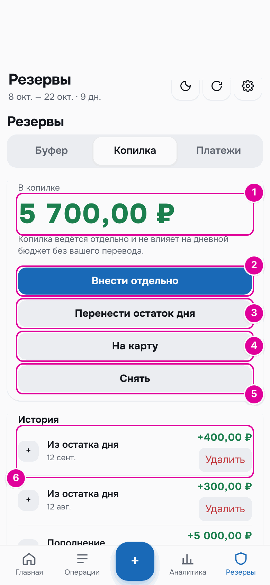
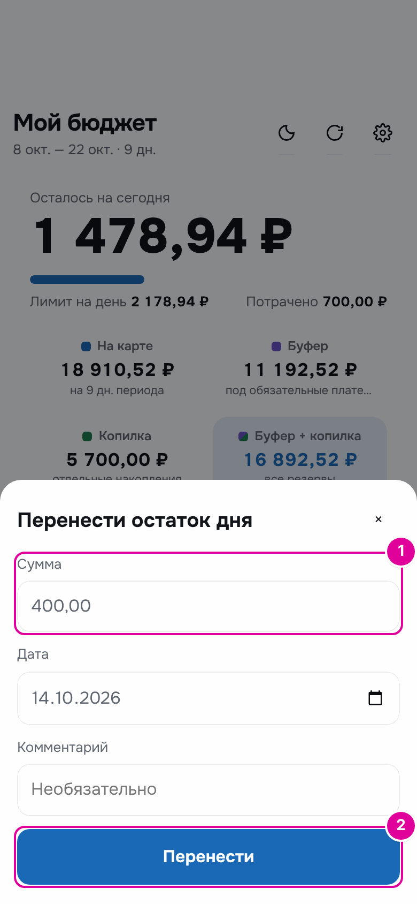
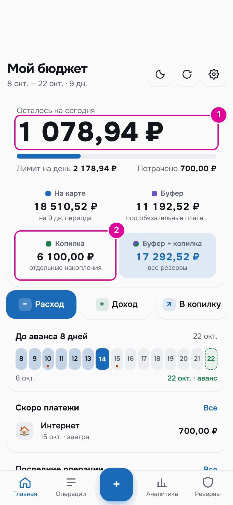
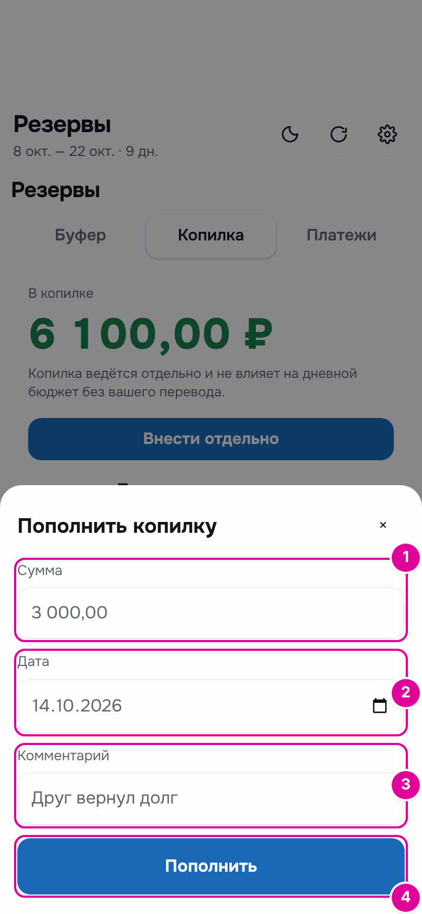
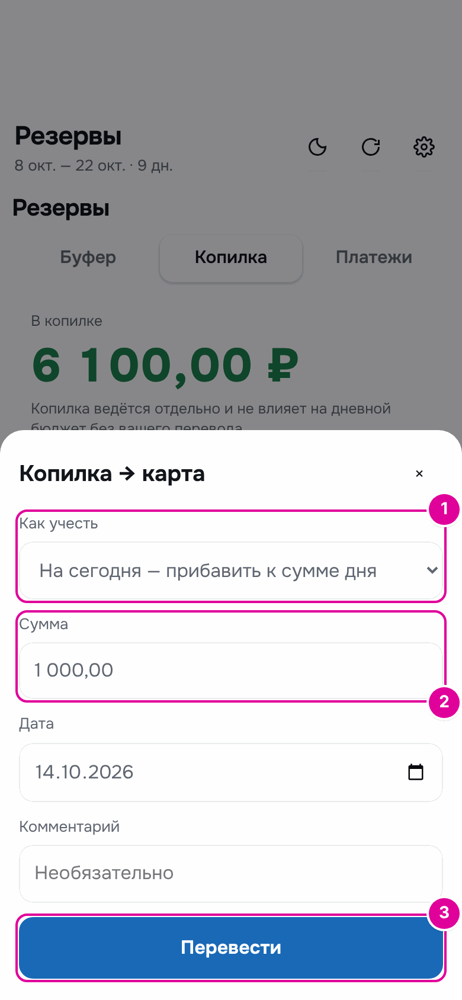
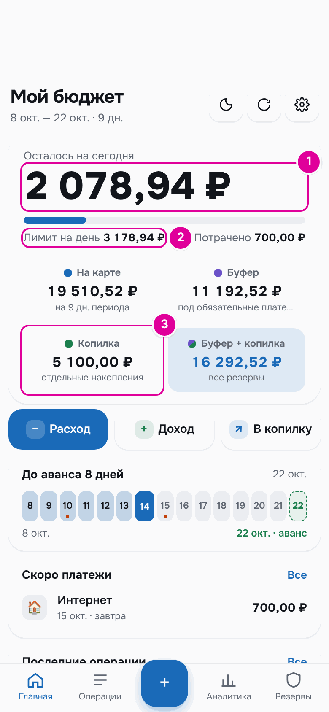
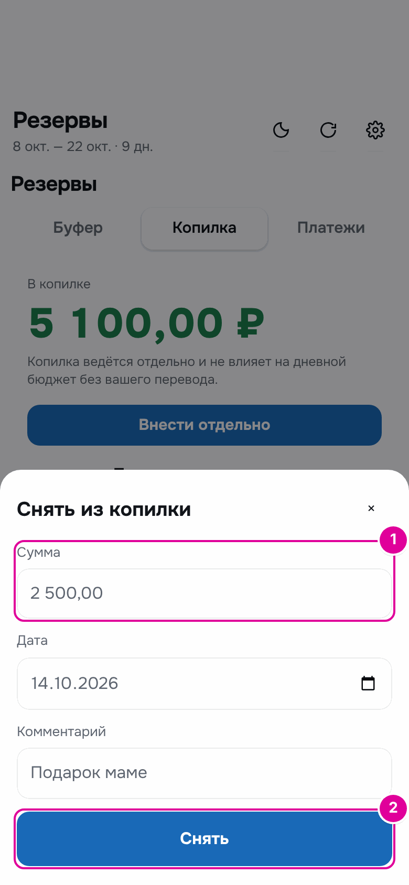

# 9. Копилка

Копилка — это ваши накопления. Приложение никогда не трогает её само: деньги попадают в копилку и уходят из неё только когда вы нажимаете кнопку.

## Как это работает

Копилка — как банка на полке, отдельная от кошелька. Сумма на сегодня её не видит. Можно положить туда то, что осталось от дня, или деньги со стороны. Можно взять оттуда на карту, если не хватает, или просто потратить на крупную покупку.

Все действия с копилкой — в разделе «Резервы» → «Копилка».

*Номера совпадают с пунктами.*

1. «В копилке» — сколько сейчас накоплено.
2. «Внести отдельно» — положить деньги со стороны: подарок, возврат долга.
3. «Перенести остаток дня» — отложить то, что не потратили сегодня. То же делает кнопка «В копилку» на главном экране.
4. «На карту» — взять из копилки на траты.
5. «Снять» — забрать деньги из копилки совсем, например на крупную покупку. Кнопка неактивна, если копилка пустая.
6. История. У каждой записи есть «Удалить».

## Пошагово: отложить остаток дня

На главном экране нажмите «В копилку». Откроется окно «Перенести остаток дня».

*Номера совпадают с шагами.*

1. В поле «Сумма» введите, сколько отложить. Не больше, чем «Осталось на сегодня».
2. Нажмите «Перенести».

### Пример

14 октября «Осталось на сегодня» 1 478,94 ₽. Человек решает отложить 400 ₽.

| Число | До | После |
| --- | --- | --- |
| «Осталось на сегодня» | 1 478,94 ₽ | 1 078,94 ₽ |
| «На карте» | 18 910,52 ₽ | 18 510,52 ₽ |
| «Копилка» | 5 700,00 ₽ | 6 100,00 ₽ |

*1 — сегодня осталось на 400 ₽ меньше. 2 — копилка выросла на 400 ₽.*

## Пошагово: пополнить извне

Нажмите «Внести отдельно». Откроется окно «Пополнить копилку».

*Номера совпадают с шагами.*

1. «Сумма» — сколько кладёте.
2. «Дата» — когда.
3. «Комментарий» — необязательно, например «Друг вернул долг».
4. Нажмите «Пополнить».

Сумма на сегодня от этого не меняется: деньги пришли со стороны и сразу легли в копилку.

## Пошагово: взять на карту

Нажмите «На карту». Откроется окно «Копилка → карта».

*Номера совпадают с шагами.*

1. «Как учесть» — два варианта:
   - «На сегодня — прибавить к сумме дня» — вся сумма достанется сегодняшнему дню. Подходит, если сегодня крупная покупка;
   - «Распределить по дням периода» — сумма разделится на все оставшиеся дни.
2. «Сумма» — сколько взять.
3. Нажмите «Перевести».

Переводить на карту можно только сегодняшним днём.

### Пример

После переноса «Осталось на сегодня» 1 078,94 ₽, в копилке 6 100 ₽. Человек берёт 1 000 ₽ «На сегодня».

| Число | До | После |
| --- | --- | --- |
| «Осталось на сегодня» | 1 078,94 ₽ | 2 078,94 ₽ |
| «Лимит на день» | 2 178,94 ₽ | 3 178,94 ₽ |
| «Копилка» | 6 100,00 ₽ | 5 100,00 ₽ |

*1 — сегодня можно потратить на 1 000 ₽ больше. 2 — лимит дня вырос на 1 000 ₽. 3 — копилка уменьшилась на 1 000 ₽.*

## Пошагово: снять

Нажмите «Снять». Откроется окно «Снять из копилки».

*Номера совпадают с шагами.*

1. «Сумма» — сколько забираете.
2. Нажмите «Снять».

Деньги уходят из копилки и не попадают на траты. Сумма на сегодня не меняется. Так записывают покупку, которую оплатили прямо из накоплений.

## Важно знать

- «Перенести остаток дня» и «На карту» работают только сегодняшним днём. Записать такой перенос задним числом нельзя.
- Перенести из остатка дня можно не больше, чем «Осталось на сегодня». У «Внести отдельно» такого ограничения нет.
- Если удалить запись в истории, копилка и сумма на сегодня пересчитаются. Запись, которую создал доход или остаток платежа, отдельно не удаляется: меняйте сам доход или платёж.
- Если включены карты и счета, при пополнении появится поле «Откуда», а при снятии — «Куда». Подробнее — в главе [«Карты и счета»](12-accounts.md).

---
[← Обязательные платежи](08-bills.md) · [Оглавление](README.md) · [Категории →](10-categories.md)
