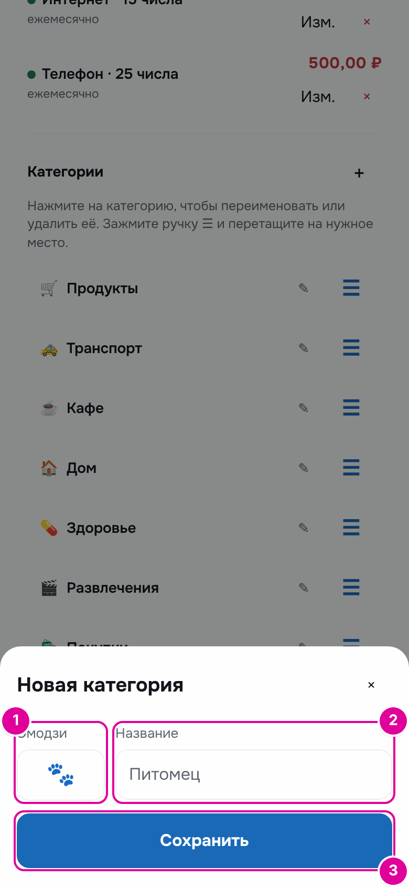
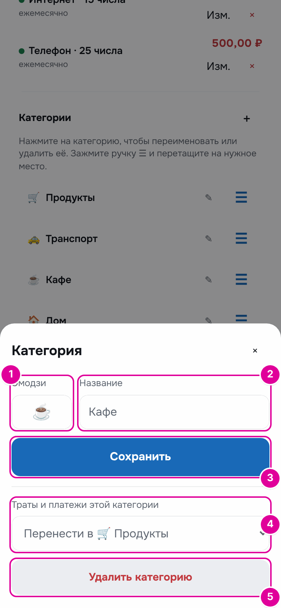
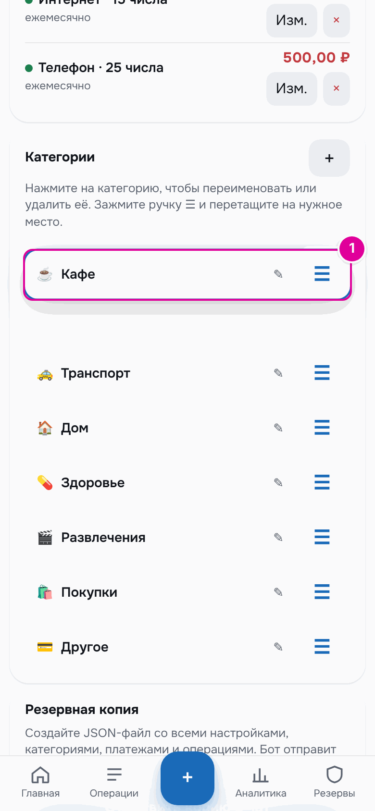
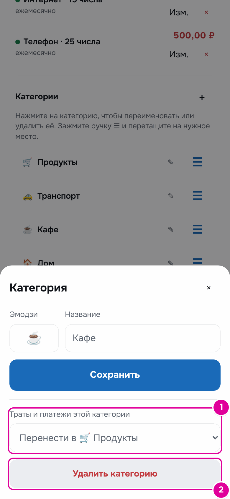
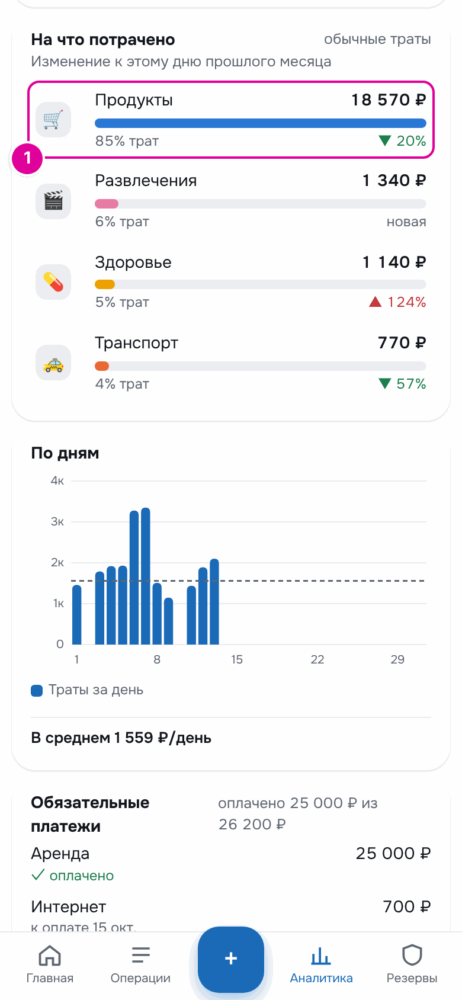

# 10. Категории

Категория — это ярлык траты: «Продукты», «Транспорт», «Кафе». По категориям в аналитике видно, на что уходят деньги. Список категорий можно менять под себя.

## Как это работает

Категории — как подписанные отделения в кошельке для чеков. Вы сами решаете, какие отделения нужны. Когда записываете трату, выбираете отделение.

Сразу после первого запуска есть восемь категорий: «Продукты», «Транспорт», «Кафе», «Дом», «Здоровье», «Развлечения», «Покупки», «Другое». Порядок категорий — это порядок плиток в окне расхода. От места в списке зависит и цвет категории в аналитике.

Категории находятся в «Настройках», в блоке «Категории».

*Номера совпадают с пунктами.*

1. «＋» добавляет категорию.
2. Нажатие на название открывает категорию: её можно переименовать или удалить.
3. Ручка ☰ меняет порядок.

## Пошагово: добавить категорию

Нажмите «＋». Откроется окно «Новая категория».

*Номера совпадают с шагами.*

1. «Эмодзи» — картинка категории. Нажмите поле и выберите эмодзи на клавиатуре.
2. «Название» — короткое имя, до 40 знаков.
3. Нажмите «Сохранить».

## Пошагово: переименовать

Нажмите на название категории. Откроется окно «Категория».

*Номера 1–3 совпадают с шагами. 4 и 5 — для удаления, о нём ниже.*

1. Поменяйте эмодзи.
2. Поменяйте название.
3. Нажмите «Сохранить».

Траты остаются в этой категории, меняется только подпись.

## Пошагово: поменять порядок

Зажмите ручку ☰ справа от категории и перетащите её вверх или вниз. Соседние категории плавно сдвинутся. Отпустите палец — порядок сохранится.

*1 — «Кафе» перетаскивают наверх списка.*

## Пошагово: удалить категорию

Откройте категорию нажатием на её название.

*Номера совпадают с шагами.*

1. В «Траты и платежи этой категории» выберите, куда перенести траты: «Перенести в …» другую категорию или «Оставить без категории».
2. Нажмите «Удалить категорию» и подтвердите.

## Пример

В октябре по категориям: «Продукты» 16 460 ₽, «Кафе» 2 110 ₽. Человек решает не разделять еду дома и в кафе. Он удаляет «Кафе» и переносит траты в «Продукты».

После удаления в аналитике «Продукты» — 18 570 ₽: 16 460 + 2 110. Категории «Кафе» больше нет.

*1 — траты кафе теперь в «Продуктах».*

## Важно знать

- Последнюю оставшуюся категорию удалить нельзя: в окне не будет блока удаления.
- Вместе с тратами в выбранную категорию переносятся и обязательные платежи этой категории.
- Если категорий больше восьми, в окне расхода последняя плитка называется «Ещё». Самые нужные категории держите в начале списка.

---
[← Копилка](09-piggy.md) · [Оглавление](README.md) · [Аналитика →](11-analytics.md)
