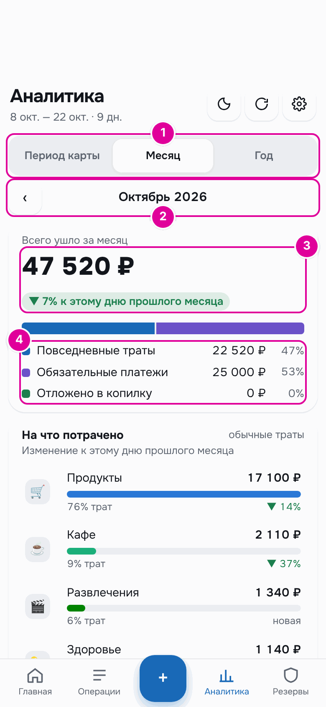
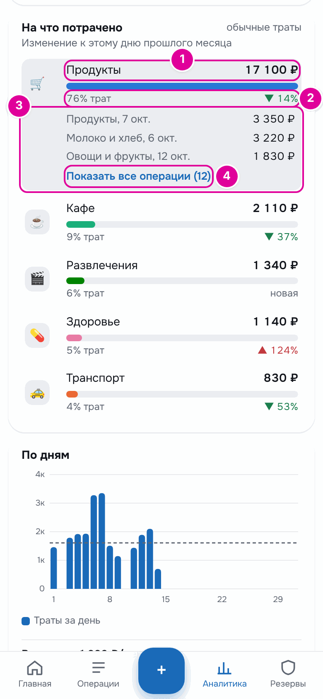
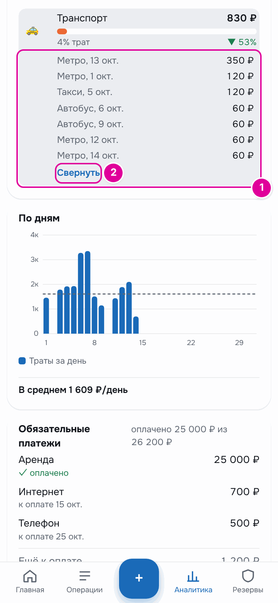
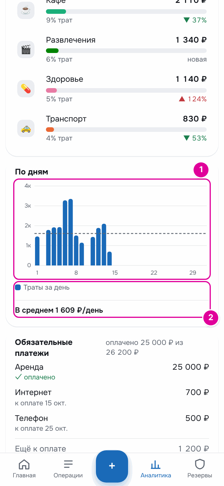
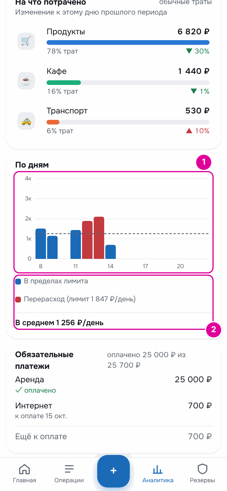
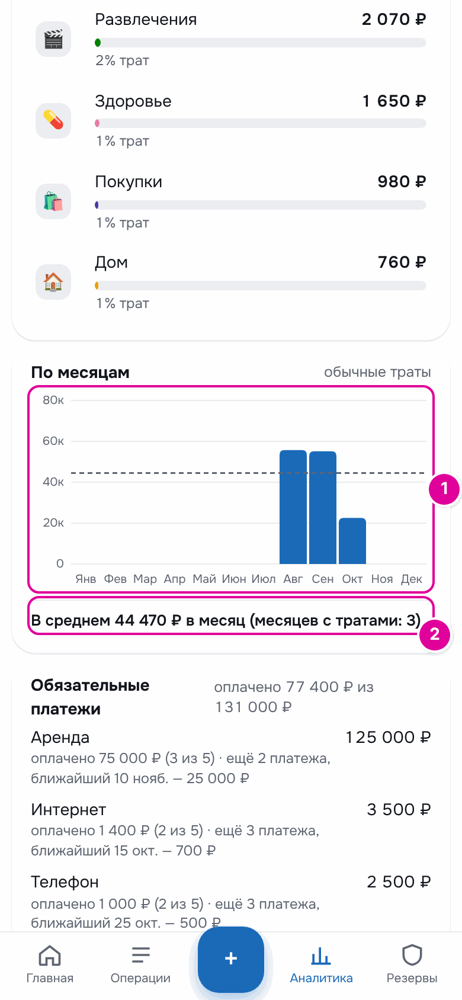
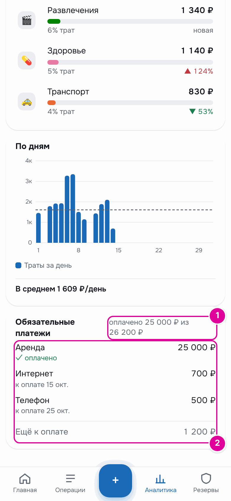
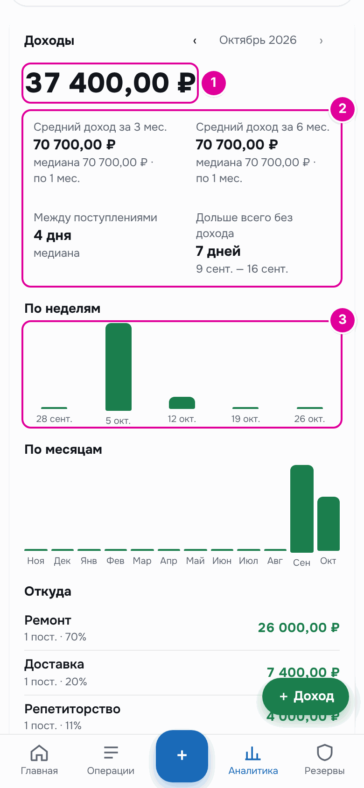
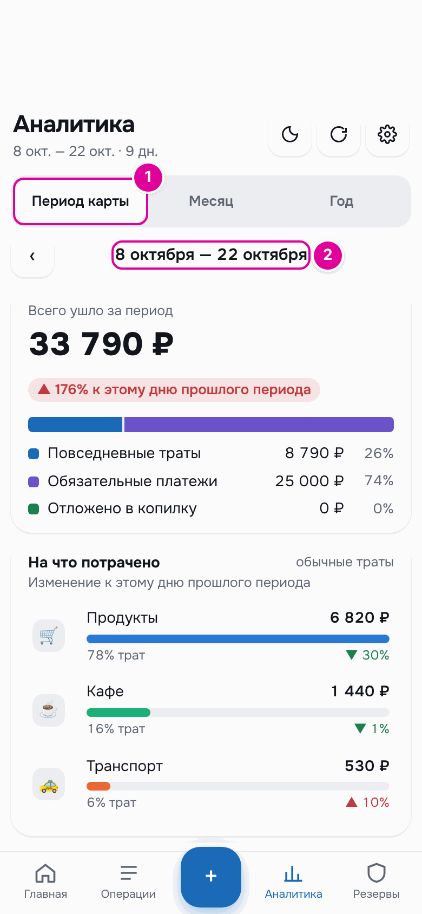

# 11. Аналитика

Раздел «Аналитика» показывает, куда ушли деньги: сколько всего, на какие категории, по каким дням и месяцам. Его открывают кнопкой «Аналитика» на нижней панели.

## Как это работает

Аналитика — как выписка из банка, только разложенная по полочкам. Она ничего не меняет в бюджете, только показывает уже записанное. Суммы трат в ней округлены до рубля.

Пока месяц или период не закончились, сравнение идёт с тем же числом дней прошлого месяца или периода. Например, 14 октября первые 14 дней октября сравниваются с первыми 14 днями сентября.

## Пошагово: выбрать период

*Номера совпадают с пунктами.*

1. Выберите, за что смотреть: «Период карты» (от выплаты до выплаты, только в режиме «Зарплата и аванс»), «Месяц» или «Год».
2. Стрелки ‹ и › листают на период назад и вперёд. В будущее листать нельзя.
3. «Всего ушло за месяц» — все деньги, которые ушли за этот срок. Рядом — сравнение с прошлым: зелёная стрелка вниз значит, что ушло меньше, красная вверх — больше.
4. Цветная полоса и строки под ней делят итог на три части: «Повседневные траты», «Обязательные платежи», «Отложено в копилку». Справа — сумма и доля в процентах.

## На что потрачено

Блок «На что потрачено» показывает только обычные траты, по категориям. Сверху — самая большая категория.

*Номера совпадают с пунктами.*

1. Название категории и сумма. Полоса показывает её размер относительно самой большой.
2. Доля среди всех обычных трат и изменение к прошлому месяцу. Слово «новая» значит, что в прошлом месяце на эту категорию не тратили.
3. Нажмите на категорию, и раскроется список трёх самых крупных покупок в ней. Повторное нажатие сворачивает список.
4. Если покупок больше трёх, под списком есть кнопка «Показать все операции (12)». В скобках — сколько всего покупок в категории. Кнопка раскрывает весь список.

*1 — все покупки категории за месяц, самые крупные сверху. 2 — «Свернуть» снова оставляет три самые крупные.*

## По дням

График «По дням» — траты каждого дня. Пунктирная линия — средняя трата в день.

*1 — столбик на каждый день. 2 — подпись со средней тратой в день.*

Нажмите на столбик, чтобы увидеть дату и сумму. В режиме «Период карты» для текущего периода график ещё и сравнивает дни с дневным лимитом: дни сверх лимита красные.

*1 — красные столбики — дни, когда потратили больше лимита. 2 — подписи цветов и средняя трата.*

## По месяцам

В режиме «Год» вместо «По дням» показан график «По месяцам»: обычные траты каждого месяца года.

*1 — траты по месяцам. 2 — среднее за месяцы, в которых были траты.*

## Обязательные платежи

Последний блок — обязательные платежи за выбранный срок.

*1 — сколько уже оплачено из общей суммы. 2 — платежи с состоянием и остаток к оплате.*

## Доходы в режиме «Подработки»

В режиме «Подработки» в аналитике есть ещё блок «Доходы» со своими стрелками по месяцам.

*1 — сколько пришло за месяц. 2 — средний доход, промежутки между доходами и самый долгий срок без дохода. 3 — доходы по неделям.*

Ниже в этом блоке — доходы «По месяцам», список «Откуда» с долей каждого источника и «Резерв за месяц»: сколько отложено и сколько взято, с причинами.

## Пример

Октябрь, данные на 14-е число. «Всего ушло за месяц» 47 520 ₽:

- «Повседневные траты» 22 520 ₽ — 47 %;
- «Обязательные платежи» 25 000 ₽ — 53 %, это аренда;
- «Отложено в копилку» 0 ₽.

Сравнение «▼ 7% к этому дню прошлого месяца»: за первые 14 дней октября ушло на 7 % меньше, чем за первые 14 дней сентября.

Самая большая категория — «Продукты»: 17 100 ₽, это 76 % обычных трат, на 14 % меньше, чем к этому дню сентября. Если нажать на неё, видны крупные покупки: «Продукты, 7 окт.» на 3 350 ₽, «Молоко и хлеб, 6 окт.» на 3 220 ₽.

Если переключиться на «Период карты», срок станет «8 октября — 22 октября», а итог — 33 790 ₽: сюда входит аренда, оплаченная 10 октября.

*1 — режим «Период карты». 2 — срок периода от выплаты до выплаты.*

В этом режиме лимит на день — 1 847 ₽. В два дня, 12 и 13 октября, потрачено больше, и их столбики на графике «По дням» красные.

## Важно знать

- Траты кредиткой учитываются в аналитике в день покупки, со своей категорией. Погашение кредитки — нет, чтобы не посчитать покупку дважды.
- «Отложено в копилку» — все пополнения копилки за срок: и остаток дня, и деньги, положенные кнопкой «Внести отдельно».
- Если в прошлом месяце не было трат, сравнения не будет.

---
[← Категории](10-categories.md) · [Оглавление](README.md) · [Карты и счета →](12-accounts.md)
