# 12. Карты и счета

Эта функция показывает, на каких картах и счетах лежат ваши деньги и сколько их всего. Бюджет и сумма на сегодня от неё не меняются. Включать её не обязательно.

## Как это работает

В приложении деньги разложены по конвертам: «на траты», «буфер», «копилка». Конверт говорит, на что деньги. Но реальные деньги лежат на картах: зарплатной, накопительной, кредитной. Карты и счета отвечают на другой вопрос — где деньги лежат.

Представьте, что конверты лежат в разных ящиках. Конверт «на траты» — в кошельке, то есть на «Карте 1». Конверты «буфер» и «копилка» — в сейфе, то есть на «Накопительном» счёте. Приложение помнит, какой конверт в каком ящике, и сверяет суммы.

Под каждой картой на главном экране видно, какие конверты на ней лежат. Если денег на карте больше, чем в её конвертах, разница — «вне бюджета». Это деньги, которые не распределены ни в один конверт. Если меньше — «не хватает».

Остаток каждой карты приложение считает само: начальный остаток плюс доходы и переводы на карту, минус траты и переводы с карты. Сверять его с банком можно в любой момент.

## Пошагово: включить

Откройте «Настройки» и найдите блок «Карты и счета».

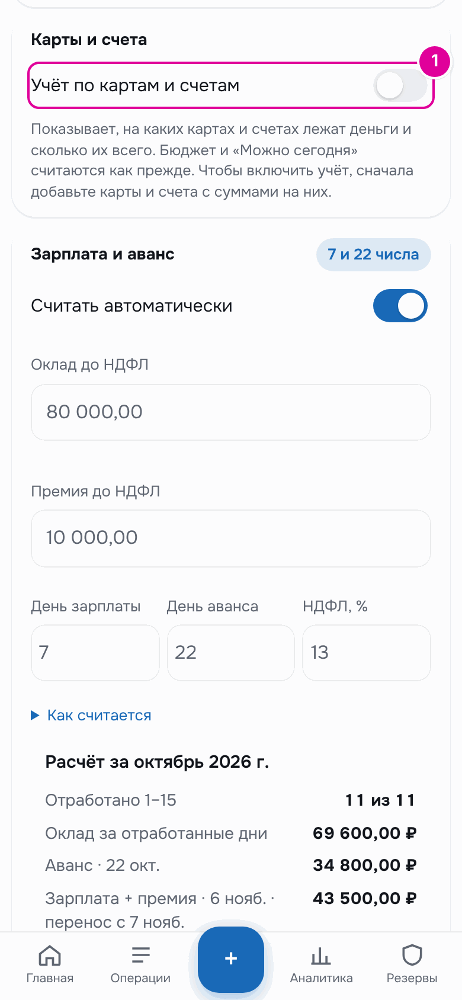

*1 — переключатель «Учёт по картам и счетам».*

1. Включите «Учёт по картам и счетам». Откроется мастер из трёх шагов.

**Шаг 1 из 3 — «Ваши карты и счета».** Перечислите все карты, счета, наличные и кредитки, где лежат деньги. Для каждой — эмодзи, название и «Тип»: «Дебетовая карта», «Накопительный счёт», «Наличные» или «Кредитная карта».

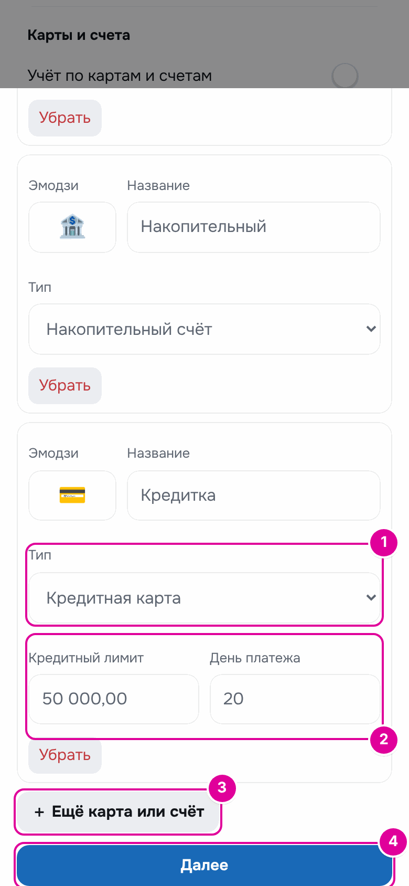

*Номера совпадают с шагами.*

1. Выберите «Тип».
2. У кредитки укажите «Кредитный лимит» и «День платежа» — число месяца, до которого нужно погасить долг. День платежа можно не указывать.
3. «＋ Ещё карта или счёт» добавляет строку. «Убрать» удаляет строку.
4. Нажмите «Далее».

**Шаг 2 из 3 — «Куда приходит доход».**

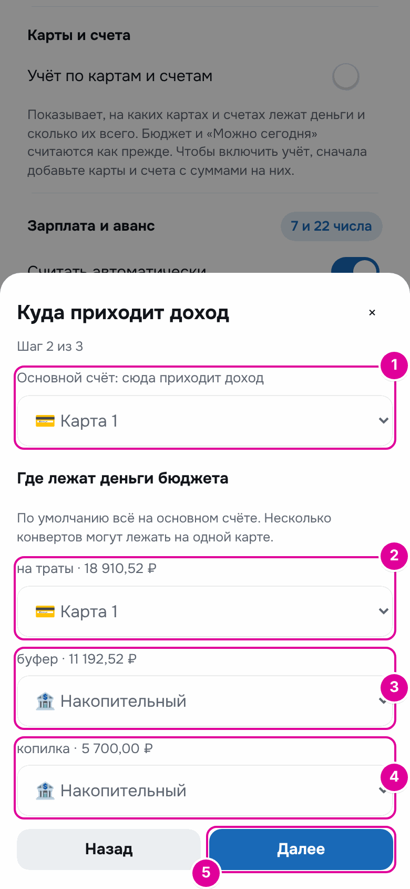

*Номера совпадают с шагами.*

1. «Основной счёт: сюда приходит доход» — карта, на которую приходит зарплата. Кредитка основной быть не может.
2. «на траты» — на какой карте лежат деньги на траты.
3. «буфер» — где лежит буфер.
4. «копилка» — где лежит копилка. Несколько конвертов могут лежать на одной карте. В режиме «Подработки» здесь ещё «свободные», «на обязательные» и «резерв».
5. Нажмите «Далее».

**Шаг 3 из 3 — «Сколько денег сейчас».**

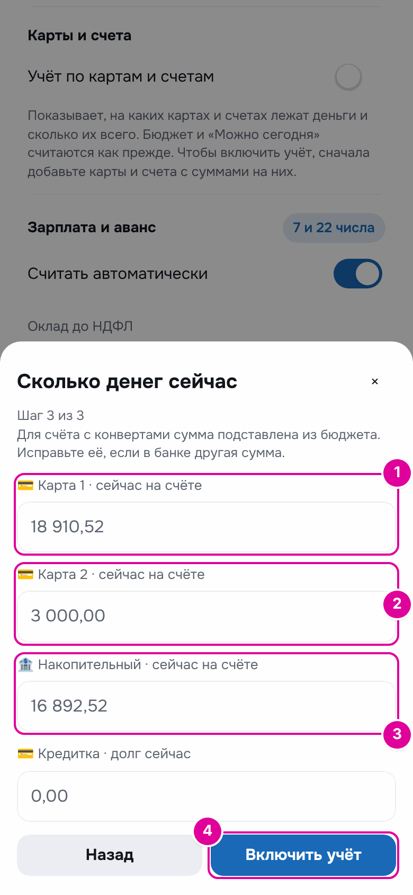

*Номера совпадают с шагами.*

1. Для карты с конвертами сумма уже подставлена из бюджета. Сверьте её с банком и исправьте, если в банке другая.
2. Для карты без конвертов введите, сколько на ней сейчас.
3. Проверьте остальные карты. Для кредитки вводится долг сейчас.
4. Нажмите «Включить учёт».

## Что видно на главном экране

*Номера совпадают с пунктами.*

1. «Всего» — сумма всех карт, счетов и наличных. Кредитки сюда не входят.
2. «Карта 1» — остаток и под ним конверты на ней. Звёздочка ⭐ отмечает основной счёт.
3. «Карта 2» — на ней нет конвертов, поэтому все её деньги «вне бюджета».
4. «Накопительный» — на нём лежат два конверта: буфер и копилка.
5. Кредитка — долг и сколько ещё доступно из лимита.

Нажатие на карту открывает её окно: остаток, кнопки и история операций по карте.

## Пример: откуда «Всего»

Конверты бюджета: на траты 18 910,52 ₽, буфер 11 192,52 ₽, копилка 5 700 ₽ — всего 35 803,04 ₽. На «Карте 2» ещё 3 000 ₽, которые в бюджет не входят. «Всего» = 35 803,04 + 3 000 = 38 803,04 ₽.

## Где лежат деньги

Карты и порядок их показа настраивают в «Настройках», в блоке «Карты и счета».

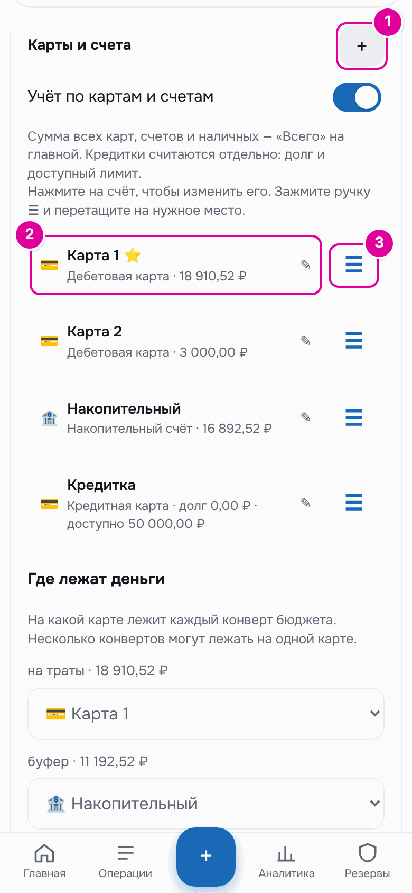

*1 — добавить карту или счёт. 2 — открыть карту, чтобы изменить её. 3 — ручка ☰: зажмите и перетащите, чтобы поменять порядок.*

Ниже в том же блоке — «Где лежат деньги».

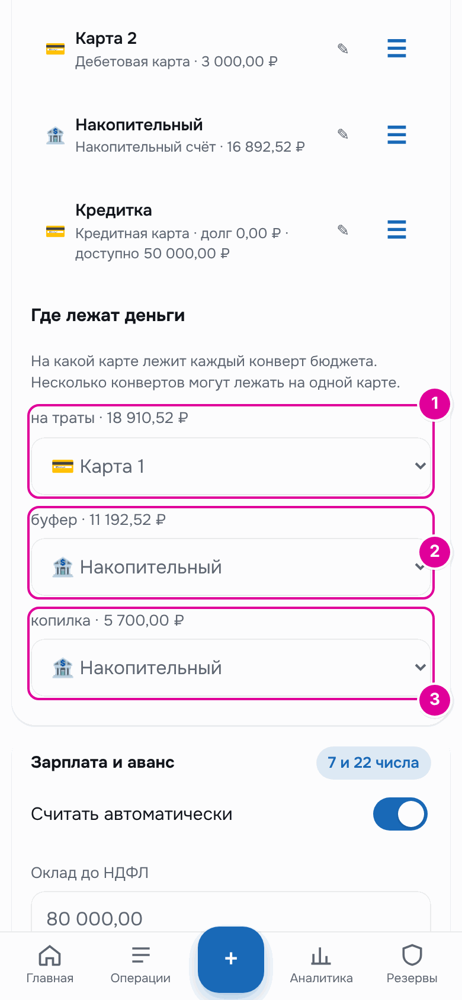

*1 — карта для денег на траты. 2 — карта для буфера. 3 — карта для копилки.*

Чтобы переложить конверт на другую карту, выберите её в списке. Если в конверте есть деньги, приложение спросит, перевести ли их одним переводом, например: «Перевести 5 700,00 ₽ (копилка) с «Накопительный» на «Карта 1» одним переводом?». Согласитесь, если переводите деньги в банке. Откажитесь, если они уже лежат на новой карте: тогда переедет только конверт.

## Пошагово: трата с выбором карты

Когда учёт включён, в окне «Новый расход» появляются два поля.

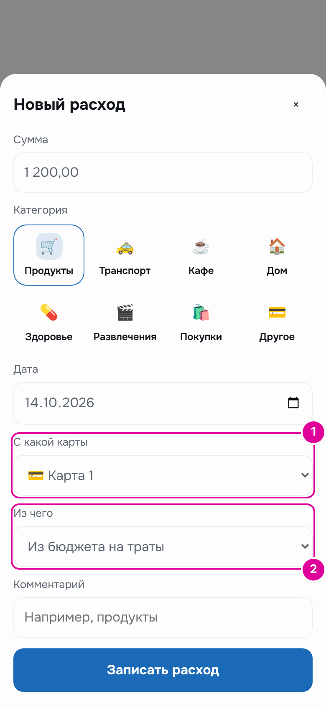

*Номера совпадают с шагами.*

1. «С какой карты» — чем платили. По умолчанию — карта, где лежат деньги на траты.
2. «Из чего» — из какого конверта деньги:
   - «Из бюджета на траты» — обычная трата, уменьшает сумму на сегодня;
   - «Из копилки» — есть, если копилка лежит на этой карте; уменьшает копилку, а не сумму на сегодня;
   - «Из резерва» — в режиме «Подработки», если резерв лежит на этой карте;
   - «Вне бюджета» — трата из денег, которые не входят в бюджет. Сумма на сегодня не меняется.

Если выбрать карту без конвертов, «Из чего» само станет «Вне бюджета». Для обычной траты поменяйте его на «Из бюджета на траты».

Если выбрать кредитку, поля «Из чего» нет. О кредитке — ниже.

## Пошагово: перевод между картами

Нажмите на карту на главном экране, затем «Перевести». Откроется окно «Перевод между счетами».

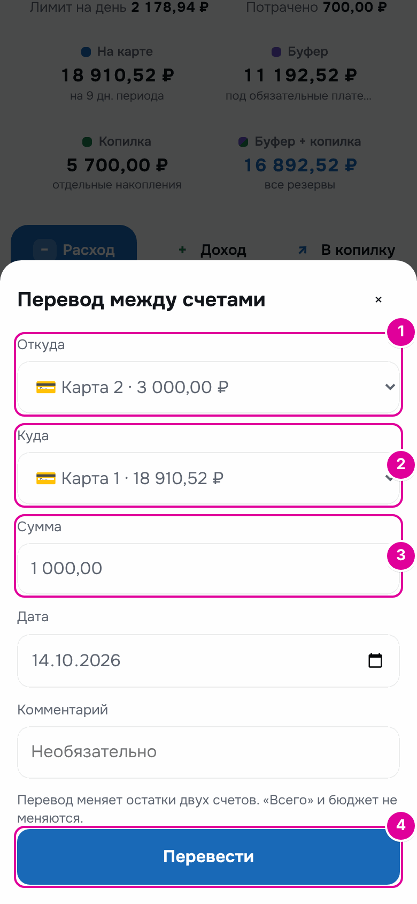

*Номера совпадают с шагами.*

1. «Откуда» — с какой карты.
2. «Куда» — на какую.
3. «Сумма».
4. Нажмите «Перевести».

### Пример

С «Карты 2» на «Карту 1» переведено 1 000 ₽.

| | До | После |
| --- | --- | --- |
| «Всего» | 38 803,04 ₽ | 38 803,04 ₽ |
| «Карта 1» | 18 910,52 ₽ | 19 910,52 ₽, из них «вне бюджета 1 000,00 ₽» |
| «Карта 2» | 3 000,00 ₽ | 2 000,00 ₽ |

Перевод меняет остатки двух карт. «Всего» и бюджет не меняются.

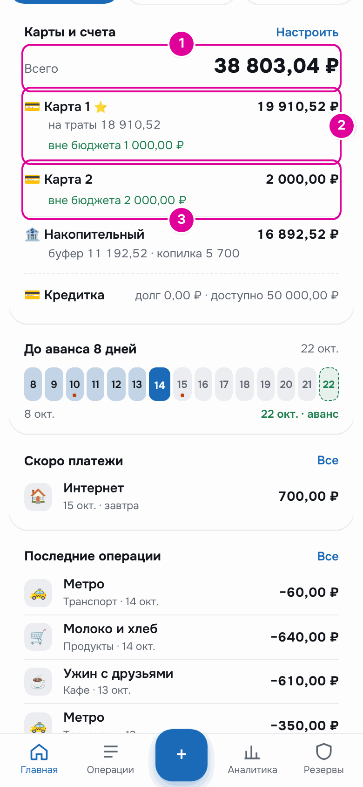

*1 — «Всего» не изменилось. 2 — на «Карте 1» стало на 1 000 ₽ больше. 3 — на «Карте 2» — на 1 000 ₽ меньше.*

### Окно карты

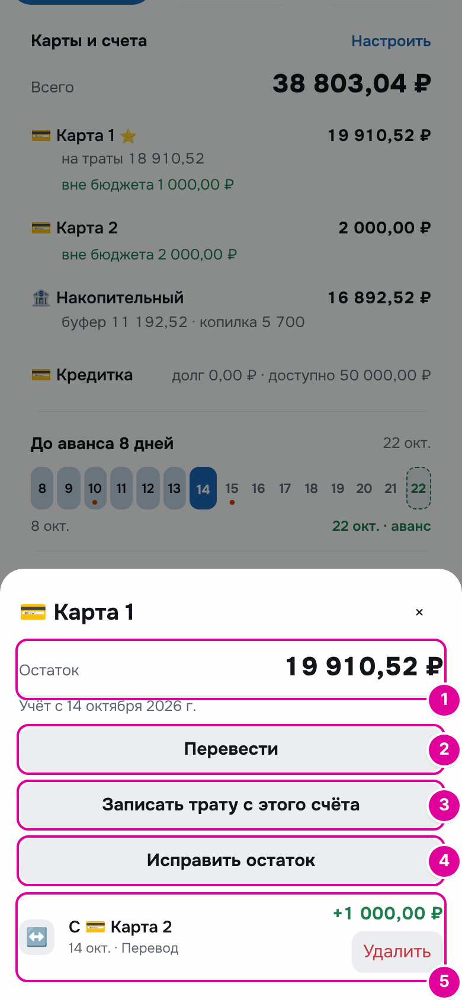

*1 — остаток. 2 — «Перевести». 3 — «Записать трату с этого счёта». 4 — «Исправить остаток». 5 — история операций по карте.*

В истории у переводов и исправлений есть «Удалить». Траты удаляют в «Операциях».

## «Нужно перевести» и кнопка «Перевёл»

Некоторые движения бюджета требуют перевести деньги между картами. Например, в день выплаты деньги пришли на «Карту 1», а буфер лежит на «Накопительном». Приложение само деньги не переводит. Оно показывает подсказку в свёрнутом блоке «Нужно перевести».

### Пошагово: день выплаты с картами

В день выплаты нажмите «Получил ✓», как в главе [«Режим «Зарплата и аванс»»](05-payroll.md). Когда учёт включён, в окне есть поле карты.

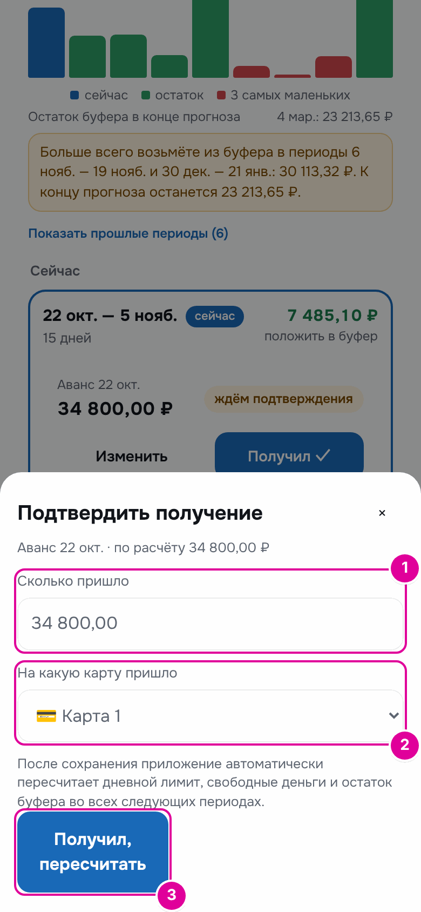

*Номера совпадают с шагами.*

1. Проверьте «Сколько пришло».
2. В «На какую карту пришло» выберите карту. По умолчанию — основная.
3. Нажмите «Получил, пересчитать».

На главном экране появится «Нужно перевести».

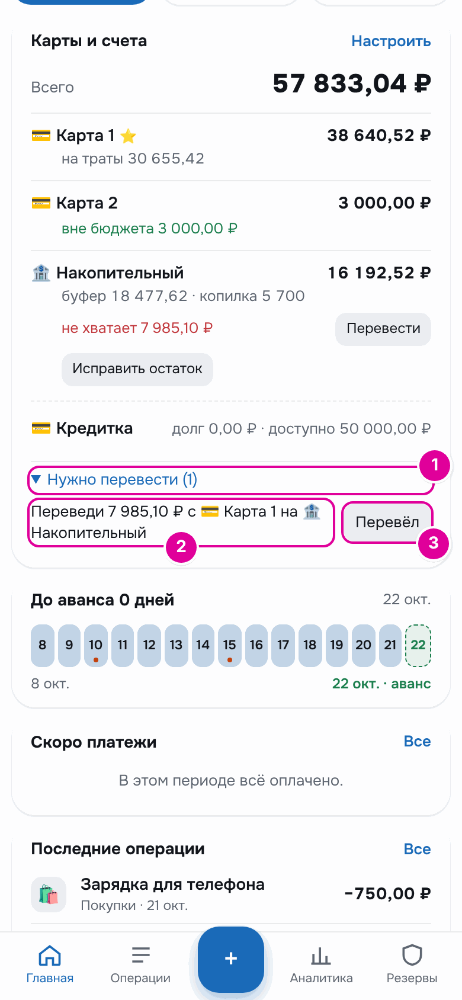

*Номера совпадают с шагами.*

1. Нажмите «Нужно перевести», чтобы раскрыть подсказки.
2. Прочитайте подсказку и сделайте перевод в приложении банка.
3. Нажмите «Перевёл». Приложение запишет перевод между картами.

### Пример

Аванс 34 800 ₽ пришёл на «Карту 1». Из него 26 814,90 ₽ — деньги на траты нового периода, они и так на «Карте 1». Остальные 7 985,10 ₽ по плану остаются в буфере, а буфер лежит на «Накопительном». Поэтому подсказка: «Переведи 7 985,10 ₽ с 💳 Карта 1 на 🏦 Накопительный».

После «Перевёл»: «Карта 1» — 30 655,42 ₽, ровно «на траты»; «Накопительный» — 24 177,62 ₽; «не хватает» исчезло. «Всего» осталось 57 833,04 ₽.

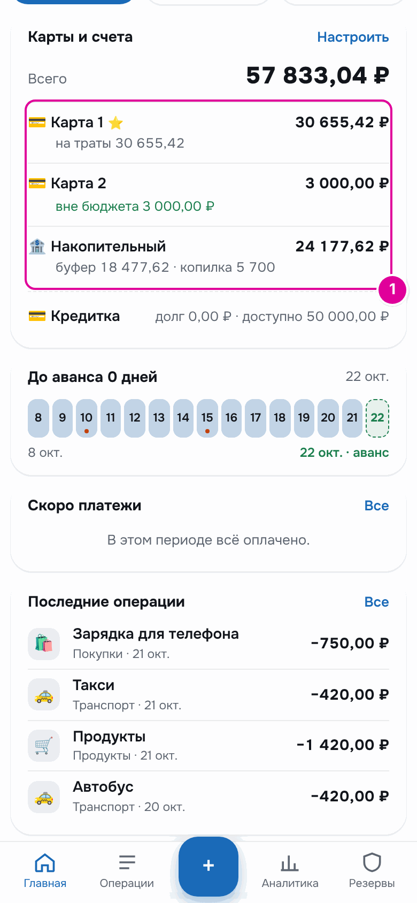

*1 — остатки карт совпадают с конвертами.*

Если выплата подтверждена, но не записана на карту, в «Нужно перевести» будет кнопка «Записать приход».

## «Вне бюджета» и «не хватает»

### Пошагово: банк начислил проценты

Нажмите на карту, затем «Исправить остаток». Откроется окно «Исправить остаток».

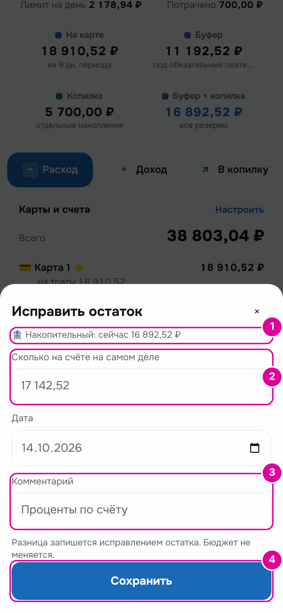

*Номера совпадают с шагами.*

1. Вверху — сколько на счёте по данным приложения.
2. В «Сколько на счёте на самом деле» введите сумму из банка.
3. «Комментарий» — необязательно.
4. Нажмите «Сохранить».

Разница запишется исправлением остатка. Бюджет не меняется. Лишние деньги окажутся «вне бюджета».

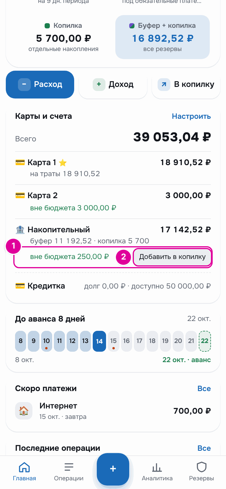

*1 — деньги вне бюджета. 2 — кнопка «Добавить в копилку».*

Кнопка «Добавить в копилку» (или «Добавить в резерв» в режиме «Подработки») кладёт эти деньги в конверт, который лежит на этой карте.

### Пример

На «Накопительном» по приложению 16 892,52 ₽, а в банке 17 142,52 ₽: банк начислил 250 ₽ процентов. После «Исправить остаток» под счётом — «вне бюджета 250,00 ₽», «Всего» — 39 053,04 ₽. После «Добавить в копилку» в копилке 5 950,00 ₽ вместо 5 700,00 ₽.

### Когда «не хватает»

Если на карте меньше, чем в её конвертах, под картой написано «не хватает …» и две кнопки:

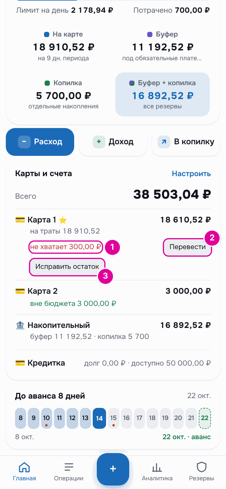

*1 — сколько не хватает. 2 — «Перевести». 3 — «Исправить остаток».*

1. Это значит, что запись и банк разошлись. Например, вы забыли записать трату на 300 ₽.
2. «Перевести» — если деньги лежат на другой карте. Откроется перевод с картой, где больше всего денег вне бюджета.
3. «Исправить остаток» — если сумма в приложении неверная. Но если причина — незаписанная трата, лучше записать её: тогда уменьшится и сумма на сегодня.

## Кредитка

Покупка кредиткой увеличивает только долг. Сумма на сегодня, конверты и «Всего» не меняются: вы потратили деньги банка, а не свои. В аналитике покупка учитывается со своей категорией.

### Пример: покупка

14 октября куплена куртка за 3 200 ₽ кредиткой. «Осталось на сегодня» как было 1 478,94 ₽, «На карте» 18 910,52 ₽.

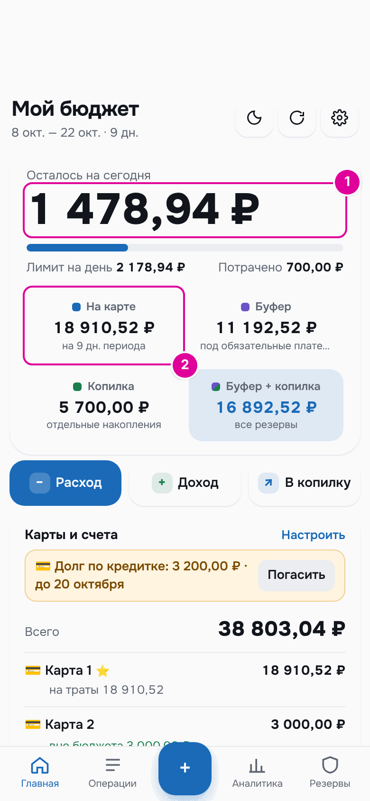

*1 — сумма на сегодня не изменилась. 2 — деньги на траты не изменились.*

Пока есть долг, на главном экране видна плашка «Долг по кредитке».

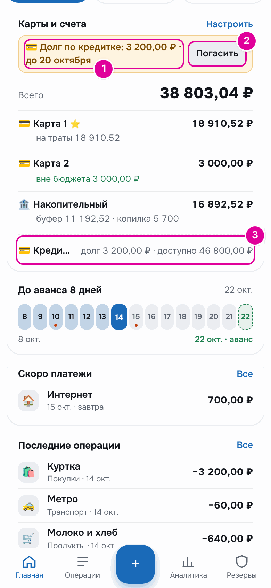

*1 — плашка с долгом и датой платежа. 2 — кнопка «Погасить». 3 — долг и доступный лимит.*

### Пошагово: погасить

Нажмите «Погасить» на плашке. Откроется окно «Погасить кредитку».

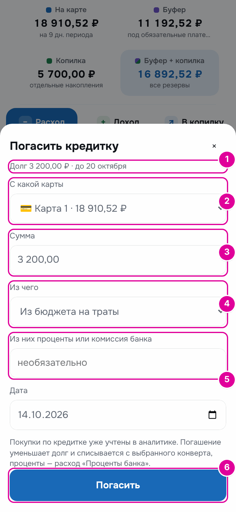

*Номера совпадают с шагами.*

1. Вверху — сколько долг и до какого числа.
2. «С какой карты» — откуда платите.
3. «Сумма» — сколько вносите. Сразу подставлен весь долг.
4. «Из чего» — из какого конверта. «Из бюджета на траты» значит, что погашение уменьшит сегодняшнюю сумму на траты.
5. «Из них проценты или комиссия банка» — если в сумме есть проценты, впишите их. Они запишутся расходом «Проценты банка» и не уменьшат долг.
6. Нажмите «Погасить».

### Пример: погашение из бюджета на траты

Человек гасит все 3 200 ₽ сразу «Из бюджета на траты». В этот день оставалось 1 478,94 ₽, поэтому получается перерасход: «Осталось на сегодня» −1 721,06 ₽.

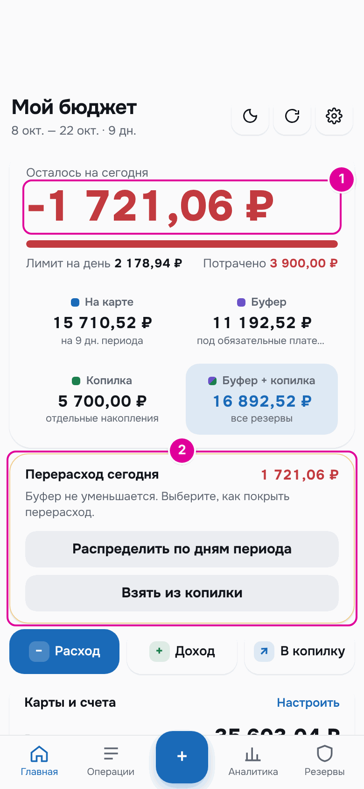

*1 — погашение засчиталось как трата сегодняшнего дня. 2 — перерасход.*

На «Карте 1» стало 15 710,52 ₽, долг по кредитке — 0. «Всего» уменьшилось до 35 603,04 ₽.

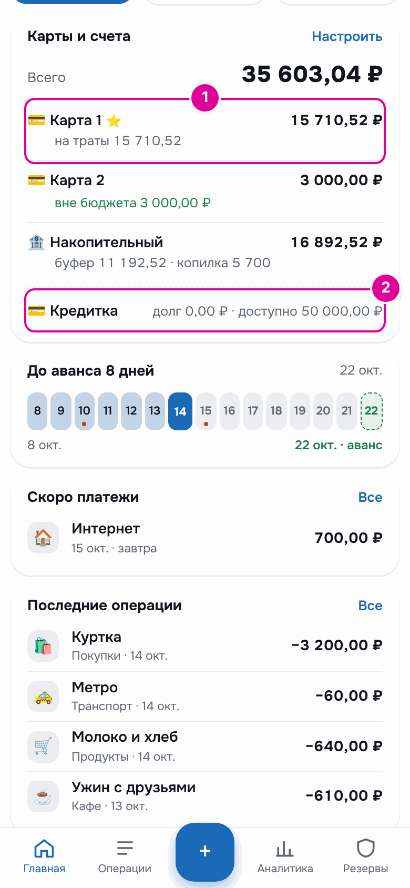

*1 — деньги ушли с «Карты 1». 2 — долга больше нет.*

Чтобы так не получалось, крупное погашение лучше запланировать заранее.

### Пошагово: запланировать погашение

Нажмите на кредитку на главном экране. Откроется её окно.

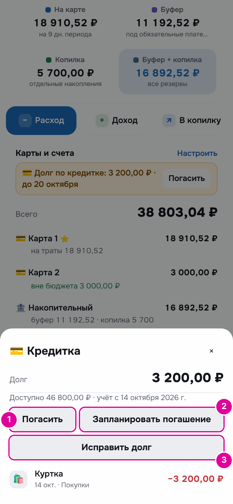

*1 — «Погасить». 2 — «Запланировать погашение». 3 — «Исправить долг».*

Нажмите «Запланировать погашение».

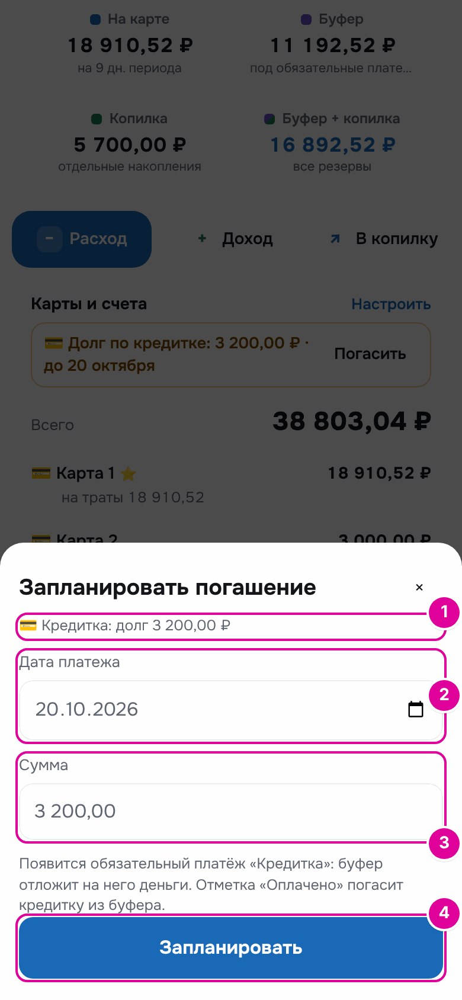

*Номера совпадают с шагами.*

1. Вверху — текущий долг.
2. «Дата платежа» — по умолчанию день платежа кредитки.
3. «Сумма» — по умолчанию весь долг.
4. Нажмите «Запланировать».

Появится обязательный платёж с названием «Кредитка» и именем карты. В демо-данных карта называется «Кредитка», поэтому платёж — «Кредитка Кредитка». Буфер заранее отложит на него деньги, а под кредиткой будет написано «Запланировано … на …».

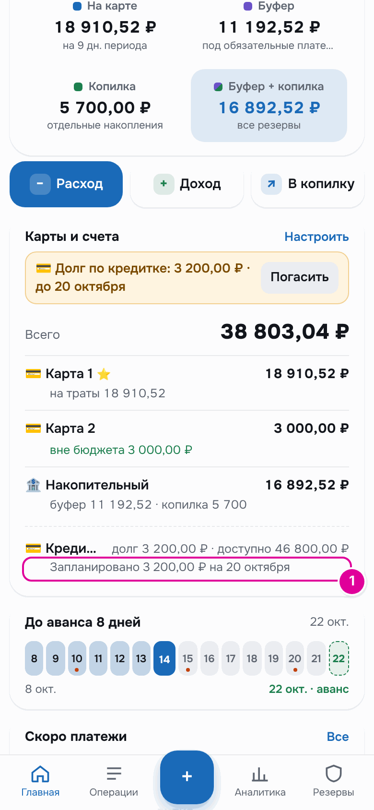

*1 — запланированное погашение.*

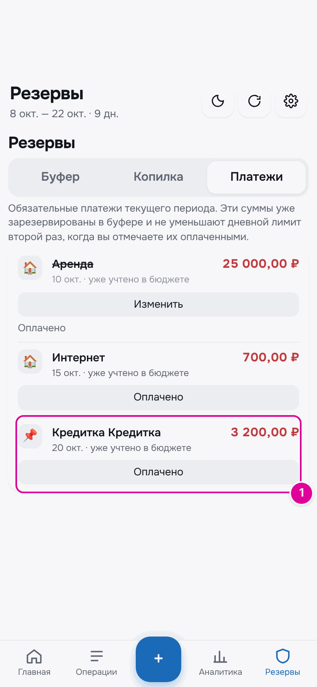

*1 — погашение среди обязательных платежей.*

В день платежа нажмите «Оплачено» на вкладке «Платежи». Кредитка погасится деньгами из буфера, с карты, где лежит буфер. Если долг изменился после планирования, рядом появится кнопка «Обновить сумму».

### Пример: погашение по плану

20 октября человек отмечает платёж оплаченным. Долг — 0, а «Накопительный», где лежит буфер, уменьшился на 3 200 ₽ (и на 700 ₽ за интернет 15-го): 12 992,52 ₽. Сумма на сегодня не пострадала.

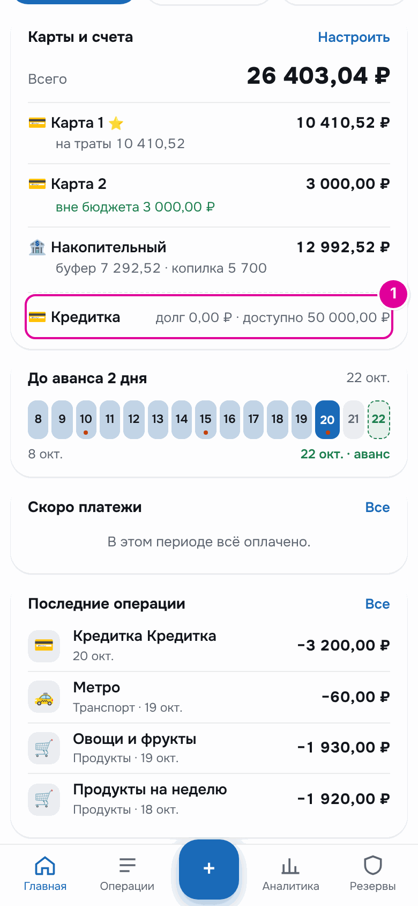

*1 — долг погашен из буфера.*

### Пошагово: исправить долг

Иногда после погашения банк показывает долг: начислил проценты или комиссию. Откройте кредитку и нажмите «Исправить долг».

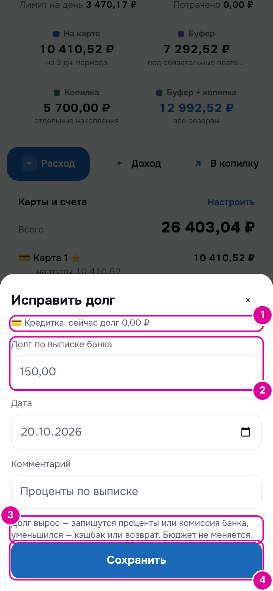

*Номера совпадают с шагами.*

1. Вверху — долг по данным приложения.
2. В «Долг по выписке банка» введите долг из выписки.
3. Прочитайте пояснение: если долг вырос, запишутся проценты или комиссия банка; если уменьшился — кэшбэк или возврат.
4. Нажмите «Сохранить».

Проценты появятся в операциях расходом категории «Проценты банка», а долг станет таким, как в выписке. Пример — в главе [«Типичные ситуации»](15-situations.md).

## Архив карт

Если карту закрыли в банке, её отправляют в архив. История операций сохраняется.

Сначала переведите с карты все деньги, чтобы остаток стал 0. Основной счёт и карту, на которой лежат конверты, в архив отправить нельзя. Сначала сделайте основным другой счёт или перенесите конверты.

Затем откройте карту в «Настройках» → «Карты и счета».

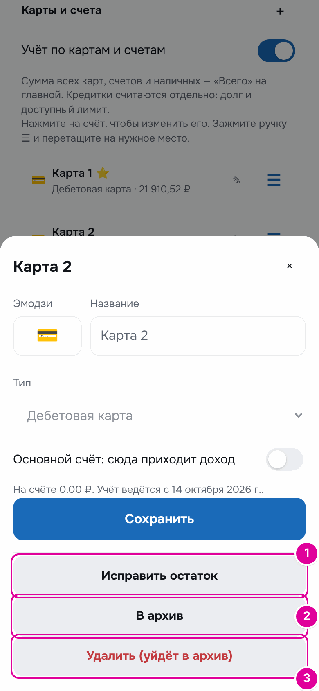

*1 — «Исправить остаток». 2 — «В архив». 3 — «Удалить».*

1. «Исправить остаток» — если на карте осталась мелочь, которой в банке нет.
2. «В архив» — убрать карту из списка.
3. «Удалить» — удалить карту совсем. Если по ней были операции, кнопка называется «Удалить (уйдёт в архив)»: карта уйдёт в архив.

Архивные карты собраны в «Архив (…)» внизу списка карт.

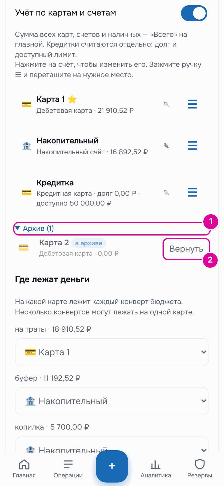

*1 — архив. 2 — «Вернуть» делает карту снова активной.*

Если на архивной карте не ноль, рядом будет предупреждение и кнопка «Исправить остаток».

## Важно знать

- Выключить учёт можно тем же переключателем. Приложение спросит: «Скрыть карты и счета? Ничего не удаляется: при включении всё вернётся.»
- Операции, записанные при выключенном учёте, не меняют остатки карт. При повторном включении приложение скажет, сколько таких операций, и предложит сверить остатки с банком.
- Если положить деньги в копилку, а копилка лежит на другой карте, приложение само запишет перевод между картами. Он удаляется вместе с операцией копилки.
- В утреннем отчёте бота при включённом учёте есть строки «💰 Всего денег» и долг по кредитке. За 3 дня до дня платежа кредитки и в сам день бот напоминает о платеже.

---
[← Аналитика](11-analytics.md) · [Оглавление](README.md) · [Бот →](13-bot.md)
