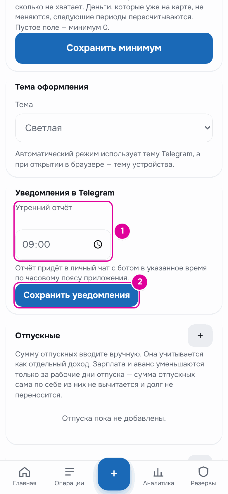

# 13. Бот

Бот — это собеседник в Telegram, который отвечает автоматически. Через него открывается приложение. Ещё он по кнопкам показывает главные числа дня и каждое утро присылает отчёт.

## Как это работает

Бот берёт числа из того же бюджета, что и приложение. Поэтому в его ответах те же суммы, что на главном экране. Бот отвечает только в личном чате и только на кнопки своего меню.

## Кнопки меню

Под полем ввода сообщения у бота есть быстрое меню. Если его не видно, отправьте `/menu`. В режиме «Зарплата и аванс» кнопки такие: «📅 На сегодня», «🧾 Траты сегодня», «💳 На карте». В режиме «Подработки» вместо последней — «💰 Свободные деньги».

**«📅 На сегодня»** — сумма на сегодня, сколько потрачено и сколько осталось.

> 📅 Сегодня, 14.10
>
> Можно потратить: 2 178,94 ₽\
> Потрачено: 700,00 ₽\
> Осталось на сегодня: 1 478,94 ₽

*Сообщение бота.*

Если сегодня перерасход, ниже будет «⚠️ Перерасход … ₽. Как его покрыть, можно выбрать в приложении.» Если в день выплаты деньги ещё не подтверждены — напоминание нажать «Получил ✓».

**«🧾 Траты сегодня»** — список сегодняшних трат.

> 🧾 Траты за 14.10
>
> Потрачено: 700,00 ₽\
> • Молоко и хлеб — 640,00 ₽\
> • Метро — 60,00 ₽

*Сообщение бота.*

Отдельно бот перечисляет оплаченные сегодня обязательные платежи, а при включённых картах — покупки кредиткой, траты из копилки и траты вне бюджета. Если трат больше 25, длинный список сокращается.

**«💳 На карте»** — сколько денег на траты до следующей выплаты.

> 💳 На карте: 18 910,52 ₽\
> На траты до 22.10 включительно (осталось 9 дн.)

*Сообщение бота.*

**«💰 Свободные деньги»** — в режиме «Подработки».

> 💰 Свободных денег: 15 520,00 ₽\
> Растягиваем до 25.10 (осталось 12 дн.)

*Сообщение бота.*

## Утренний отчёт

Каждое утро в указанное время бот присылает итоги вчерашнего дня и числа на сегодня. По умолчанию — в 09:00.

### Пошагово: поменять время

В «Настройках» найдите блок «Уведомления в Telegram».

*Номера совпадают с шагами.*

1. В поле «Утренний отчёт» выберите время.
2. Нажмите «Сохранить уведомления».

### Пример: отчёт в режиме «Зарплата и аванс»

> ☀️ Доброе утро! Итоги за 13.10.2026
>
> Вчера потрачено: 2 100,00 ₽\
> • Овощи и фрукты — 1 140,00 ₽\
> • Метро — 350,00 ₽\
> • Ужин с друзьями — 610,00 ₽
>
> До конца периода: 9 дн. · осталось 19 610,52 ₽\
> На день сегодня: 2 178,94 ₽\
> Изменение дневной суммы: +7,89 ₽
>
> Буфер: 11 192,52 ₽\
> Копилка: 5 700,00 ₽
>
> Ближайшие обязательные платежи: 15.10.2026 (завтра)\
> • Интернет — 700,00 ₽

*Утренний отчёт бота 14 октября.*

Как его читать:

- «Вчера потрачено» — все вчерашние траты списком.
- «До конца периода» — сколько дней до выплаты и сколько денег на траты на эти дни.
- «На день сегодня» — сумма на сегодня, как «Лимит на день» на главном экране утром.
- «Изменение дневной суммы» — насколько сумма на день больше или меньше, чем во вчерашнем отчёте. Вчера было 2 171,05 ₽, сегодня 2 178,94 ₽: человек вчера потратил чуть меньше лимита.
- «Буфер» и «Копилка» — как на главном экране.
- «Ближайшие обязательные платежи» — ближайший день с неоплаченными платежами и их список.

В первый день нового периода строки «Изменение дневной суммы» нет: вчерашняя сумма была остатком прошлого периода, и сравнивать с ней нечего. Вместо неё бот пишет «Сегодня начался новый период.» и что стало с остатком прошлого периода. Например: «Остаток прошлого периода 197,40 ₽ ушёл в копилку: это сверх максимума в день.» Остаток может и добавиться к новому периоду, и уйти в буфер. Если в прошлом периоде был перерасход, бот напишет, что перерасход вычтен из нового периода.

В день выплаты, пока она не подтверждена, в начале отчёта будет строка «⏳ Выплата ещё не подтверждена — суммы посчитаны по расчётной сумме. Когда деньги придут, нажмите «Получил ✓» в приложении.» Если подтвердить выплату после отчёта, бот пришлёт отчёт ещё раз с заголовком «✅ Зарплата подтверждена — бюджет пересчитан».

### Пример: отчёт в режиме «Подработки»

> ☀️ Доброе утро! Итоги за 13.10.2026
>
> Вчера потрачено: 1 110,00 ₽\
> • Продукты на неделю — 470,00 ₽\
> • Аптека — 640,00 ₽
>
> Можно сегодня: 1 293,33 ₽\
> Изменение дневной суммы: +14,10 ₽\
> Свободных денег: 15 520,00 ₽ · растягиваем до 25.10 (осталось 12 дн.)
>
> Резерв на непредвиденное: 12 310,00 ₽ · хватит примерно на 6 дн.\
> Отложено на обязательные: 1 200,00 ₽\
> Копилка: 0,00 ₽
>
> Ближайший обязательный платёж: Интернет — 700,00 ₽, 15.10 (отложено 700,00 ₽)

*Утренний отчёт бота в режиме «Подработки».*

Если дохода давно не было, в конце будет «⚠️ Дохода не было … дн. При необходимости возьмите деньги из резерва.» Если на обязательные не хватает — «⚠️ На обязательные не хватает … ₽ к …».

### Напоминание о кредитке

Если включены карты и счета, в конце отчёта есть «Всего денег» и долг по кредитке. За 3 дня до дня платежа кредитки и в сам этот день бот напоминает о платеже.

> 💰 Всего денег: 38 803,04 ₽\
> 💳 Долг по кредитке: 3 200,00 ₽ · до 20.10\
> ⏰ Платёж по кредитке «Кредитка» через 3 дн., 20.10: долг 3 200,00 ₽

*Конец утреннего отчёта 17 октября.*

Других напоминаний бот не присылает. О ближайших обязательных платежах он пишет в утреннем отчёте.

## Важно знать

- Если вы ещё ни разу не открывали приложение, бот на кнопки ответит «Бюджет ещё не настроен. Откройте его, и здесь появятся цифры.»
- После смены режима старое меню продолжает работать. Бот ответит числами нового режима и сам пришлёт новое меню.
- Время отчёта считается по часовому поясу приложения. В демо-данных это Москва.
- Резервную копию и Excel-файл бот присылает в этот же чат. Подробнее — в главе [«Резервная копия и Excel»](14-backup.md).

---
[← Карты и счета](12-accounts.md) · [Оглавление](README.md) · [Резервная копия и Excel →](14-backup.md)
