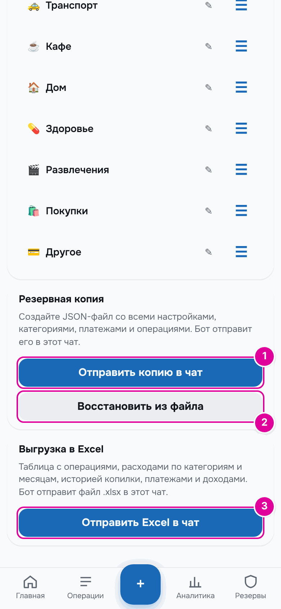

# 14. Резервная копия и Excel

Резервная копия — это файл со всеми вашими данными. Из него можно восстановить бюджет, если что-то пошло не так. Выгрузка в Excel — таблица для просмотра и анализа.

## Как это работает

Резервная копия — как фотография бюджета на сегодняшний день. Если позже что-то испортить, можно вернуть всё как было на фотографии.

Копия — это файл, имя которого заканчивается на `.json`. Бот присылает его в чат. Восстановить данные можно только из такого файла. Таблица Excel для этого не подходит: она для чтения.

Обе кнопки находятся внизу «Настроек».

*1 — «Отправить копию в чат». 2 — «Восстановить из файла». 3 — «Отправить Excel в чат».*

## Пошагово: сохранить копию

1. Нажмите «Отправить копию в чат». Появится подсказка «Копия отправлена в чат с ботом».
2. Откройте чат с ботом. Там будет файл `budget-backup-…json` с подписью:

> Резервная копия бюджета. Сохраните этот файл — из него можно полностью восстановить данные.

*Сообщение бота.*

Файл можно просто оставить в чате или сохранить на телефон. Делайте копию время от времени, например раз в месяц.

## Пошагово: восстановить из копии

1. Сохраните файл копии из чата на телефон.
2. Нажмите «Восстановить из файла» и выберите этот файл.
3. Приложение предупредит: «Восстановление заменит все текущие данные бюджета содержимым резервной копии. Продолжить?» Подтвердите.
4. Появится подсказка «Данные восстановлены», и числа на экране станут как в копии.

Файл должен быть не больше 5 МБ.

## Что внутри копии

В копии всё, что нужно для полного восстановления:

- настройки и время утреннего отчёта;
- категории и обязательные платежи;
- все операции;
- отпуска и запланированные изменения зарплаты;
- суммы, уже выданные на траты в прошлых периодах;
- история копилки;
- настройки и резерв режима «Подработки»;
- карты и счета.

## Пошагово: выгрузить в Excel

1. Нажмите «Отправить Excel в чат». Появится подсказка «Excel-файл отправлен в чат с ботом».
2. Откройте чат с ботом. Там будет файл `budget-….xlsx` с подписью:

> Выгрузка бюджета в Excel: операции, графики расходов, расходы по месяцам, копилка и правила.

*Сообщение бота.*

## Что внутри Excel

Листы в файле:

| Лист | Что на нём |
| --- | --- |
| «Операции» | все операции: дата, тип, категория или назначение, сумма, комментарий; при включённых картах — ещё «Счёт» и «Из чего» |
| «Графики» | куда ушли деньги и на что потрачено за текущий месяц, траты по дням, последние 12 месяцев — с диаграммами |
| «Расходы по месяцам» | траты по категориям, по колонке на каждый месяц, и итог |
| «Копилка» | все движения копилки и остаток после каждого |
| «Обязательные платежи» | название, день месяца, сумма, категория, включён ли платёж |
| «Доходы» | в режиме «Зарплата и аванс» — правила доходов; в режиме «Подработки» — каждый доход и как он разделился: в резерв, на обязательные, свободные, в копилку |
| «Резерв на непредвиденное» | история резерва с причинами — если вы пользовались режимом «Подработки» |
| «Карты и счета» | «Всего (без кредиток)», остатки карт и долги кредиток — если включён учёт по картам |
| «Отпуска» | отпуска и отпускные — если они есть |

## Пример

В демо-данных этой инструкции лист «Операции» начинается с колонок «Дата», «Тип», «Категория / назначение», «Сумма, RUB», «Комментарий», «Счёт», «Из чего». На листе «Расходы по месяцам» — колонки «08.2026», «09.2026», «10.2026» и «Всего»: учёт начался в августе.

## Важно знать

- Восстановление заменяет все текущие данные. Если сомневаетесь, сначала отправьте себе свежую копию.
- Можно восстановить и старую копию, сделанную до появления карт и счетов. Тогда учёт по картам после восстановления будет выключен.
- Из Excel-файла восстановить данные нельзя. Для восстановления нужна копия `.json`.
- Бот присылает оба файла только в личный чат с ним. Другие люди их не видят.

---
[← Бот](13-bot.md) · [Оглавление](README.md) · [Типичные ситуации →](15-situations.md)
