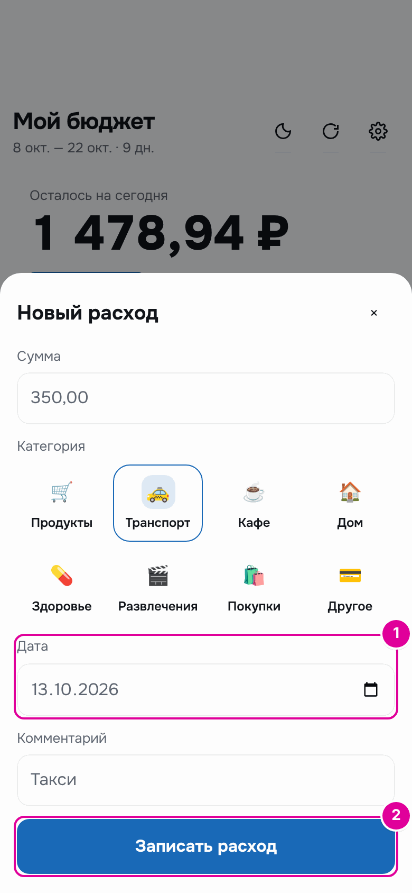
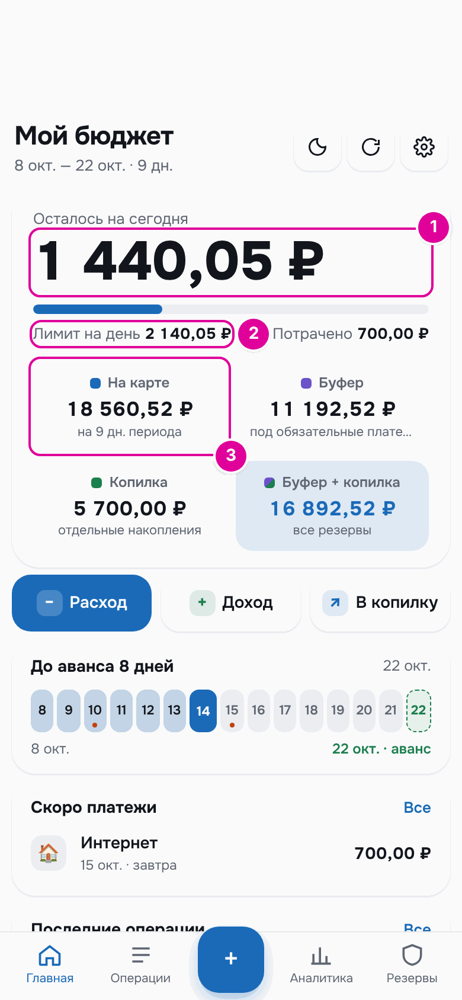
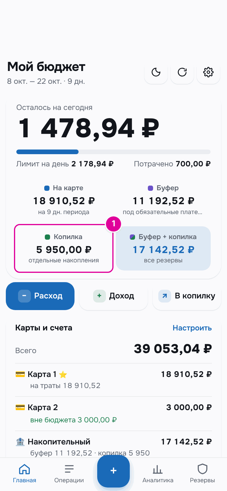
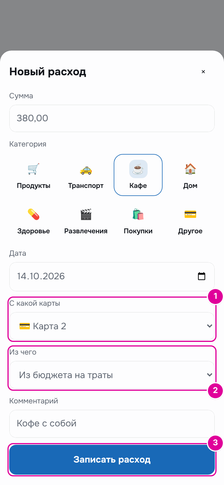
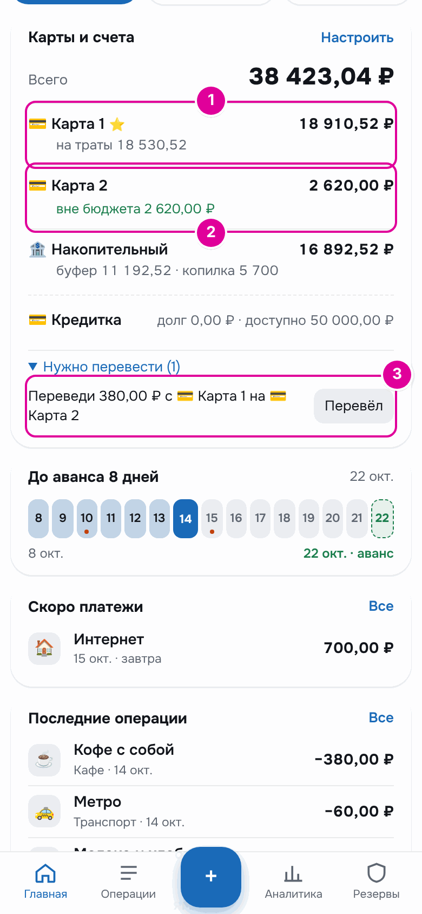
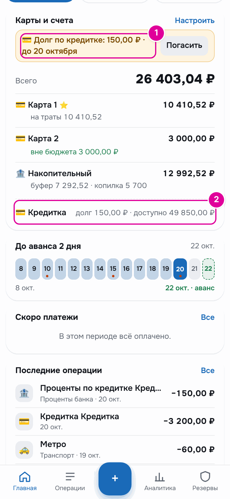
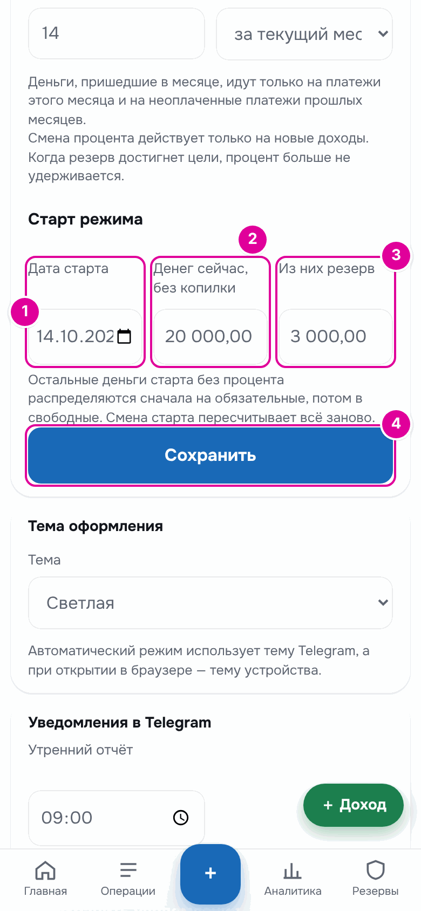
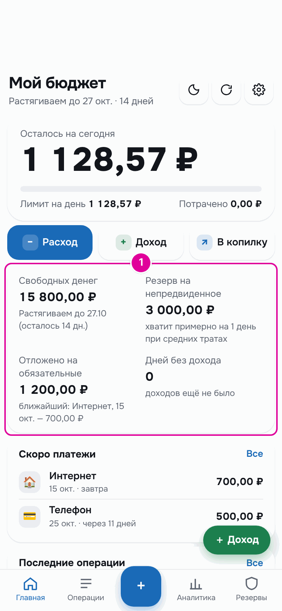

# 15. Типичные ситуации

Короткие ответы для случаев, когда что-то пошло не по плану. Подробности — в главах по ссылкам.

## Потратил больше, чем можно сегодня

«Осталось на сегодня» стало отрицательным, на главном экране появился блок «Перерасход сегодня».

1. Решите, откуда взять деньги.
2. Если ничего не делать или нажать «Распределить по дням периода», перерасход разделится на оставшиеся дни. Лимит следующих дней станет немного меньше.
3. Если есть накопления, нажмите «Взять из копилки», введите сумму перерасхода и нажмите «Покрыть». Следующие дни не пострадают.

*Результат: перерасход 971,06 ₽ закрыт из копилки. 1 — на сегодня 0,00 ₽. 2 — в копилке на 971,06 ₽ меньше.*

Подробнее — в главе [«Траты»](07-expenses.md).

## Зарплату задержали или пришла другая сумма

**Задержали.** Не нажимайте «Получил ✓», пока деньги не пришли. Приложение будет считать, что денег ещё нет, и не выдаст на траты деньги, которых у вас нет. Бот каждый раз напомнит о неподтверждённой выплате.

*Пока выплата не подтверждена, новый период живёт на остатке старого: 246,70 ₽ в день.*

**Пришла другая сумма.**

1. Откройте «Резервы» → «Буфер».
2. В карточке «Сейчас» нажмите «Получил ✓».
3. В поле «Сколько пришло» введите настоящую сумму.
4. Нажмите «Получил, пересчитать».

*Результат: пришло на 1 000 ₽ меньше, и приложение пересчитало деньги на траты и буфер.*

Подробнее — в главе [«Режим «Зарплата и аванс»»](05-payroll.md).

## Забыл записать трату вчера

Откройте окно расхода кнопкой «Расход» и заполните сумму и категорию как обычно.

*Номера совпадают с шагами.*

1. В поле «Дата» поставьте вчерашний день.
2. Нажмите «Записать расход».

### Пример

14 октября человек вспомнил, что вчера ездил на такси за 350 ₽. Вчерашние деньги уже не потратить, поэтому трата уменьшает деньги на оставшиеся дни.

| Число | До записи | После записи |
| --- | --- | --- |
| «Лимит на день» | 2 178,94 ₽ | 2 140,05 ₽ |
| «Осталось на сегодня» | 1 478,94 ₽ | 1 440,05 ₽ |
| «На карте» | 18 910,52 ₽ | 18 560,52 ₽ |

350 ₽ разделились на 9 оставшихся дней: лимит каждого дня стал меньше примерно на 39 ₽.

*Результат. 1 — остаток на сегодня. 2 — новый лимит. 3 — деньги на карте.*

## Ушёл в отпуск

1. В «Настройках» → «Отпускные» нажмите «＋».
2. Укажите «Начало», «Окончание», «Отпускные к получению» и «Дата выплаты отпускных».
3. Нажмите «Сохранить отпуск». Аванс или зарплата уменьшатся за рабочие дни отпуска.
4. Когда отпускные придут, запишите их кнопкой «Доход» с направлением «В буфер».

*Результат: зарплата за октябрь стала 27 681,82 ₽ вместо 43 500 ₽, а 15 000 ₽ отпускных придут отдельно.*

Подробнее — в главе [«Режим «Зарплата и аванс»»](05-payroll.md).

## Банк начислил проценты на накопительный счёт

**Если включены карты и счета:**

1. Нажмите на счёт на главном экране, затем «Исправить остаток».
2. В «Сколько на счёте на самом деле» введите сумму из банка и нажмите «Сохранить».
3. Под счётом появится «вне бюджета …». Нажмите «Добавить в копилку».

*Результат: 250 ₽ процентов теперь в копилке — 5 950,00 ₽ вместо 5 700,00 ₽.*

**Если карты и счета не включены:** откройте «Резервы» → «Копилка», нажмите «Внести отдельно» и запишите проценты.

Подробнее — в главах [«Карты и счета»](12-accounts.md) и [«Копилка»](09-piggy.md).

## Заплатил не с той карты

В «Операциях» найдите трату и нажмите «Изменить». Откроется окно расхода.

*Номера совпадают с шагами.*

1. В «С какой карты» выберите карту, которой на самом деле платили.
2. Проверьте «Из чего». Если на этой карте нет конвертов, поле само станет «Вне бюджета». Для обычной траты выберите «Из бюджета на траты».
3. Нажмите «Записать расход».

### Пример

Кофе за 380 ₽ записали с «Карты 1», а платили «Картой 2». После исправления «Карта 2» уменьшилась на 380 ₽ — до 2 620,00 ₽. Деньги на траты лежат на «Карте 1», поэтому приложение подсказывает: «Переведи 380,00 ₽ с 💳 Карта 1 на 💳 Карта 2». Сделайте перевод в банке и нажмите «Перевёл».

*Результат. 1 — остаток «Карты 1» прежний, а денег на траты на 380 ₽ меньше: кофе по-прежнему учтён в бюджете. 2 — «Карта 2» уменьшилась на 380 ₽. 3 — подсказка о переводе.*

## Внёс деньги на кредитку, а долг не закрылся

Обычно это проценты или комиссия банка.

1. Нажмите на кредитку на главном экране, затем «Исправить долг».
2. В «Долг по выписке банка» введите долг из выписки и нажмите «Сохранить».
3. Разница запишется расходом «Проценты банка». Оставшийся долг погасите кнопкой «Погасить».

*Результат: после погашения 3 200 ₽ банк насчитал ещё 150 ₽. 1 — плашка показывает долг из выписки. 2 — долг и доступный лимит.*

Подробнее — в главе [«Карты и счета»](12-accounts.md).

## Закрыл карту в банке

1. Переведите остаток с этой карты на другую: нажмите на карту, затем «Перевести».
2. Если на карте лежат конверты или она основная, сначала перенесите конверты и выберите другой основной счёт.
3. В «Настройках» → «Карты и счета» нажмите на карту и выберите «В архив».

*Результат: карта в архиве, её история сохранилась. Кнопка «Вернуть» делает её снова активной.*

## Перешёл с зарплаты на подработки

Откройте «Настройки» и в «Как приходят деньги» нажмите «Подработки, без графика». Появится блок «Подработки» с разделом «Старт режима».

*Номера совпадают с шагами.*

1. «Дата старта» — сегодня.
2. «Денег сейчас, без копилки» — все ваши деньги сейчас.
3. «Из них резерв» — сколько из них оставить на непредвиденное.
4. Нажмите «Сохранить». Появится подсказка «Режим подработок включён».

### Пример

На картах 20 000 ₽, из них 3 000 ₽ человек оставляет в резерве. Остальные 17 000 ₽ распределяются: 1 200 ₽ — на интернет и телефон этого месяца, 15 800 ₽ — свободные. Их делят на 14 дней: 1 128,57 ₽ в день.

*Результат: главный экран режима «Подработки».*

Данные режима «Зарплата и аванс» сохраняются. Чтобы вернуться, нажмите «Зарплата и аванс» в том же блоке. Подробнее — в главе [«Режим «Подработки»»](06-side-jobs.md).

---
[← Резервная копия и Excel](14-backup.md) · [Оглавление](README.md) · [Частые вопросы →](16-faq.md)
