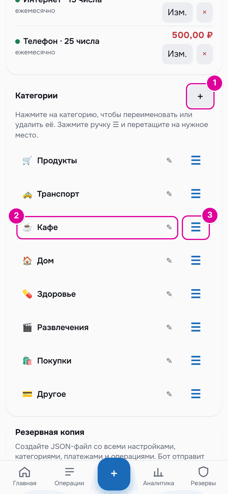

# Как обновить картинки инструкции

Все скриншоты в `docs/guide/images/` создаёт скрипт `scripts/make_guide_screenshots.py`. Он запускается одной командой и пересоздаёт картинки с нуля, поэтому после изменений интерфейса инструкцию можно обновить за несколько минут.

## Что нужно

- Python 3.11 или новее.
- Зависимости приложения и Playwright:

```bash
pip install -r requirements.txt playwright pillow
python -m playwright install chromium
```

Если Chromium уже установлен, вместо второй команды можно указать путь к нему в переменной `GUIDE_CHROMIUM`.

## Запуск

Из корня репозитория:

```bash
python scripts/make_guide_screenshots.py
```

Полный прогон занимает около 5 минут. Перед ним старые `*.png` в `docs/guide/images/` удаляются, чтобы не оставалось лишних.

Полезные ключи:

- `--only 3,5` — снять только главы 3 и 5. Остальные картинки не трогаются, а файлы в `generated/` дополняются.
- `--keep` — не удалять временную папку. В ней `server.log` и снимки базы для каждой сцены.
- `--check` — ничего не снимать, только проверить текст инструкции: ссылки, картинки и названия в «ёлочках» (см. ниже).

## Как устроен скрипт

1. Запускает приложение (`app.cashflow_app`) на временной базе с `DEV_MODE=true`, то есть без Telegram. На сервере подменяются `app.clock.today` и `app.clock.now`, как в тестах. Дата берётся из файла, поэтому её можно менять между сценами.
2. Наполняет базу демо-данными только через API приложения. Наборы данных:
   - `payroll` — режим «Зарплата и аванс»: оклад 80 000 и премия 10 000 до НДФЛ, платежи «Аренда», «Интернет», «Телефон», старт 1 августа 2026 года с капиталом 40 000, повседневные траты по 14 октября;
   - `payday` — тот же человек 22 октября, аванс пришёл, но не подтверждён;
   - `irregular` — режим «Подработки» с 1 сентября: доходы «Ремонт», «Доставка», «Репетиторство»;
   - `accounts` и `accounts-credit` — `payroll` с картами «Карта 1», «Карта 2», «Накопительный», «Кредитка» (во втором — покупка кредиткой).
   Траты генерируются с фиксированным зерном случайных чисел, поэтому каждый прогон даёт те же суммы.
3. Открывает приложение в Chromium без окна: 390×844, `device_scale_factor` 2, светлая тема, русский язык. Скрипт Telegram подменяется заглушкой `window.Telegram.WebApp`, дата в браузере фиксируется через `page.clock`.
4. Перед каждым снимком рисует отметки: рамку вокруг элемента и пронумерованный кружок. Координаты берутся из `getBoundingClientRect()` в момент снимка. Место кружка выбирается само: там, где он меньше всего закрывает текст. Цвет отметок один на всю инструкцию — `#E0009A`.
5. Сохраняет картинки в `docs/guide/images/`, а ещё:
   - `docs/guide/generated/numbers.json` — числа, видимые на скриншотах;
   - `docs/guide/generated/bot-texts.json` и `bot-messages.md` — сообщения бота, собранные функциями `bot.py` и `app/morning_reports.py` на тех же демо-данных;
   - `docs/guide/generated/screen-texts.txt` — весь текст, который был виден на снятых экранах.

Картинки сохраняются с палитрой из 256 цветов (Pillow): так они в 3–4 раза меньше, а текст остаётся чётким.

Снимки получаются шириной 780 px — вдвое шире экрана телефона. Чтобы на GitHub они не были огромными, в главах картинка вставляется тегом с шириной 390, а не через ``:

```html

```

Так картинка показывается в размер экрана телефона и остаётся чёткой на экранах с высокой плотностью пикселей. Тег пишется одной строкой, перед ним и после него — пустая строка, следом — подпись курсивом.

Каждая глава — отдельная функция `chNN` в скрипте. Отметка задаётся так: `M(номер, селектор)`. Номер отметки должен совпадать с номером шага в тексте главы.

## После изменений в приложении

1. Запустите скрипт. Если элемент переименовали или убрали, Playwright остановится с ошибкой и назовёт селектор. Поправьте селектор в функции главы.
2. Посмотрите, какие числа изменились:

   ```bash
   git diff docs/guide/generated/
   ```

   Если числа или тексты бота изменились, поправьте примеры и цитаты в главах. Цитаты бота берите из `generated/bot-messages.md`.
3. Просмотрите новые картинки: отметки должны стоять на нужных кнопках.
4. Запустите проверку текста:

   ```bash
   python scripts/make_guide_screenshots.py --check
   ```

   Она проверяет, что все ссылки между главами и на картинки работают, что у каждой картинки есть alt-текст, подпись и `width="390"`, что каждая картинка используется и что каждое название в «ёлочках» есть на снятых экранах (`generated/screen-texts.txt`), в сообщениях бота или в исходниках (`app/`, `bot.py`). Так ловятся и переименованные кнопки, и устаревшие числа в примерах. Названия в другом падеже («Настройках», «Карте 1») перечислены в скрипте в `INFLECTED`.
5. Если в интерфейсе появилось новое, допишите главу и сцену в скрипте.

## Если что-то пошло не так

- Сервер не запустился — смотрите `server.log` во временной папке (запуск с `--keep`).
- Кружок встал неудачно — для отметки можно задать место явно: `M(1, селектор, "tr")`. Варианты перечислены в словаре `spots` в `MARKS_JS`.
- Картинки с датами в формате `10/14/2026` — Chromium запущен без русского языка. Скрипт передаёт ему `--lang=ru-RU`; проверьте, что используется Chromium, а не другой браузер.
